# AI agent registry demo: step-by-step guide

This guide goes through every agent registry feature of Apicurio Registry, and the Quarkus
LangChain4j extensions that use it. Each part has the commands, what to expect, and what to say.
It takes about 45 minutes in full. For a shorter demo, pick parts: [1](#part-1-agent-artifact-types),
[3](#part-3-compatibility-rules-keep-published-contracts-safe),
[8](#part-8-import-tools-from-a-running-mcp-server) and [9](#part-9-quarkus-langchain4j-agents-that-use-the-registry)
make a 15-minute story.

- [Before you start](#before-you-start)
- [Part 1: agent artifact types](#part-1-agent-artifact-types)
- [Part 2: references between agents, servers and tools](#part-2-references-between-agents-servers-and-tools)
- [Part 3: compatibility rules keep published contracts safe](#part-3-compatibility-rules-keep-published-contracts-safe)
- [Part 4: prompt templates](#part-4-prompt-templates)
- [Part 5: Agent Cards generated from OpenAPI](#part-5-agent-cards-generated-from-openapi)
- [Part 6: discovery](#part-6-discovery)
- [Part 7: the MCP Registry API](#part-7-the-mcp-registry-api)
- [Part 8: import tools from a running MCP server](#part-8-import-tools-from-a-running-mcp-server)
- [Part 9: Quarkus LangChain4j agents that use the Registry](#part-9-quarkus-langchain4j-agents-that-use-the-registry)
- [Part 10: who discovers which agents](#part-10-who-discovers-which-agents)
- [Part 11: the Registry MCP server, for AI assistants](#part-11-the-registry-mcp-server-for-ai-assistants)
- [What this demo does not show](#what-this-demo-does-not-show)
- [Troubleshooting](#troubleshooting)

## Before you start

Start the stack and create the demo data, as in the [README](README.md#quick-start):

```bash
docker compose up -d
./demo.sh
```

`./demo.sh` ends with `All checks passed.` Every part below shows the calls it made, so you can
repeat them live. Load the helper commands in the terminal you present from:

```bash
source ./demo-env.sh
```

| Helper | What it does |
|---|---|
| `open_api <method> <path> [body]` | Calls the open Registry (port 8180) |
| `secured_api <user> <method> <path> [body]` | Calls the secured Registry (port 8081) as a user, or `anonymous` |
| `publish <group> <id> <type> <file> [references]` | Creates an artifact on the open Registry from a file in `content/` |
| `new_version <group> <id> <file>` | Adds a version on the open Registry, or prints why it was rejected |
| `agents <user>` | The agents a user discovers on the secured Registry |
| `mcp <user> <method> [params]` | Calls the Registry MCP server as a user |

Paths that start with `/apis` or `/.well-known` are used as they are. Other paths are relative to
the Core Registry API, `/apis/registry/v3`.

> **Presenter note.** The demo has two Registries on purpose. The Quarkus extensions cannot
> authenticate to a Registry yet, so the applications use one without authentication (port 8180).
> The secured one (port 8081) shows everything that depends on who is asking. Parts 1 to 9 use the
> open Registry, parts 10 and 11 the secured one.

## Part 1: agent artifact types

The Registry stores the definitions that agents and AI applications depend on, as versioned
artifacts with their own types:

| Type | What it is | Demo file |
|---|---|---|
| `AGENT_CARD` | An [A2A](https://a2a-protocol.org) Agent Card: what an agent does (skills), where to reach it, and how | [`trip-planner-card.json`](content/trip-planner-card.json) |
| `MCP_TOOL` | An MCP tool definition: name, description, input and output schemas | [`forecast-tool.json`](content/forecast-tool.json) |
| `MCP_SERVER` | An MCP server description (`server.json`), which references its tools | [`travel-server.json`](content/travel-server.json) |
| `PROMPT_TEMPLATE` | A versioned prompt with typed variables | [`briefing-prompt.json`](content/briefing-prompt.json) |
| `MODEL_SCHEMA` | A model's input and output schemas | [`chat-model-schema.json`](content/chat-model-schema.json) |

Create a tool. `demo.sh` set a `VALIDITY` rule on the `demo` group, so content is checked against
the type's schema:

```bash
publish demo get_forecast MCP_TOOL content/forecast-tool.json        # 409 if demo.sh created it already
```

A tool without an `inputSchema` is not a valid MCP tool, so it is rejected:

```bash
open_api POST /groups/demo/artifacts '{"artifactId":"broken","artifactType":"MCP_TOOL","firstVersion":{"content":{"content":"{\"name\":\"broken\"}","contentType":"application/json"}}}' | jq .status
```

```text
400
```

Open the web console at <http://localhost:8889> and the `demo` group:

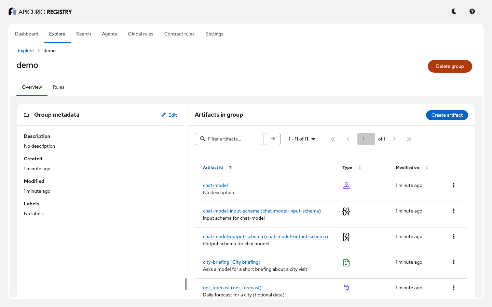

The `chat-model-input-schema` and `chat-model-output-schema` artifacts were not created by the demo:
the Registry extracted the model schema's input and output into their own artifacts, so other
artifacts can reference them.

Each agent type has its own view. Open `trip-planner`, version 1, **Documentation**:

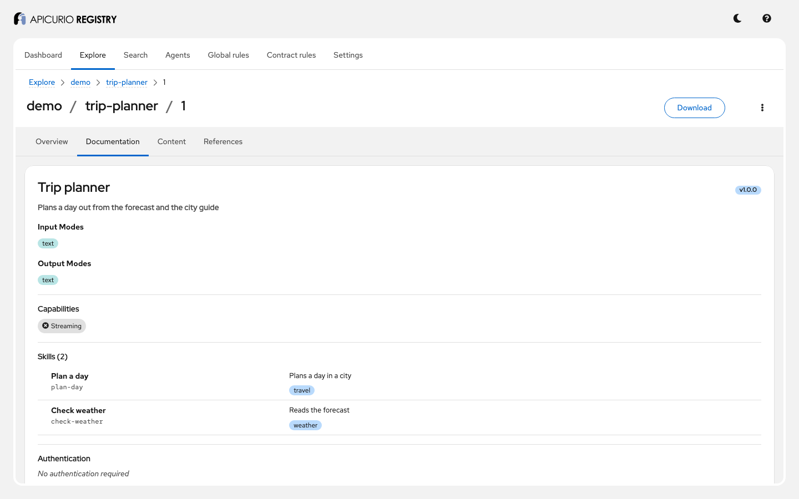

## Part 2: references between agents, servers and tools

An agent depends on tools, servers, models and prompts. References record those dependencies, and
an `INTEGRITY` rule checks them. `demo.sh` set one on the `demo` group:

```bash
open_api POST /groups/demo/rules '{"ruleType":"INTEGRITY","config":"REFS_EXIST"}'
```

The `travel` MCP server references its tool, and the trip planner references a tool, the server,
the model and the prompt. References are part of a version's content, next to the document:

```bash
publish demo travel MCP_SERVER content/travel-server.json \
  '[{"groupId":"demo","artifactId":"get_forecast","version":"1","name":"get_forecast"}]'
```

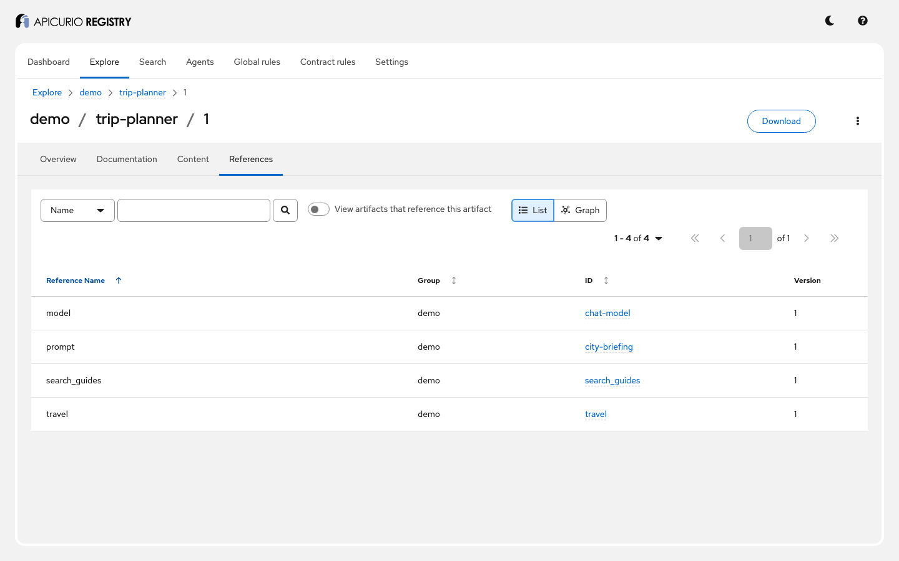

Each type may only reference what makes sense for it. An MCP tool cannot reference another tool:

```bash
publish demo tool-with-reference MCP_TOOL content/packing-list-tool.json \
  '[{"groupId":"demo","artifactId":"get_forecast","version":"1","name":"get_forecast"}]' | jq '.causes[0].description'
```

```text
"Referenced artifact (demo/get_forecast @ 1) is of type MCP_TOOL, which MCP_TOOL artifacts cannot reference."
```

Agent Cards may reference tools, servers, model schemas, prompt templates and other Agent Cards. MCP
servers may reference tools only. A reference to an artifact that does not exist is rejected too.

The other direction answers "who uses this tool?", which you need before changing it:

```bash
open_api GET '/groups/demo/artifacts/get_forecast/versions/1/references?refType=INBOUND'
```

```json
[{ "groupId": "demo", "artifactId": "travel", "version": "1", "name": "get_forecast" }]
```

In the web console, the **References** tab has a **View artifacts that reference this artifact**
switch, and a graph view.

## Part 3: compatibility rules keep published contracts safe

This is the governance story. Callers depend on a tool's input schema and an agent's skills. A
`COMPATIBILITY` rule makes the Registry reject a new version that would break them, so a bad change
never reaches the agents that discover it. `demo.sh` set `BACKWARD` on `search_guides` and
`trip-planner`.

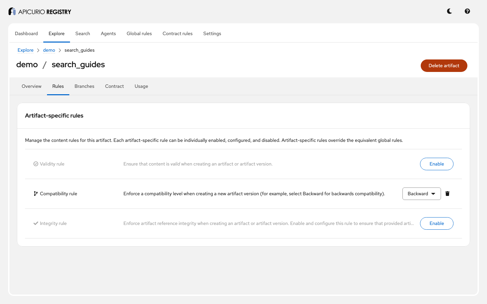

`search_guides` takes a `query` of up to 10 characters. Lowering that to 5 would break callers that
send 6 to 10 characters:

```bash
new_version demo search_guides content/search-tool-maxlength-5.json | jq '{status, causes}'
```

```json
{
  "status": 400,
  "causes": [{
    "description": "The 'maxLength' string-length limit was decreased.",
    "context": "/inputSchema/properties/query/maxLength"
  }]
}
```

Raising it to 20 is safe, and accepted as version 2 (`demo.sh` already added it):

```bash
new_version demo search_guides content/search-tool-maxlength-20.json
```

The check is directional. Inputs may only accept more, outputs may only promise more: lowering a
limit in an `outputSchema` is accepted, raising it is rejected. The view of the accepted version:

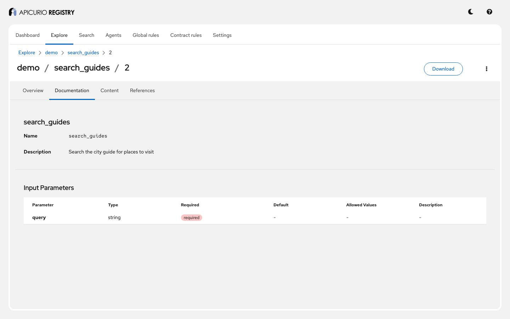

The same applies to agents. Removing a skill from the trip planner would break callers that use it:

```bash
new_version demo trip-planner content/trip-planner-card-without-check-weather.json | jq '{status, causes}'
```

```json
{ "status": 400, "causes": [{ "description": "Skill 'check-weather' was removed", "context": "/skills" }] }
```

> **Presenter note.** A rejected version is never stored, so agents that discover the tool keep
> getting the version they were built against. Part 9 shows this with running agents.

## Part 4: prompt templates

Prompts are versioned like any other contract. A template declares its variables and their types:

```json
"template": "Write a {{style}} briefing for a visit to {{city}}. Mention the weather: {{weather}}.",
"variables": {
  "city": { "type": "string", "required": true },
  "weather": { "type": "string", "required": true },
  "style": { "type": "string", "default": "short" }
}
```

The Registry renders it. `style` takes its default:

```bash
open_api POST /groups/demo/artifacts/city-briefing/versions/branch=latest/render \
  '{"variables":{"city":"Lisbon","weather":"sunny, 24 C"}}' | jq -r .rendered
```

```text
Write a short briefing for a visit to Lisbon. Mention the weather: sunny, 24 C.
```

A missing required variable is reported rather than silently left in the prompt:

```bash
open_api POST /groups/demo/artifacts/city-briefing/versions/branch=latest/render '{"variables":{"city":"Lisbon"}}' | jq .validationErrors
```

```json
[{ "variableName": "weather", "message": "Required variable is missing" }]
```

The prompt's **Documentation** tab has the same as a form:

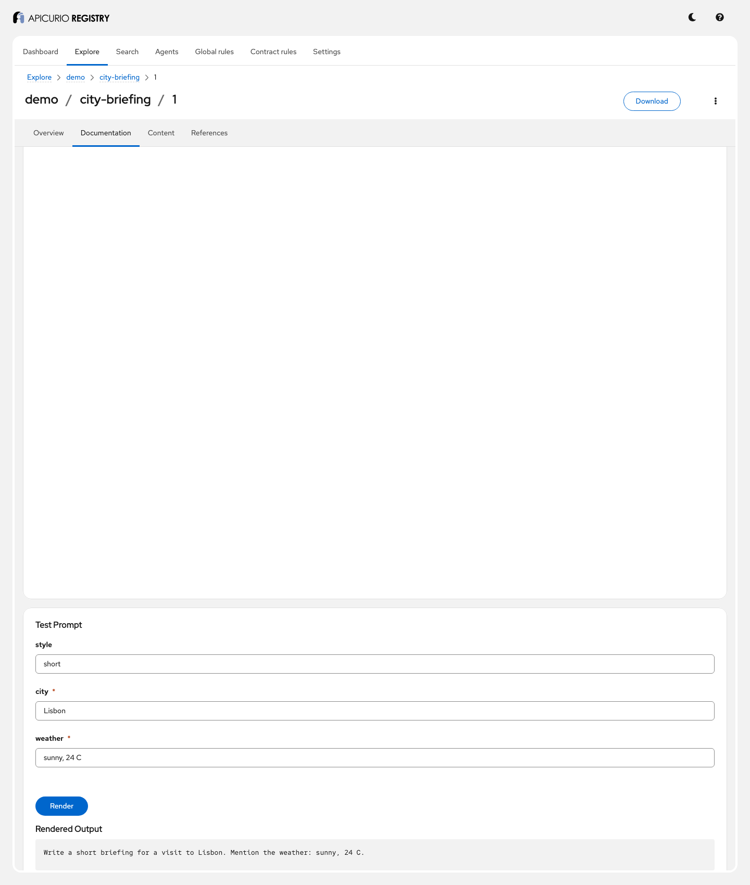

## Part 5: Agent Cards generated from OpenAPI

Existing REST services become discoverable agents without writing an Agent Card. An `x-agent-card`
extension in an OpenAPI document ([`weather-api-openapi.json`](content/weather-api-openapi.json))
lists the skills; the Registry builds the card from it, the document's title, description and
version, and its `servers`. This needs `apicurio.a2a.openapi-integration.enabled`.

```bash
publish demo weather-api OPENAPI content/weather-api-openapi.json
open_api GET /groups/demo/artifacts/weather-api-agent-card | jq '{artifactType, labels}'
```

The companion card, `weather-api-agent-card`, records where it came from:

```json
{
  "artifactType": "AGENT_CARD",
  "labels": {
    "apicurio.a2a.openapi-agent-card.generated": "true",
    "apicurio.a2a.openapi-agent-card.source-group-id": "demo",
    "apicurio.a2a.openapi-agent-card.source-artifact-id": "weather-api",
    ...
  }
}
```

When the OpenAPI document changes, the card follows. Version 2 adds a `forecast` skill:

```bash
new_version demo weather-api content/weather-api-openapi-v2.json
open_api GET /groups/demo/artifacts/weather-api-agent-card/versions/branch=latest/content | jq '{version, skills: [.skills[].id]}'
```

```json
{ "version": "2.0.0", "skills": ["current-weather", "forecast"] }
```

## Part 6: discovery

Agents and AI platforms find what they need through standard discovery endpoints, without knowing
group or artifact IDs.

**The Registry's own Agent Card.** The Registry is itself an A2A agent:

```bash
open_api GET /.well-known/agent.json | jq '{name, skills: [.skills[].id]}'
```

```json
{
  "name": "Apicurio Registry (agent registry demo)",
  "skills": ["schema-validation", "schema-search", "artifact-management", "compatibility-check", "agent-discovery"]
}
```

**Agent search** by name, skill, capability, or input and output mode:

```bash
open_api GET '/.well-known/agents?skill=translator' | jq '.agents[] | {artifactId, name, url: .supportedInterfaces[0].url}'
```

```json
{ "artifactId": "translator", "name": "translator", "url": "http://translator:11030" }
```

That card was published by a running Quarkus agent (part 9). Agents in the `default` group are
listed with `"groupId": null`.

The web console's **Agents** tab searches the same way:

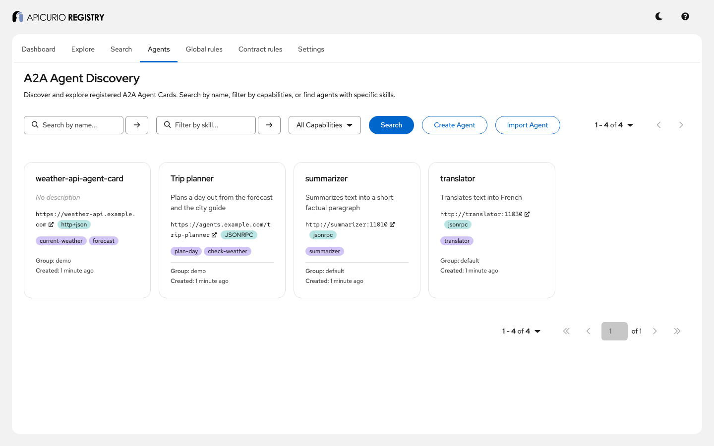

**MCP tool search** by name or parameter, and **tool chaining**: the tools whose input accepts
another tool's output. `get_forecast` returns a city, temperature and conditions:

```bash
open_api GET '/.well-known/mcp-tools?parameter=city' | jq '[.tools[] | "\(.groupId)/\(.artifactId)"]'
```

```json
["weather-tools/weather.getWeather", "demo/get_forecast"]
```

```bash
open_api GET /.well-known/mcp-tools/demo/get_forecast/compatible | jq '[.tools[] | "\(.groupId)/\(.artifactId)"]'
```

```json
["weather-tools/weather.getWeather", "demo/packing_list"]
```

`packing_list` takes the temperature and conditions. The imported `getWeather` tool from part 8
takes a city, so it qualifies too.

**AI Catalog and ARD.** The [AI Catalog](https://ai-catalog.io) lists every agent and tool the
Registry publishes, and [Agentic Resource Discovery](https://agenticresourcediscovery.org) adds
search, listing and facets on top:

```bash
open_api GET /.well-known/ai-catalog.json | jq '[.entries[] | {displayName, type}]'
open_api POST /.well-known/ard/search '{"query":{"text":"trip"}}' | jq '.results[] | {identifier, displayName, type}'
open_api POST /.well-known/ard/explore '{"query":{"text":"*"},"resultType":{"facets":[{"field":"type","limit":10}]}}' | jq .facets
```

```json
{ "identifier": "urn:air:localhost:8180:demo:trip-planner", "displayName": "Trip planner", "type": "application/a2a-agent-card+json" }
```

## Part 7: the MCP Registry API

The Registry also speaks the official [MCP Registry API](https://github.com/modelcontextprotocol/registry),
so tools built for that registry can publish and list servers here. A published server is stored as
an `MCP_SERVER` artifact. The API is a developer preview and needs `apicurio.mcp-registry.enabled`.

```bash
open_api POST /apis/mcp-registry/v0.1/publish "$(cat content/calendar-server.json)"
open_api GET '/apis/mcp-registry/v0.1/servers?search=calendar' | jq '[.servers[].server.name]'
```

Mark a version deprecated, with a message for its users:

```bash
open_api PATCH /apis/mcp-registry/v0.1/servers/io.apicur.demo%2Fcalendar/versions/1.0.0/status \
  '{"status":"deprecated","statusMessage":"Use the travel server"}'
open_api GET /apis/mcp-registry/v0.1/servers/io.apicur.demo%2Fcalendar/versions/1.0.0 | jq '._meta'
```

```json
{
  "io.modelcontextprotocol.registry/official": {
    "isLatest": true, "status": "deprecated", "statusMessage": "Use the travel server", ...
  },
  "io.apicurio.registry": { "id": "..." }
}
```

## Part 8: import tools from a running MCP server

Writing `MCP_TOOL` artifacts by hand gets out of date. The Registry can ask a running MCP server for
its tools (`tools/list`), publish each one as an `MCP_TOOL`, and add a new version of the server that
references them. The same rules apply, so an incompatible tool change is rejected on import.

The `weather-server` container is a Quarkus MCP server with one tool, `getWeather`. Register it as an
`MCP_SERVER` ([`weather-server.json`](content/weather-server.json)), then preview the import:

```bash
publish weather-tools weather MCP_SERVER content/weather-server.json
open_api POST /groups/weather-tools/artifacts/weather/mcp-import '{"url":"http://weather-server:11040/mcp","dryRun":true}'
```

A dry run contacts the server and reports what would change, without writing anything. Without
`dryRun`, the import creates `weather.getWeather` and version 2 of the server:

```bash
open_api POST /groups/weather-tools/artifacts/weather/mcp-import '{"url":"http://weather-server:11040/mcp"}'
```

```json
{
  "groupId": "weather-tools", "artifactId": "weather", "status": "NEW_VERSION", "version": "2",
  "tools": [{ "name": "getWeather", "artifactId": "weather.getWeather", "version": "1", "status": "CREATED" }]
}
```

Import again and nothing changes (`"status": "UNCHANGED"`). The web console has the same as **Import
tools** on the server's page. Here it previews an import after `demo.sh` already imported:

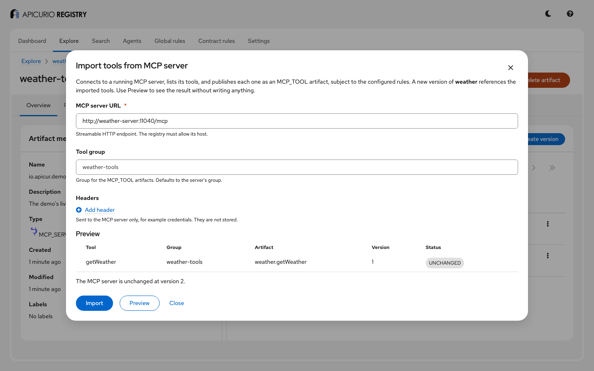

The Registry only connects where it is allowed to. Here `apicurio.mcp-import.allowed-hosts` is
`weather-server`, so any other host is refused:

```bash
open_api POST /groups/weather-tools/artifacts/weather/mcp-import '{"url":"https://evil.example.com/mcp"}' | jq .title
```

```text
"The MCP server URL is not allowed by this registry."
```

Headers for the MCP server, such as credentials, go in the request's `headers` field. They are sent
to the MCP server only, never stored or logged.

**From the command line.** The `acr` CLI has the same as `acr mcp import`:

```bash
acr mcp import weather -g weather-tools --url http://weather-server:11040/mcp --dry-run
```

`acr mcp import` is not in a released CLI yet. Until it is, build `acr` from the main branch
(see [`cli/README.md`](../../cli/README.md)) or use the REST call above.

## Part 9: Quarkus LangChain4j agents that use the Registry

Here the Registry is used by running applications, built with the Quarkus LangChain4j
[A2A Registry extension](https://docs.quarkiverse.io/quarkus-langchain4j/dev/agentic.html#_discovering_a2a_agents_with_apicurio_registry)
and [MCP Registry extension](https://docs.quarkiverse.io/quarkus-langchain4j/dev/mcp.html#_apicurio_registry_mcp_server_discovery):

```text
                   Registry (port 8180)
   publish cards  ↗      ↑ discover agents and the weather server
summarizer, translator   orchestrator ── MCP ──→ weather-server
                         orchestrator ── A2A ──→ summarizer, then translator
```

1. **Publish.** When `summarizer` and `translator` start, the A2A extension publishes their Agent
   Cards. No one registered them by hand: they are the cards you found in part 6.
2. **Discover.** The orchestrator knows roles (`summarizer`, `translator`, `weather-tools/weather`),
   not URLs. The A2A extension finds the agents; the MCP extension finds the weather server, the
   `MCP_SERVER` from part 8, and connects to the URL in its `server.json`.

```bash
curl -s http://localhost:11020/workflow/agents | jq .
```

```json
{ "translator": "Translates text into French", "summarizer": "Summarizes text into a short factual paragraph" }
```

3. **Run.** Open the dashboard at <http://localhost:11020> and click **Create briefing in French**.
   The orchestrator calls `getWeather` on the MCP server, passes the result to the summarizer, then
   the summary to the translator. It shows the Registry versions it found, and each call's actual
   input and output:

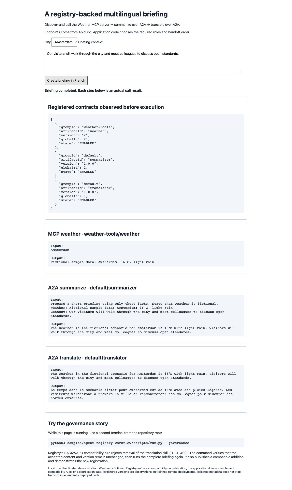

The weather is fictional fixture data, and the text comes from the model, so it varies.

4. **Governance, live.** Try to publish a translator card without its `translator` skill, as a bad
   deployment would. `demo.sh` set a `BACKWARD` rule on it:

```bash
card=$(open_api GET /groups/default/artifacts/translator/versions/branch=latest/content | jq -c '.skills = []')
jq -n --arg c "$card" '{content: {content: $c, contentType: "application/json"}}' \
  | curl -s -X POST http://localhost:8180/apis/registry/v3/groups/default/artifacts/translator/versions \
      -H 'Content-Type: application/json' -d @- | jq '{status, causes}'
```

```json
{ "status": 400, "causes": [{ "description": "Skill 'translator' was removed", "context": "/skills" }] }
```

Create the briefing again: it works, against the same translator version as before.

> **Presenter note.** Be precise about what this protects. The Registry rejects the bad
> *definition*; it does not stop someone deploying incompatible code, or calling an agent directly.
> The dashboard's note about `run.py --governance` comes from the upstream sample; in this demo the
> command above is the equivalent.

## Part 10: who discovers which agents

Switch to the secured Registry (port 8081). Discovery depends on who asks, from two things:

- **Agent visibility**, the `apicurio.agent.visibility` label: `public` (everyone), `entitled`
  (anyone who may read the card) or `private` (its owner and administrators).
- **Access rules** ([`authz/access.rules`](authz/access.rules)), which say who may read which group.
  Here only `developer` may read `team-b`.

`demo.sh` created four agents: `public-agent`, `entitled-agent` and `team-b-agent` as `admin`, and
`private-agent` as `developer`, who owns it. Ask as each user:

```bash
for u in anonymous user developer2 developer admin; do echo "== $u"; agents $u; done
```

| User | Discovers |
|---|---|
| anonymous | `agents/public-agent` |
| `user` (sr-readonly) | + `agents/entitled-agent` |
| `developer2` (sr-developer) | + `agents/entitled-agent` |
| `developer` | + `agents/private-agent` (owner), `team-b/team-b-agent` (access rule) |
| `admin` | all four |

Log in to the web console at <http://localhost:8888> as `user`, then as `developer`. The **Agents**
tab follows the same rules:

| As `user` | As `developer` |
|---|---|
| 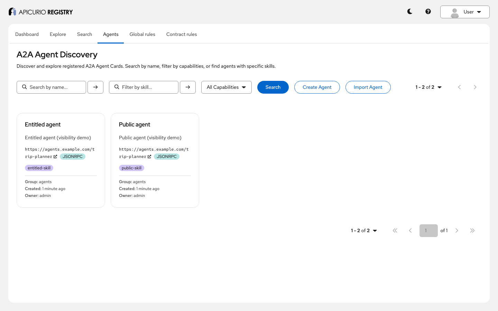 | 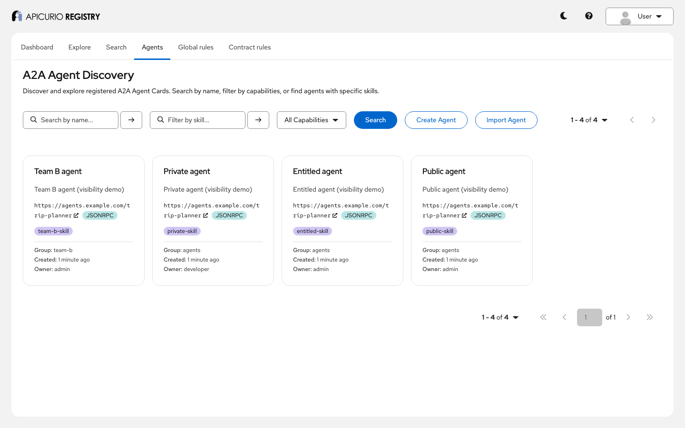 |

The rules apply to every discovery endpoint, and to the REST API itself:

```bash
secured_api user POST /.well-known/ard/search '{"query":{"text":"agent"}}' | jq '[.results[].displayName]'
secured_api developer2 GET /groups/team-b/artifacts/team-b-agent | jq .status      # 403
```

Visibility is a discovery setting, not access control: a user who may read a group can still fetch a
card in it directly. Access rules are what restrict access. Edit `authz/access.rules`, for example to
let `developer2` read `team-b`, and `agents developer2` changes within seconds.

## Part 11: the Registry MCP server, for AI assistants

The Registry MCP server gives AI assistants tools to work with the Registry: search artifacts,
discover agents and MCP tools, search ARD, render prompts, check rules. Here it runs over HTTP in
front of the secured Registry. A user logs in through Keycloak, and the server passes the user's
token on, so the assistant sees exactly what that user may see.

Without a token, the server refuses:

```bash
curl -s -o /dev/null -w '%{http_code}\n' -X POST http://localhost:8082/mcp \
  -H 'Content-Type: application/json' -H 'Accept: application/json, text/event-stream' -d '{}'
```

```text
401
```

As a user, list the tools, then call `discover_agents`. `developer` finds the `team-b` agent; `user`
does not:

```bash
mcp developer tools/list | jq '[.result.tools[].name]'
mcp developer tools/call '{"name":"discover_agents","arguments":{"skill":"team-b-skill"}}' | jq -r '.result.content[0].text' | jq '.agents[].artifactId'
mcp user tools/call '{"name":"discover_agents","arguments":{"skill":"team-b-skill"}}' | jq -r '.result.content[0].text' | jq '.agents | length'
```

To use it from an MCP client that supports OAuth, such as the
[MCP Inspector](https://github.com/modelcontextprotocol/inspector) (`npx @modelcontextprotocol/inspector`),
connect to `http://localhost:8082/mcp` with Streamable HTTP; the client finds Keycloak from the
server's OAuth metadata. The `apicurio-mcp` client allows the Inspector's callback URL. For
assistants that start a local command instead, see the stdio setup in the
[MCP server README](../../mcp/README.md).

## What this demo does not show

- **Calling the Registry's own A2A skills.** Its Agent Card advertises them, but the Registry has no
  A2A message endpoint yet.
- **Federated search across Registries.** Peer registries can be configured
  (`/apis/registry/v3/admin/peers`), but searching across them is not merged yet.
- **Agent Skills (`SKILL` artifacts)**: planned in [#10117](https://github.com/Apicurio/apicurio-registry/issues/10117).
- **Production security.** Everything is local and over HTTP. Keycloak runs in dev mode, the token
  issuer check is relaxed, and the `apicurio-mcp` client allows the password grant only so `demo.sh`
  can log in without a browser.

## Troubleshooting

| Symptom | Cause and fix |
|---|---|
| `docker compose up` waits on `weather-server`, `summarizer` or `translator` | The first run builds the Quarkus applications. `docker compose logs -f summarizer` shows progress. |
| The orchestrator finds no agents | The agents publish their cards when they start. If `registry` was recreated: `docker compose restart summarizer translator orchestrator`. |
| The briefing fails or times out | Check Ollama: `curl http://localhost:11434/api/tags` should list `qwen2.5:7b`. The first call loads the model and can take a minute. |
| `Weather server is not registered` | Run `./demo.sh`, or part 8: the orchestrator looks for the `weather-tools/weather` MCP server. |
| A port is already in use | Stop what uses it; the demo needs 8080, 8081, 8082, 8180, 8888, 8889 and 11020. |
