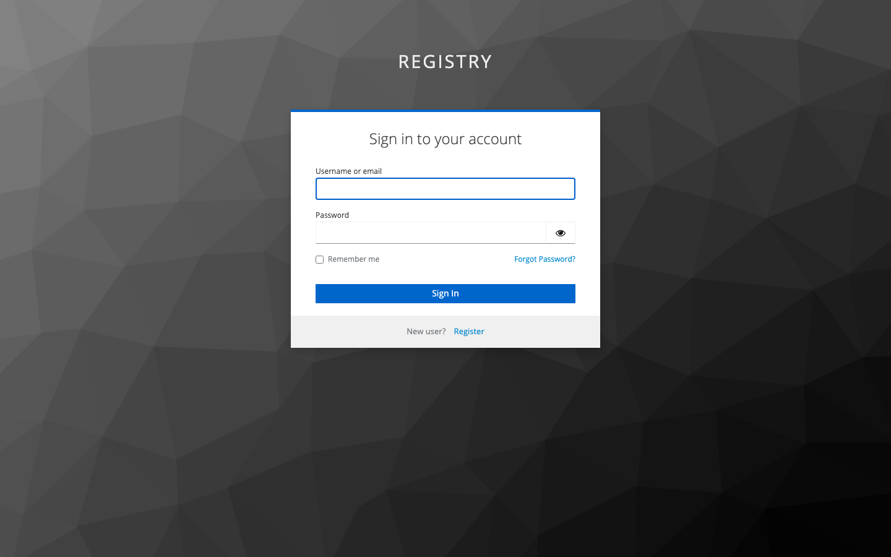
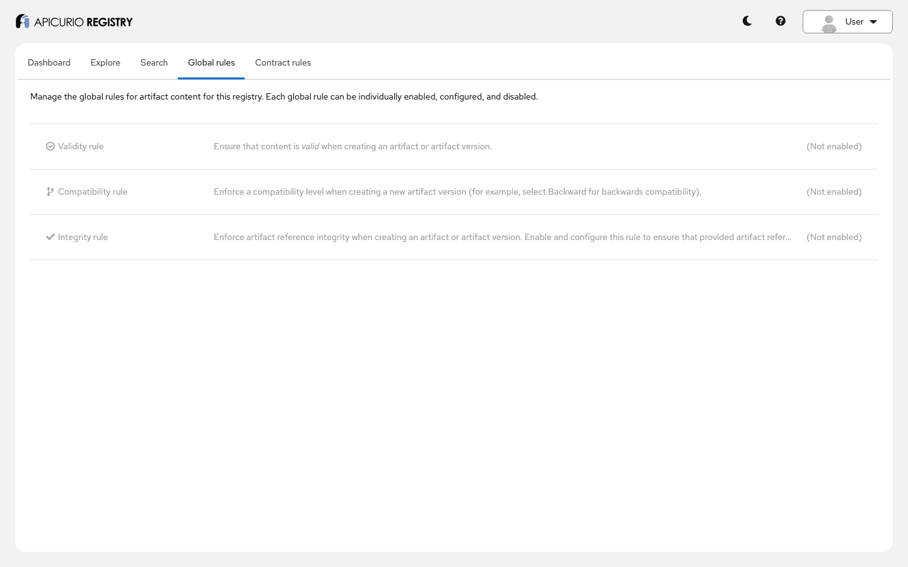
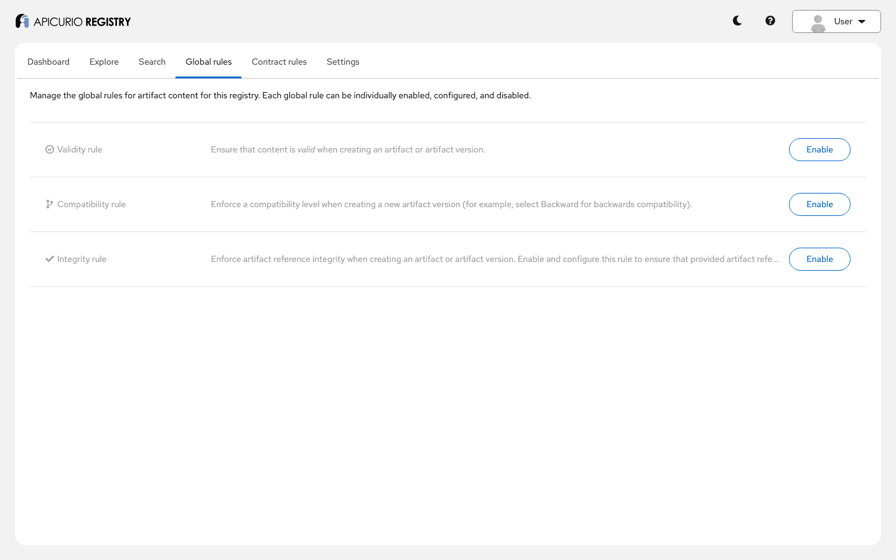

# Authentication: step-by-step guide

This guide walks through every way Apicurio Registry can authenticate a caller, with a running
example: one Keycloak, and four registries configured differently. You will see who is let in, as
whom, with which roles, and what a caller gets back when it is not. Follow it on your own, or use it
as the script for a live demo.

**Time:** about 40 minutes. **You will see:**

- what anonymous callers get, and how to allow anonymous reads;
- users and service accounts with OIDC tokens from Keycloak, and their roles;
- HTTP basic credentials exchanged for a token, and the token cache;
- HTTP basic against users configured in the registry itself;
- identity from an authenticating reverse proxy, and why the registry must sit behind it;
- Kubernetes service account tokens, checked with the TokenReview API;
- the Java SDK, Kafka serializers, the Maven plugin and the CLI authenticating;
- logging in to the web console.

Who may access which **resource** is a separate layer, covered by the
[per-resource authorization example](../per-resource-authorization/). For the reference documentation,
see *Configuring Registry security* ([source](../../docs/modules/ROOT/pages/getting-started/assembly-configuring-registry-security.adoc))
and, for how authentication is implemented, [ADR-0009](../../adr/0009-authentication.md).

## Before you start

You need:

- Docker with Docker Compose v2, or Podman with a Compose provider. The Kubernetes part runs k3s in a
  privileged container;
- `curl`, `jq`, and JDK 21 or later (`demo.sh` builds the clients, the Maven plugin and the CLI from
  this checkout);
- a shell (bash or zsh) and a browser;
- free ports 8080 to 8084, 8888 and 9092; see [Using other ports](#using-other-ports).

```bash
cd examples/authentication
```

## Step 1: Start the example

```bash
docker compose up -d
```

| Service | Port | Authenticates with |
|---|---|---|
| `keycloak` | 8080 | Realm `registry`: users, service accounts, roles |
| `registry` + `registry-ui` | 8081, 8888 | OIDC bearer tokens; basic credentials exchanged for tokens |
| `registry-basic` | 8082 | HTTP basic against users configured in the registry |
| `proxy` -> `registry-proxy` | 8083 | An nginx proxy authenticates, the registry trusts its headers |
| `registry-k8s` (+ `k3s`) | 8084 | Kubernetes service account tokens |
| `kafka` | 9092 | (for the serializers in step 11) |

## Step 2: Run the checks

```bash
./demo.sh
```

The first run builds the clients with [`build.sh`](build.sh) (a few minutes). `demo.sh` then runs
every step below and ends with `All checks passed.`

## Step 3: The identities

The realm in [`keycloak/realm.json`](keycloak/realm.json) has:

| Identity | Kind | Credentials | Role |
|---|---|---|---|
| `admin`, `developer`, `user` | users | password = user name | `sr-admin`, `sr-developer`, `sr-readonly` |
| `admin-client`, `developer-client`, `readonly-client` | service accounts | secret `test1` | `sr-admin`, `sr-developer`, `sr-readonly` |
| `no-role-client` | service account | secret `test1` | none |
| `apicurio-registry` | public client of the web console | none | |

With role-based authorization on (`APICURIO_AUTH_ROLE_BASED_AUTHORIZATION=true`), the role decides
the operation: `sr-readonly` reads, `sr-developer` also writes, `sr-admin` also uses the admin API.

**Authentication answers "who is calling?"; a failure is 401. Authorization answers "may they?"; a
failure is 403.**

## Step 4: Anonymous callers

With authentication on, an anonymous request to `registry` gets 401:

```json
{"title": "User is not authenticated.", "status": 401, ...}
```

Anonymous reads can be allowed, at runtime, by an administrator:

```bash
curl -X PUT localhost:8081/apis/registry/v3/admin/config/properties/apicurio.auth.anonymous-read-access.enabled \
  -H "Authorization: Bearer $ADMIN_TOKEN" -H 'Content-Type: application/json' -d '{"value": "true"}'
```

Anonymous writes stay 401. To switch it off, set it to `false`: resetting the property with `DELETE`
does not take effect until a restart today
([#11044](https://github.com/Apicurio/apicurio-registry/issues/11044)).
`apicurio.auth.authenticated-read-access.enabled` is the same for authenticated callers with no role.

## Step 5: Users with OIDC tokens

A user logs in to Keycloak and sends the token as `Authorization: Bearer <token>`:

```bash
TOKEN=$(curl -s localhost:8080/realms/registry/protocol/openid-connect/token \
  -d 'grant_type=password&client_id=apicurio-registry&username=developer&password=developer' | jq -r .access_token)
curl -H "Authorization: Bearer $TOKEN" localhost:8081/apis/registry/v3/groups
```

| User | Read | Write | Admin API |
|---|---|---|---|
| `admin` | 200 | 200 | 200 |
| `developer` | 200 | 200 | 403 |
| `user` | 200 | 403 | 403 |

The registry checks the token's signature against Keycloak (`QUARKUS_OIDC_AUTH_SERVER_URL`) and its
audience (`QUARKUS_OIDC_CLIENT_ID=registry-api`), and reads the roles from it. An invalid token is
401. (The example relaxes the issuer check, `QUARKUS_OIDC_TOKEN_ISSUER=any`, because the browser and
the containers reach Keycloak under different host names; do not do that in production.)

## Step 6: Service accounts

Applications use the client credentials grant: `client_id` and `client_secret` for a token. The
roles work the same; `no-role-client` is authenticated but has no role, so even reads are 403. Every
write records who made it: the owner of `sa-developer` is `developer-client`.

## Step 7: Basic credentials exchanged for a token

Some tools can only send HTTP basic. With
`APICURIO_AUTHN_BASIC_CLIENT_CREDENTIALS_ENABLED=true`, the registry treats
`Authorization: Basic <client id>:<secret>` as client credentials: it asks Keycloak for a token, then
validates it like any other.

```bash
curl -u developer-client:test1 localhost:8081/apis/registry/v3/groups
```

- A wrong secret is 401. A user name and password is 401 too: they are not a client (exchanging user
  passwords needs `quarkus.oidc.client-secret`, the password grant).
- Tokens are **cached** per credentials until shortly before they expire: `demo.sh` counts Keycloak's
  `CLIENT_LOGIN` events, and five more calls make no new token request. Failures are cached for a
  minute.
- A malformed header returns 500 today instead of 401
  ([#11043](https://github.com/Apicurio/apicurio-registry/issues/11043)).

## Step 8: Basic against users in the registry

`registry-basic` has no identity provider. Users, passwords and roles are configuration:

```yaml
QUARKUS_HTTP_AUTH_BASIC: "true"
QUARKUS_SECURITY_USERS_EMBEDDED_PLAIN_TEXT: "true"
QUARKUS_SECURITY_USERS_EMBEDDED_USERS_DEVELOPER: "developer"   # the password
QUARKUS_SECURITY_USERS_EMBEDDED_ROLES_DEVELOPER: "sr-developer"
```

Fine for development and tests; there is no way to change a password without a restart.

## Step 9: Identity from a trusted proxy

The [nginx proxy](proxy/nginx.conf) checks HTTP basic against [`htpasswd`](proxy/htpasswd)
(`alice/alice`, `bob/bob`), then forwards the request with `X-Forwarded-User`, `X-Forwarded-Email`
and `X-Forwarded-Groups`. `registry-proxy` (`APICURIO_AUTHN_PROXY_HEADER_ENABLED=true`) takes the
caller's identity and roles from those headers.

The registry believes whatever the headers say, so:

- it must be unreachable except through the proxy: `registry-proxy` publishes no port;
- the proxy must overwrite the headers, never pass on the client's: `bob` sending
  `X-Forwarded-Groups: sr-admin` is still read-only.

With `APICURIO_AUTHN_PROXY_HEADER_TRUST_PROXY_AUTHORIZATION=true` (not used here) the registry also
skips its own authorization for these callers, leaving every decision to the proxy.

## Step 10: Kubernetes service account tokens

`registry-k8s` accepts Kubernetes service account tokens. For each new token, it asks the API server
(k3s here) whether the token is valid, with the TokenReview API, and caches the answer
(`APICURIO_AUTHN_KUBERNETES_CACHE_EXPIRATION`, 5 minutes). The registry's own credentials come from
a kubeconfig that [`k8s/setup.sh`](k8s/setup.sh) writes for a service account allowed to review
tokens (`system:auth-delegator`). Kubernetes authentication is experimental, so it needs
`APICURIO_FEATURES_EXPERIMENTAL_ENABLED=true`.

Roles come from the caller's Kubernetes groups (`APICURIO_AUTH_ROLE_SOURCE=kubernetes`): the service
accounts of namespace `payments` are developers, those of `auditors` are read-only.

```bash
TOKEN=$(docker compose exec -T k3s kubectl -n payments create token app)
curl -H "Authorization: Bearer $TOKEN" localhost:8084/apis/registry/v3/groups
```

The owner of what they create is `system:serviceaccount:payments:app`. A Keycloak token is 401
here. On a real cluster, the registry uses its pod's service account, and applications their own.

## Step 11: Java clients

The [clients](clients/src/main/java/io/apicurio/registry/examples/authentication/Clients.java):

| Client | Configuration |
|---|---|
| Java SDK, client credentials | `RegistryClientOptions.create(url).oauth2(tokenEndpoint, clientId, secret)` |
| Java SDK, a token you already have | `.httpAdapter(HttpAdapterType.JDK).bearerToken(token)`: the JDK adapter is required for now ([#11046](https://github.com/Apicurio/apicurio-registry/issues/11046)) |
| Java SDK, basic (`registry-basic`) | `.basicAuth(user, password)` |
| Kafka serializer and deserializer | `apicurio.registry.auth.service.token.endpoint`, `apicurio.registry.auth.client.id`, `apicurio.registry.auth.client.secret` (or `apicurio.registry.auth.username`/`.password`) |

A wrong secret fails the call. The serializer registers `greetings-value` as `developer-client`, and
the deserializer fetches it with its own token.

## Step 12: The Maven plugin and the CLI

The Maven plugin ([`clients/pom.xml`](clients/pom.xml)) takes `authServerUrl` (the **full token
endpoint**), `clientId` and `clientSecret`, or `username` and `password`. It registers
`maven/greeting`, owned by `developer-client`.

The CLI logs in once per context, and stores the credentials:

```bash
acr context create oidc http://localhost:8081
acr login --client-id developer-client --client-secret test1 \
  --token-endpoint http://localhost:8080/realms/registry/protocol/openid-connect/token
acr context create basic http://localhost:8082
acr login --username developer --password developer
```

`demo.sh` adds `--allow-unsafe-credential-storage`, because CI has no OS keychain.

## Step 13: The web console

Open <http://localhost:8888>. The console redirects to Keycloak (authorization code flow, public
client `apicurio-registry`):



Log in as `developer`. The console shows what the role allows: no **Settings** tab, and the global
rules read-only.



As `admin`, the rules can be changed, and **Settings** appears:



The console's settings are in the `registry-ui` service: `REGISTRY_AUTH_TYPE=oidc`, and
`REGISTRY_AUTH_URL` on `localhost`, because the browser cannot reach `keycloak:8080`.

## Step 14: Clean up

```bash
docker compose down -v
```

## Presenter notes

- **Before the session:** run steps 1 and 2 (the first start downloads several images, and k3s takes
  a minute). Keep a private browser window for the admin login.
- **The story in one sentence per step:** 401 is "who are you?", 403 is "you may not" (3, 4); users
  and applications get tokens from the identity provider (5, 6); tools that only speak basic still
  work, and tokens are reused (7); no identity provider at all for development (8); a proxy can own
  authentication, if the registry is behind it (9); Kubernetes workloads use their own identity (10);
  every client speaks all of this (11, 12); the console follows the roles (13).
- **Questions that usually come up:**
  - *Can several mechanisms be on at once?* Yes: they are tried in order
    (`apicurio.authn.mechanism.priority`, default `basic,proxy-header,oidc`), and the first that
    identifies the caller wins. OIDC and Kubernetes cannot be combined: both use bearer tokens.
  - *Where do roles come from?* The token by default; also the registry's own role mappings
    (`role-source=application`), a header, or Kubernetes groups.
  - *Which artifacts may a developer touch?* All, unless owner-only or per-resource authorization
    narrows it.

## Troubleshooting

| Symptom | What to do |
|---|---|
| Every call is 401 with a valid token | Check `QUARKUS_OIDC_AUTH_SERVER_URL` is reachable from the registry container, and the token's audience includes `registry-api`. |
| The console loops on the login page | `REGISTRY_AUTH_URL` must be the URL the browser uses for Keycloak. |
| `registry-k8s` does not start | `docker logs k8s-setup-authn`; k3s needs a privileged container. On Podman, use a rootful machine. |
| `build.sh failed` | JDK 21 or later is needed; run `./build.sh` to see the errors. |

## Using other ports

```bash
export KEYCLOAK_PORT=18080 REGISTRY_PORT=18081 UI_PORT=18888 BASIC_PORT=18082 PROXY_PORT=18083 \
  K8S_PORT=18084 KAFKA_PORT=19092
docker compose up -d
KEYCLOAK=http://localhost:18080 REGISTRY=http://localhost:18081 BASIC=http://localhost:18082 \
  PROXY=http://localhost:18083 K8S=http://localhost:18084 KAFKA=localhost:19092 ./demo.sh
```
