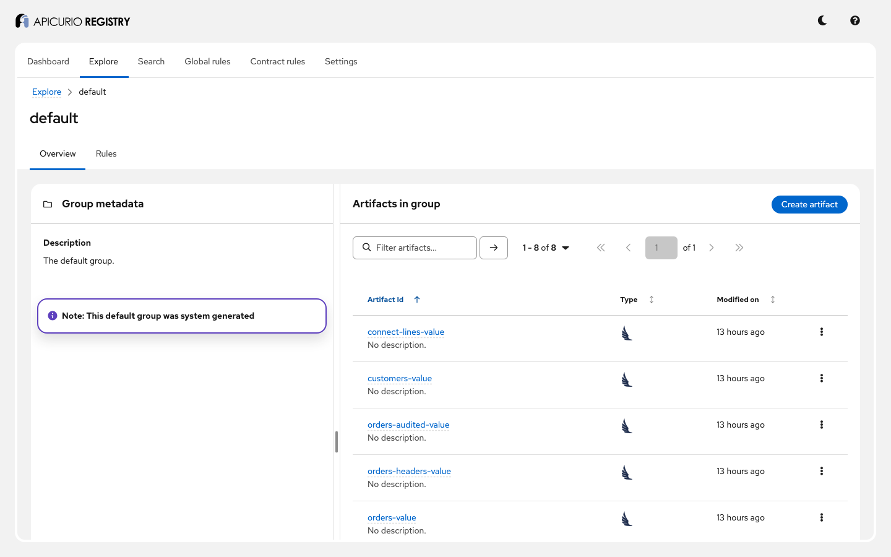
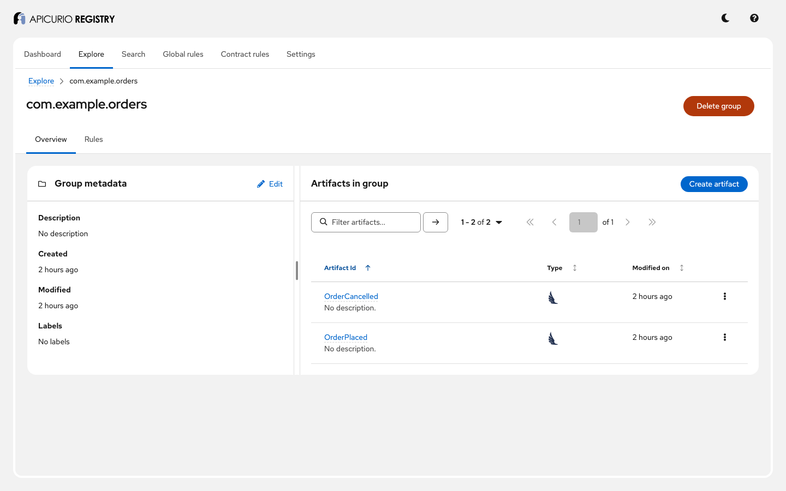
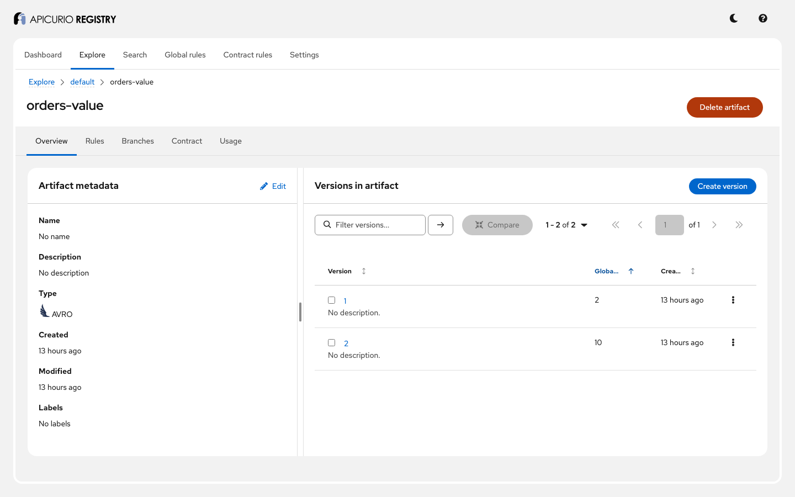

# Kafka serdes: step-by-step guide

This guide walks through the Apicurio Registry serializers and deserializers (serdes) for Kafka with
a running example: a Kafka broker, the registry, and Java producers and consumers that use Avro,
JSON Schema and Protobuf. You will see what the serdes send to Kafka, what they register in the
registry, and how to configure them. Follow it on your own, or use it as the script for a live demo.

**Time:** about 40 minutes. **You will see:**

- how a producer registers its schema and a consumer finds it again, from a 5-byte prefix;
- how the schema ID can travel in Kafka headers instead;
- Avro, JSON Schema and Protobuf, with generated classes, plain Java classes and generic records;
- how the serdes name artifacts, and how to change that, including with your own strategy;
- schema evolution, and what a producer sees when a compatibility rule rejects its schema;
- a schema registered ahead of time by a build, with auto-registration switched off;
- Kafka Connect using the Apicurio converters.

For the reference documentation, see *Configuring Kafka serializers/deserializers* in the Registry
documentation ([source](../../docs/modules/ROOT/pages/getting-started/assembly-configuring-kafka-client-serdes.adoc))
and, for how they are implemented, [ADR-0007](../../adr/0007-kafka-serdes.md).

## Before you start

You need:

- Docker with Docker Compose v2, or Podman with a Compose provider;
- `curl` and `jq`;
- JDK 21 or later: the tour is built from this checkout (the serdes snapshots are not published);
- a shell: bash or zsh, and a browser for the UI;
- free ports 9092 (Kafka), 8081 (Registry API), 8888 (Registry UI) and 8083 (Kafka Connect). If they
  are in use, see [Using other ports](#using-other-ports).

Run every command from this directory:

```bash
cd examples/kafka-serdes
```

## Step 1: Start the example

```bash
docker compose up -d
docker compose ps --format '{{.Name}}: {{.Status}}'
```

```
apicurio-registry-api-serdes: Up ... (healthy)
apicurio-registry-ui-serdes: Up ...
kafka-serdes: Up ... (healthy)
```

The Kafka Connect worker is in the Compose profile `connect`; `demo.sh` starts it in step 13.

## Step 2: Run the tour and check everything works

```bash
./demo.sh
```

The first run builds the tour with [`build.sh`](build.sh) (a few minutes). Then `demo.sh` resets the
example's topics and artifacts, runs the [tour](tour/src/main/java/io/apicurio/registry/examples/serdes/Tour.java),
which runs steps 4 to 12 and checks each one, then checks what the tour left in Kafka and in the
registry, and runs step 13. It ends with:

```
All checks passed.
```

Every serde setting the tour uses is a plain string property, so you can copy it into any Kafka
client configuration. The steps below show them.

## Step 3: Run one step on its own

To rerun a single step of the tour:

```bash
../../mvnw -q -f tour exec:java -Dtour.steps=avro
```

Steps are `avro`, `headers`, `json`, `protobuf`, `protobuf-find-latest`, `reflect`,
`record-strategy`, `evolution`, `rules`, `custom-strategy`, `custom-resolver` and `preregistered`.
Steps append to their topics, and their checks count the records from the start of the topic, so a
step checks reliably only on the data `demo.sh` starts from. Run it after a reset:

```bash
SKIP_TOUR_CHECKS=1 ./demo.sh > /dev/null   # resets the topics and artifacts, and registers greetings/greeting
../../mvnw -q -f tour exec:java -Dtour.steps=avro
```

Steps that read records written by earlier steps (`evolution` reads `avro`'s orders, `rules` uses
`orders-value`) need those steps first, in the same order: `-Dtour.steps=avro,evolution,rules`.

## Step 4: Avro: the producer registers, the consumer looks up

The producer uses `AvroKafkaSerializer` and sends three `GenericRecord` orders to the topic `orders`.
The only serde settings are:

```properties
value.serializer=io.apicurio.registry.serde.avro.AvroKafkaSerializer
apicurio.registry.url=http://localhost:8081/apis/registry/v3
apicurio.registry.auto-register=true
```

With `auto-register`, the serializer registers the record's schema the first time, and finds it again
afterwards. Where? The default **strategy**, `TopicIdStrategy`, names the artifact after the topic:
`<topic>-value` (or `-key`) in the group `default`. Without `auto-register` (the default), the schema
must already be in the registry (step 12).

The consumer uses `AvroKafkaDeserializer` with only `apicurio.registry.url`, and gets
`GenericRecord`s.

```bash
curl -s localhost:8081/apis/registry/v3/groups/default/artifacts/orders-value | jq -r .artifactType   # AVRO
```

**In the UI:** open **Explore** > `default`: one artifact per topic the tour used.



## Step 5: The wire format

How does the consumer know which schema to use? Each record starts with a 5-byte prefix:

```bash
docker compose exec -T kafka /opt/kafka/bin/kafka-console-consumer.sh --bootstrap-server localhost:29092 \
  --topic orders --from-beginning --max-messages 1 2>/dev/null | head -c 5 | od -An -tx1
```

```
 00 00 00 00 02
```

A magic byte `0`, then the **content ID** of the schema in 4 bytes: the same as
`GET /groups/default/artifacts/orders-value/versions/1` returns as `contentId`. The deserializer reads
the ID, fetches the schema once, and caches it. This is the same framing Confluent's serializers use.

Two settings change the prefix:

| Setting | Effect |
|---|---|
| `apicurio.registry.use-id=globalId` | Writes the global ID (unique per version) instead of the content ID (shared by identical schemas) |
| `apicurio.registry.id-handler=io.apicurio.registry.serde.Legacy8ByteIdHandler` | Writes the ID in 8 bytes, as Apicurio Registry 2.x did; `OptimisticFallbackIdHandler` reads both |

The `headers` step sends the same records to `orders-headers` with
`apicurio.registry.headers.enabled=true` on **both** the producer and the consumer. The ID then
travels in the Kafka header `apicurio.value.contentId`, and the payload is plain Avro with no prefix:

```bash
docker compose exec -T kafka /opt/kafka/bin/kafka-console-consumer.sh --bootstrap-server localhost:29092 \
  --topic orders-headers --from-beginning --max-messages 1 --property print.headers=true --property print.value=false
```

The consumer only reads the headers when headers are enabled on it too; otherwise it looks for the
prefix and fails.

## Step 6: JSON Schema from a file

A JSON Schema cannot be derived from a Java object, so the serializer needs to be told which schema
to register: here [`shipment.json`](tour/src/main/resources/shipment.json), from the classpath. (It
can also take the schema from Kafka headers, with `apicurio.registry.use-schema-from-headers`.)

```properties
value.serializer=io.apicurio.registry.serde.jsonschema.JsonSchemaKafkaSerializer
apicurio.registry.auto-register=true
apicurio.registry.artifact.schema.location=shipment.json
```

The serializer validates every object before sending it (`apicurio.registry.serde.validation-enabled`
is `true` by default). A shipment with `parcels: 0` (the schema says `minimum: 1`) is never sent:

```
  info  validation failure: java.io.UncheckedIOException: ... $.parcels: must have a minimum value of 1
```

The consumer sets `apicurio.registry.deserializer.value.return-class` to get `Shipment` objects back.

## Step 7: Protobuf, with and without auto-registration

The `protobuf` step sends a `Payment`, a class generated from
[`payment.proto`](tour/src/main/proto/payment.proto), with `auto-register`. Read back with no other
setting, the consumer gets a `DynamicMessage`; with `apicurio.protobuf.derive.class=true` it gets the
generated `Payment` class.

The `protobuf-find-latest` step first registers [`refund.proto`](tour/src/main/proto/refund.proto) as
`default/refunds-value`, then sends with:

```properties
apicurio.registry.find-latest=true
```

The serializer then uses the latest registered version of the artifact, instead of looking the schema
up by content. For Protobuf that matters: the schema the serializer derives from a class is not
byte-for-byte the `.proto` file you registered.

## Step 8: Plain Java classes with Avro

[`Customer`](tour/src/main/java/io/apicurio/registry/examples/serdes/Customer.java) is a plain class
with no Avro code. With the reflect datum provider on both sides, Avro derives the schema from its
fields, and the consumer gets `Customer` objects back:

```properties
apicurio.registry.avro-datum-provider=io.apicurio.registry.serde.avro.ReflectAvroDatumProvider
```

Avro only reads and writes classes from packages you trust: the tour runs with
`-Dorg.apache.avro.SERIALIZABLE_PACKAGES=io.apicurio.registry.examples.serdes`
([`tour/pom.xml`](tour/pom.xml)).

## Step 9: Several record types on one topic

`TopicIdStrategy` gives a topic one schema. To send `OrderPlaced` and `OrderCancelled` to the same
topic, `order-events`, name artifacts after the record instead:

```properties
apicurio.registry.artifact-resolver-strategy=io.apicurio.registry.serde.avro.strategy.RecordIdStrategy
```

| Strategy | Group | Artifact |
|---|---|---|
| `io.apicurio.registry.serde.strategy.TopicIdStrategy` (default) | `default` | `<topic>-value` |
| `io.apicurio.registry.serde.strategy.SimpleTopicIdStrategy` | `default` | `<topic>` |
| `io.apicurio.registry.serde.avro.strategy.RecordIdStrategy` | record namespace | record name |
| `io.apicurio.registry.serde.avro.strategy.TopicRecordIdStrategy` | record namespace | `<topic>-<record name>` |
| `io.apicurio.registry.serde.avro.strategy.QualifiedRecordIdStrategy` | `default` | record full name |

`apicurio.registry.artifact.group-id`, `.artifact-id` and `.version` override whatever the strategy
returns.

**In the UI:** open **Explore** > `com.example.orders`: one artifact per record type.



## Step 10: Evolution, and a rule that says no

The `evolution` step sends an order with a new field, `currency`, which has a default. The serializer
registers it as version 2 of `orders-value`. The consumer reads all four orders: each record carries
the ID of the schema it was written with, so old and new records stay readable side by side.

The `rules` step then adds a `BACKWARD` compatibility rule to `orders-value`, and tries to send an
order whose `amount` is text instead of a number. The registry rejects the schema, so `send()` throws
and nothing is written:

```
  info  producer exception: java.lang.RuntimeException: io.apicurio.registry.rest.client.models.RuleViolationProblemDetails ...
  info  rule violation: Incompatible artifact: orders-value [AVRO], ... reader type: STRING not compatible with writer type: DOUBLE at /fields/1/type
```

The reason is in the cause, a `RuleViolationProblemDetails` from the Java SDK; the tour shows how to
read it. That the exception's own message is empty is
[#11018](https://github.com/Apicurio/apicurio-registry/issues/11018). `orders-value` still has 2
versions. The [rules example](../rules-and-compatibility/) covers the rules themselves.

**In the UI:** open **Explore** > `default` > `orders-value`: 2 versions, and a compatibility rule
under **Rules**.



## Step 11: Your own strategy and resolver

Both are plain classes on the client's classpath, named in its configuration:

- [`TeamArtifactStrategy`](tour/src/main/java/io/apicurio/registry/examples/serdes/TeamArtifactStrategy.java)
  implements `ArtifactReferenceResolverStrategy`: topic `inventory.stock-levels` uses the artifact
  `inventory/stock-levels`, so each team's schemas land in its own group
  (`apicurio.registry.artifact-resolver-strategy`).
- [`CountingSchemaResolver`](tour/src/main/java/io/apicurio/registry/examples/serdes/CountingSchemaResolver.java)
  extends `DefaultSchemaResolver` and counts lookups (`apicurio.registry.schema-resolver`). A real one
  might audit lookups, or resolve schemas from somewhere else.

## Step 12: A schema registered by the build

Many teams register schemas in their build, and do not let producers register anything. `demo.sh`
registers [`greeting.avsc`](tour/src/main/resources/greeting.avsc) as `greetings/greeting` with the
Maven plugin (configured in [`tour/pom.xml`](tour/pom.xml)):

```bash
../../mvnw -q -f tour io.apicurio:apicurio-registry-maven-plugin:3.4.0-SNAPSHOT:register
```

The producer then sends with:

```properties
apicurio.registry.auto-register=false
apicurio.registry.artifact.group-id=greetings
apicurio.registry.artifact.artifact-id=greeting
apicurio.registry.find-latest=true
```

`greetings/greeting` still has the single version the build registered.

## Step 13: Kafka Connect with the Apicurio converters

`demo.sh` starts a Kafka Connect worker (`docker compose --profile connect up -d`) with the Apicurio
converters in its plugin path (`build.sh` collects them in `connect-plugin/target/plugins`), and two
connectors that ship with Kafka:

- `orders-to-file`, a FileStream **sink** reading `orders` with
  `value.converter=io.apicurio.registry.utils.converter.AvroConverter`. The converter reads the
  prefix, fetches the schema, and gives the connector structured records:

  ```bash
  docker compose exec -T connect cat /tmp/orders-sink.txt
  ```

  ```
  Struct{orderId=o-1,amount=10.0}
  ...
  Struct{orderId=o-4,amount=40.0,currency=USD}
  ```

- `file-to-lines`, a FileStream **source** writing lines of text to `connect-lines` with the same
  converter and `value.converter.apicurio.registry.auto-register=true`: the converter registers the
  Avro schema `"string"` as `default/connect-lines-value`.

```bash
curl -s localhost:8083/connectors?expand=status | jq 'map_values(.status.tasks[0].state)'
```

`ProtobufConverter` and `ExtJsonConverter` work the same way.

## Step 14: Clean up

```bash
docker compose --profile connect down -v
```

## Presenter notes

- **Before the session:** run steps 1 and 2 in advance, so the images are downloaded, the tour is
  built and the data exists. Keep a terminal in this directory and the UI open on **Explore**.
- **The story in one sentence per step:** a producer registers its schema and a consumer finds it from
  5 bytes (4, 5); the ID can travel in headers instead (5); every format, with classes or without
  (6, 7, 8); strategies decide where schemas go (9, 11); schemas evolve, and rules refuse breaking
  changes at the producer (10); builds can own registration (12); Kafka Connect uses the same
  serdes (13).
- **Questions that usually come up:**
  - *Does every message call the registry?* No: schemas are cached by ID
    (`apicurio.registry.check-period-ms`, 30 seconds by default for lookups by name).
  - *Can Confluent clients read these messages?* Avro and JSON Schema: yes, the framing is the same,
    through the registry's Confluent-compatible API. Protobuf needs extra settings; see the
    configuration docs.
  - *What if the registry is down?* Consumers keep decoding the IDs they have seen. Producers fail
    once their cached entries expire (30 seconds) and the retries are exhausted, unless
    `apicurio.registry.fault-tolerant-refresh=true`, which keeps using the stale schema.
- **To reset between runs:** `./demo.sh` resets the data itself.

## Troubleshooting

| Symptom | What to do |
|---|---|
| `build.sh failed` | It needs JDK 21 or later. The log path is printed; `./build.sh` shows the errors directly. |
| The tour times out, or `Connection to node -1 ... could not be established` | Kafka is not reachable on `localhost:9092`: check `docker compose ps`, or see [Using other ports](#using-other-ports). |
| `artifact reference cannot be null` on a consumer | The records were sent with headers, and the consumer does not have `apicurio.registry.headers.enabled=true`. |
| `Forbidden ... This class is not trusted to be included in Avro schemas` | Add the class's package to `org.apache.avro.SERIALIZABLE_PACKAGES` (step 8). |
| Step 13 waits for the Connect worker | `docker logs kafka-connect-serdes`; the worker needs `connect-plugin/target/plugins`, which `build.sh` creates. |

## Using other ports

```bash
export KAFKA_PORT=19092 REGISTRY_PORT=18081 UI_PORT=18888 CONNECT_PORT=18083
docker compose up -d
API=http://localhost:18081/apis KAFKA=localhost:19092 CONNECT=http://localhost:18083 ./demo.sh
```

To run a step by hand, add `-Dregistry.url=http://localhost:18081/apis/registry/v3
-Dkafka.bootstrap=localhost:19092`.
