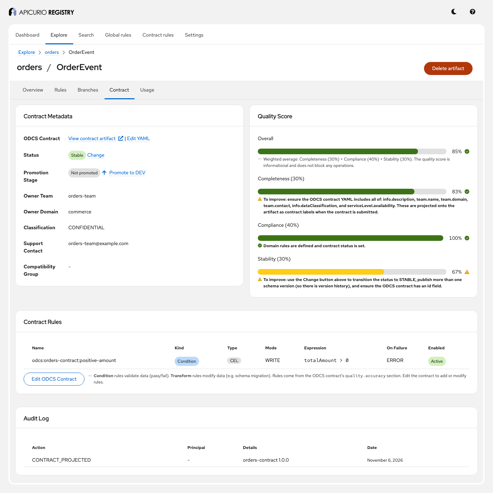
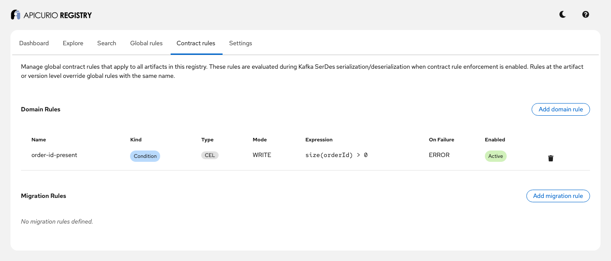
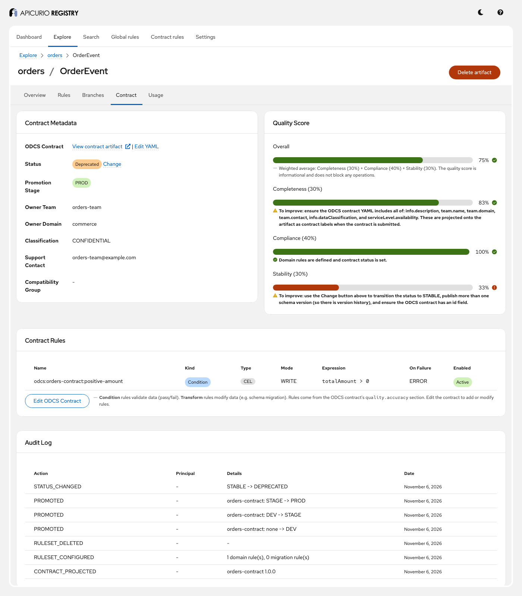

# ODCS data contracts: step-by-step guide

This guide walks through Apicurio Registry's data contracts with a running example: an Avro schema
for order events, an [Open Data Contract Standard (ODCS)](https://bitol-io.github.io/open-data-contract-standard/)
v3.1 contract that governs it, and a Kafka producer that the contract's rules protect. Follow it on
your own, or use it as the script for a live demo. Each step shows the API commands and their
expected output and, where the UI shows the same thing, a screenshot of what you should see. Every
step builds on the previous ones, so run them in order.

**Time:** about 30 minutes. **You will see:**

- how a submitted ODCS contract is stored, and *projected* onto the schema it governs as labels,
  rules and field tags;
- how to read the contract back: its metadata, and an ODCS export rebuilt from the projection;
- how the contract's quality rules check records, on demand and inside a Kafka serializer;
- how global rules apply to every artifact, and how a narrower rule overrides them;
- the contract lifecycle: status, promotion stages and the quality score;
- how to find contracts, and what the audit log records;
- how migration rules upgrade a record to a new schema version;
- what updating and deleting a contract does, and does not, change.

For the reference documentation, see *Apicurio Registry data contracts* in the Registry documentation
([source](../../docs/modules/ROOT/pages/getting-started/assembly-data-contracts.adoc)) and, for how
it is designed, [ADR-0002](../../adr/0002-odcs-native-data-contracts.md).

## Before you start

You need:

- Docker with Docker Compose v2, or Podman with a Compose provider;
- `curl` and `jq`;
- a shell: bash or zsh;
- Java 17 or later, for the Kafka step (step 9) only; the Maven wrapper is in the repository root;
- a browser, for the UI;
- free ports 8081 (Registry API), 8888 (Registry UI) and 9092 (Kafka). If they are in use, see
  [Using other ports](#using-other-ports).

Run every command from this directory:

```bash
cd examples/odcs-data-contracts
```

## Step 1: Start the example

```bash
docker compose up -d
```

The first run downloads three images and takes a few minutes. Check that all three containers are
up:

```bash
docker compose ps --format '{{.Name}}: {{.Status}}'
```

```
apicurio-registry-api-contracts: Up ...
apicurio-registry-ui-contracts: Up ...
kafka-contracts: Up ...
```

The registry uses in-memory storage and no authentication, so there is nothing else to set up.

## Step 2: Create the sample data and check everything works

```bash
./demo.sh
```

`demo.sh` registers the Avro schema [`schemas/order-event-v1.avsc`](schemas/order-event-v1.avsc) as
artifact `orders/OrderEvent`, version `1`, submits the contract
[`contracts/orders-contract.yaml`](contracts/orders-contract.yaml) to group `orders`, then checks
what the registry made of it. It ends with:

```
All checks passed.
```

The script starts by deleting the `orders` group and the global contract rules, so it is safe to
run again. Deleting the group also deletes its contract rules and audit log. Kafka messages survive
this reset; to start from scratch, use `docker compose down -v` instead.

## Step 3: Load the helper commands

```bash
source ./demo-env.sh
```

The helpers call the Registry API (`/apis/registry/v3`) for you. `$ORDER` is set to
`/groups/orders/artifacts/OrderEvent`, the schema artifact used throughout this guide.

| Command | What it does |
|---|---|
| `call <method> <path> [json]` | prints the response |
| `status <method> <path> [json]` | prints only the HTTP status |
| `submit <file> [PUT <contract id>]` | submits an ODCS contract (YAML) to group `orders` |
| `check <json record> [mode] [version]` | runs `OrderEvent`'s contract rules against a record |

**In the UI:** open <http://localhost:8888>, choose *Explore*, then `orders` and `OrderEvent`. The
UI needs no login in this example.

## Step 4: Read the contract

```bash
cat contracts/orders-contract.yaml
```

The contract says who owns the data (`team`), how sensitive it is (`info.dataClassification`, and
`pii` and `tags` on each field), what a valid record looks like (`quality.accuracy`), and what
consumers can expect (`quality.freshness`, `serviceLevel`). Its `schemas` section says which
registry artifact it governs:

```yaml
schemas:
  - name: OrderEvent
    type: avro
    location: orders/OrderEvent
```

`location` is `[groupId/]artifactId[:version]`. Without a group, the contract's own group is used;
without a version, the latest one.

The schema itself knows nothing of the contract. Ownership, quality rules and service levels all
live in the contract, which a different team can own and version separately. The schema can
still describe its own fields: [`schemas/order-event-v1.avsc`](schemas/order-event-v1.avsc) tags
`customerEmail` as `PII` with Avro's `tags` property.

## Step 5: What the registry did with it

The contract itself is stored as an artifact of type `ODCS_CONTRACT`, named after its `id`, with one
version per `info.version`:

```bash
call GET /groups/orders/contracts
call GET /groups/orders/artifacts/orders-contract | jq -c '{artifactId, artifactType}'
```

```
[
  {
    "contractId": "orders-contract",
    "name": "Orders Data Contract"
  }
]
{"artifactId":"orders-contract","artifactType":"ODCS_CONTRACT"}
```

Its contents were also **projected** onto `OrderEvent`, into things the registry already knows how to
store and enforce. Contract-level facts became artifact labels:

```bash
call GET $ORDER | jq .labels
```

```
{
  "contract.orders-contract.support.contact": "orders-team@example.com",
  "contract.orders-contract.version": "1.0.0",
  "contract.orders-contract.classification": "CONFIDENTIAL",
  "contract.orders-contract.id": "orders-contract",
  "contract.orders-contract.status": "STABLE",
  "contract.orders-contract.owner.team": "orders-team",
  "contract.orders-contract.sla.availability": "0.999",
  "contract.orders-contract.owner.domain": "commerce",
  "contract.orders-contract.sla.latency.p99": "PT1S",
  "contract.orders-contract.lifecycle.stable-date": "2026-11-06",
  "contract.orders-contract.quality.freshness.maxStaleness": "PT5M"
}
```

Every key carries the contract ID, so several contracts can govern the same schema without
overwriting each other. ODCS status `active` became the registry status `STABLE`, dated today.

The `quality.accuracy` entry became a contract rule, a CEL condition checked when data is written:

```bash
call GET $ORDER/contract/ruleset | jq -c '.domainRules[] | {name, kind, type, mode, expr, onFailure}'
```

```
{"name":"odcs:orders-contract:positive-amount","kind":"CONDITION","type":"CEL","mode":"WRITE","expr":"totalAmount > 0","onFailure":"ERROR"}
```

`threshold: 1.0` in the contract chose `onFailure: ERROR`. A threshold of 0.95 or more gives `DLQ`,
anything lower `NONE`.

The field-level `pii` and `tags` became **field tags**: labels on the schema version, not the
artifact, because fields belong to a version:

```bash
call GET $ORDER/versions/1 | jq .labels
```

```
{
  "field-tag.orders-contract:customerEmail|PII": "EXTERNAL",
  "field-tag.orders-contract:customerEmail|EMAIL": "EXTERNAL",
  "field-tag.customerEmail|PII": "INLINE"
}
```

Tags from the contract are `field-tag.<contract>:<field path>|<tag>` = `EXTERNAL`. The last label
came from the schema itself: when a version is created, the registry reads the tags declared in its
content (Avro `tags`, JSON Schema `x-tags`, Protobuf `@tag:` comments) into
`field-tag.<field path>|<tag>` = `INLINE`.

**In the UI:** open the *Contract* tab of `OrderEvent`. It shows the projected metadata, the quality
score (step 10), the contract's rules, and the audit log (step 11). *View contract artifact* opens
the `ODCS_CONTRACT` artifact, and *Edit YAML* edits and re-submits it.



## Step 6: Read it back: metadata and export

The metadata view reads the projected labels:

```bash
call GET $ORDER/contract/metadata
```

```
{
  "status": "STABLE",
  "ownerTeam": "orders-team",
  "ownerDomain": "commerce",
  "supportContact": "orders-team@example.com",
  "classification": "CONFIDENTIAL",
  "stableDate": "2026-11-06"
}
```

The export rebuilds an ODCS document from what is projected on the artifact:

```bash
curl -s $API/registry/v3$ORDER/contract/export
```

```yaml
apiVersion: "v3.1.0"
kind: "DataContract"
id: "orders-contract"
info:
  version: "1.0.0"
  status: "active"
  dataClassification: "confidential"
schemas:
- type: "avro"
  location: "orders/OrderEvent:1"
  fields:
    customerEmail:
      pii: true
      tags:
      - "EMAIL"
...
```

Compare it with the original: the export is a view of the projection, not a copy of the contract.
What was projected comes back, but anything that was not (the title, field descriptions) is
missing. The submitted YAML stays the source of truth:
`call GET /groups/orders/contracts/orders-contract` returns it unchanged.

## Step 7: Check records against the contract

The contract's rules can be run against any record, without Kafka. A valid order:

```bash
check '{"orderId":"A1","customerEmail":"a@example.com","totalAmount":99.99}'
```

```
{
  "passed": true,
  "violations": [],
  "executedRules": 1,
  "failedRules": 0
}
```

An order with a negative amount breaks `positive-amount`:

```bash
check '{"orderId":"A2","customerEmail":"b@example.com","totalAmount":-5}'
```

```
{
  "passed": false,
  "violations": [
    {
      "ruleName": "odcs:orders-contract:positive-amount",
      "message": "Condition failed: odcs:orders-contract:positive-amount",
      "action": "ERROR"
    }
  ],
  "executedRules": 1,
  "failedRules": 1
}
```

The response is HTTP 200 either way: the result is in `passed`. Rules only run in their own mode,
so the same record passes a `READ` check, where no rule applies:

```bash
check '{"orderId":"A2","totalAmount":-5}' READ | jq -c .
```

```
{"passed":true,"violations":[],"executedRules":0,"failedRules":0}
```

Each top-level field of the record is a CEL variable, so the rule says `totalAmount`, not
`record.totalAmount`. A record whose fields are nested under another object fails, because
`totalAmount` is then not defined:

```bash
check '{"order":{"totalAmount":99.99}}' | jq -r '.violations[0].message' | head -1
```

```
CEL evaluation error: CEL compilation failed: check failed: ERROR: <input>:1:1: undeclared reference to 'totalAmount' (in container '')
```

## Step 8: Global rules, and overriding them

A global rule applies to every artifact. Require a non-empty `orderId` everywhere:

```bash
call PUT /admin/contracts/ruleset '{"domainRules":[{"name":"order-id-present","kind":"CONDITION","type":"CEL","mode":"WRITE","expr":"size(orderId) > 0","onFailure":"ERROR"}],"migrationRules":[]}' > /dev/null
check '{"orderId":"","totalAmount":10}' | jq -c .
check '{"orderId":"A3","totalAmount":10}' | jq -c .
```

```
{"passed":false,"violations":[{"ruleName":"order-id-present","message":"Condition failed: order-id-present","action":"ERROR"}],"executedRules":1,"failedRules":1}
{"passed":true,"violations":[],"executedRules":2,"failedRules":0}
```

The valid record ran two rules: the global one and the contract's. The first failure with
`onFailure: ERROR` stops the evaluation, so the empty `orderId` ran only one.

Rules are merged by name: global, then artifact, then version, and the narrowest one wins. Give
version 1 its own `order-id-present`, which always passes:

```bash
call PUT $ORDER/versions/1/contract/ruleset '{"domainRules":[{"name":"order-id-present","kind":"CONDITION","type":"CEL","mode":"WRITE","expr":"true","onFailure":"ERROR"}],"migrationRules":[]}' > /dev/null
check '{"orderId":"","totalAmount":10}' | jq -c .
status DELETE $ORDER/versions/1/contract/ruleset
```

```
{"passed":true,"violations":[],"executedRules":2,"failedRules":0}
204
```

Keep the global rule for the next step.

**In the UI:** the *Contract rules* page, in the top menu, manages the global rules:



## Step 9: The contract in a Kafka producer

The registry can check records, but the place to stop bad data is the producer. With
`apicurio.registry.serde.contract-rules.enabled=true`, the Apicurio serializer fetches the
contract rules that apply to the schema version from the registry (global, artifact and version
rules, merged by name exactly as in step 8), caches them (60 seconds by default), and runs the
`WRITE` rules on every record before serializing it.
[`ContractSerdesDemo`](src/main/java/io/apicurio/registry/examples/ContractSerdesDemo.java) sends
three orders, then reads the topic back:

```bash
../../mvnw -q compile exec:java
```

```
sent      {"orderId": "ORD-1001", "customerEmail": "customer@example.com", "totalAmount": 99.99}
rejected  {"orderId": "ORD-1002", "customerEmail": "customer@example.com", "totalAmount": -5.0}
          Contract rule validation failed (WRITE): [odcs:orders-contract:positive-amount (ERROR): Condition failed: odcs:orders-contract:positive-amount]
rejected  {"orderId": "", "customerEmail": "customer@example.com", "totalAmount": 25.0}
          Contract rule validation failed (WRITE): [order-id-present (ERROR): Condition failed: order-id-present]
consumed  {"orderId": "ORD-1001", "customerEmail": "customer@example.com", "totalAmount": 99.99}
1 message(s) on topic 'orders'
```

The invalid orders never reached Kafka: one broke the contract's rule, the other the global rule.
The first run downloads dependencies, and Maven may print some JVM warnings first; they are
harmless.

The serializer runs the rules in the client, so a rule change reaches producers within the cache
TTL, not at once. With `apicurio.registry.serde.contract-rules.fail-on-error=false`, a failing
record is logged and sent anyway; nothing routes it to a dead letter topic, whatever the rule's
`onFailure`, and the serializer does not apply the output of `TRANSFORM` rules.

Remove the global rule:

```bash
status DELETE /admin/contracts/ruleset
```

```
204
```

## Step 10: Lifecycle: quality score, promotion and status

The quality score says how complete and well-governed the contract is:

```bash
call GET "$ORDER/contract/quality?contractId=orders-contract" | jq -c .
```

```
{"overall":0.85,"compliance":1.0,"stability":0.6666667,"completeness":0.8333333}
```

`overall` weighs completeness 30%, compliance 40% and stability 30%. Completeness misses one point
because `OrderEvent` has no description; stability because the schema has only one version. The
score is informational and blocks nothing.

Promotion moves the contract through the stages DEV, STAGE and PROD, forward only and one stage at
a time:

```bash
call POST $ORDER/contract/promote '{"contractId":"orders-contract","targetStage":"DEV"}' | jq -c .
call POST $ORDER/contract/promote '{"contractId":"orders-contract","targetStage":"PROD"}' | jq -r .title
call POST $ORDER/contract/promote '{"contractId":"orders-contract","targetStage":"STAGE"}' | jq -c .
call POST $ORDER/contract/promote '{"contractId":"orders-contract","targetStage":"PROD"}' | jq -c .
```

```
{"stage":"DEV"}
Cannot skip stages. Promote to STAGE first.
{"stage":"STAGE"}
{"stage":"PROD"}
```

PROD also requires the status `STABLE`. The status moves the other way, from `DRAFT` to `STABLE`
to `DEPRECATED`, and never back:

```bash
call POST $ORDER/contract/status '{"status":"DEPRECATED"}' | jq -c '{status, stage, deprecatedDate}'
call POST $ORDER/contract/status '{"status":"STABLE"}' | jq -c '{status, title}'
```

```
{"status":"DEPRECATED","stage":"PROD","deprecatedDate":"2026-11-06"}
{"status":409,"title":"Invalid status transition from DEPRECATED to STABLE"}
```

**In the UI:** reload the *Contract* tab. The status is *Deprecated*, the stage *PROD*, and the
stability score has dropped. *Change* and *Promote* next to them do the same as the commands above.



## Step 11: Find contracts, and see what changed

Search finds schemas by their contract metadata, across all groups:

```bash
call GET '/search/contracts?ownerTeam=orders-team' | jq -c '{count, artifacts: [.artifacts[] | "\(.groupId)/\(.artifactId)"]}'
call GET '/search/contracts?status=STABLE' | jq .count
call GET '/search/contracts?status=DEPRECATED' | jq .count
```

```
{"count":1,"artifacts":["orders/OrderEvent"]}
0
1
```

The contract audit log of `OrderEvent` records everything done to its contract so far, newest
first:

```bash
call GET $ORDER/contract/audit | jq -c '.[] | {action, details}'
```

```
{"action":"STATUS_CHANGED","details":"STABLE -> DEPRECATED"}
{"action":"PROMOTED","details":"orders-contract: STAGE -> PROD"}
{"action":"PROMOTED","details":"orders-contract: DEV -> STAGE"}
{"action":"PROMOTED","details":"orders-contract: none -> DEV"}
{"action":"RULESET_DELETED","details":null}
{"action":"RULESET_CONFIGURED","details":"1 domain rule(s), 0 migration rule(s)"}
{"action":"CONTRACT_PROJECTED","details":"orders-contract 1.0.0"}
```

The two ruleset entries are the version 1 override of step 8; their `version` field (not shown)
says `1`. Changes to the global ruleset are not in any artifact's log. The principal is empty here
because the example has no authentication. The log is deleted with the artifact.

**In the UI:** the same entries are in the *Audit Log* card of the *Contract* tab (screenshot above).

## Step 12: Evolve the schema, and migrate records

Version 2 of the schema adds a `currency` field:

```bash
call POST $ORDER/versions "$(jq -n --rawfile s schemas/order-event-v2.avsc '{version: "2", content: {content: $s, contentType: "application/json"}}')" | jq -c '{version}'
```

```
{"version":"2"}
```

A migration rule turns a version 1 record into a version 2 record. Migration rules belong to the
version they lead **to**, and run in mode `UPGRADE` (or `DOWNGRADE` for the way back). This one is
a JSONata transform:

```bash
call PUT $ORDER/versions/2/contract/ruleset '{"domainRules":[],"migrationRules":[{"name":"default-currency","kind":"TRANSFORM","type":"JSONATA","mode":"UPGRADE","expr":"$merge([$, {\"currency\": \"USD\"}])","onFailure":"ERROR"}]}' | jq -c '[.migrationRules[].name]'
call POST $ORDER/contract/migrate '{"fromVersion":"1","toVersion":"2","record":{"orderId":"A1","customerEmail":"a@example.com","totalAmount":99.99}}'
```

```
["default-currency"]
{
  "passed": true,
  "transformedRecord": {
    "orderId": "A1",
    "customerEmail": "a@example.com",
    "totalAmount": 99.99,
    "currency": "USD"
  },
  "violations": [],
  "executedRules": 1,
  "failedRules": 0
}
```

Migrating from 1 to 3 would apply version 2's rules, then version 3's. Migration rules at the
artifact or global level are not used for migration.

## Step 13: Update the contract

The orders team tightens the rule and releases version 1.1.0 of the contract:

```bash
sed -e 's/version: 1.0.0/version: 1.1.0/' -e 's/totalAmount > 0/totalAmount >= 1/' \
  contracts/orders-contract.yaml > orders-contract-1.1.yaml
submit orders-contract-1.1.yaml PUT orders-contract
```

```
{
  "contractId": "orders-contract",
  "version": "1.1.0",
  "projection": {
    "rulesApplied": 1,
    "labelsApplied": 10,
    "tagsApplied": 2,
    "warnings": [
      "Status STABLE from the contract not applied to orders/OrderEvent: the contract is already DEPRECATED, and its status cannot move back."
    ]
  }
}
```

The YAML still says `status: active`, but the contract was deprecated in step 10, and a status
never moves back; the warning says so. The contract artifact now has two versions, and the
projection was redone:

```bash
call GET /groups/orders/artifacts/orders-contract/versions | jq -c '[.versions[].version]'
call GET $ORDER/contract/ruleset | jq -c '[.domainRules[] | "\(.name): \(.expr)"]'
call GET $ORDER/versions/2 | jq -c '.labels | keys'
call GET $ORDER/contract/metadata | jq -c .
```

```
["1.0.0","1.1.0"]
["odcs:orders-contract:positive-amount: totalAmount >= 1"]
["field-tag.customerEmail|PII","field-tag.orders-contract:customerEmail|EMAIL","field-tag.orders-contract:customerEmail|PII"]
{"status":"DEPRECATED","ownerTeam":"orders-team","ownerDomain":"commerce","supportContact":"orders-team@example.com","classification":"CONFIDENTIAL","stage":"PROD","stableDate":"2026-11-06","deprecatedDate":"2026-11-06"}
```

The rule was replaced, and the contract's field tags now also sit on version 2, the latest, next to
the `INLINE` tag from the schema. The state set through the API (the status, the PROD stage, the
lifecycle dates, and a compatibility group if there were one) is kept: re-projection replaces
only what the YAML provides. If a new version of the contract stops listing a schema, or stops
declaring rules or field tags, what the previous version projected is removed.

Submitting the same contract version twice is refused, and `POST` cannot replace a contract:

```bash
curl -s -o /dev/null -w '%{http_code}\n' -X POST $API/registry/v3/groups/orders/contracts \
  -H 'Content-Type: application/x-yaml' --data-binary @contracts/orders-contract.yaml
```

```
409
```

## Step 14: Delete the contract

```bash
status DELETE /groups/orders/contracts/orders-contract
call GET /groups/orders/contracts | jq -c .
call GET $ORDER | jq '.labels | length'
call GET $ORDER/contract/ruleset | jq -c '[.domainRules[].name]'
```

```
204
[]
0
[]
```

Deleting a contract also removes everything it projected, from every schema any of its versions
governed: the labels (including the stage and status set through the API), the rule, and the
field tags. The `INLINE` tags belong to the schema and stay. The removal is recorded in each
schema's audit log as `CONTRACT_REMOVED`.

## Step 15: Clean up

```bash
docker compose down -v
rm -f orders-contract-1.1.yaml
```

## Presenter notes

- **Before the session:** run steps 1 to 3 in advance, so the images are downloaded and the data
  exists, and run `../../mvnw -q compile` once so step 9 does not download anything live. Keep a
  terminal with `source ./demo-env.sh` already loaded, and a browser on the *Contract* tab of
  `orders/OrderEvent`.
- **The story in one sentence per step:** a contract is a YAML file a team owns (4); the registry
  keeps it and projects it onto the schema, namespaced by contract (5); you can read it back, but
  the YAML is the source of truth (6); its rules check records (7), with global defaults that
  narrower rules override (8), and the serializer enforces them before data reaches Kafka (9);
  contracts have a lifecycle (10), can be searched and audited (11), and evolve with the schema
  (12); updating re-projects the YAML without undoing the lifecycle (13), and deleting removes
  the projection (14).
- **Questions that usually come up:**
  - *Why projection, instead of reading the contract at runtime?* The registry already stores and
    enforces labels and rules in every storage variant, and serializers already fetch rules.
    Projection reuses all of it. See ADR-0002.
  - *Can two contracts govern one schema?* Yes. Everything projected carries the contract ID.
  - *Are inline schema tags (Avro `tags`, JSON Schema `x-tags`) picked up?* Yes, when a version
    is created through the REST API (as `INLINE` field tags, step 5).
  - *Does the compatibility group change compatibility checks?* Not yet: it is stored as a label
    and can be searched, but compatibility rules ignore it.
- **To reset between runs:** `docker compose down -v`, then steps 1 to 3 again.

## Troubleshooting

| Symptom | What to do |
|---|---|
| `demo.sh` times out waiting for the Registry | Check `docker logs apicurio-registry-api-contracts`. Usually a port conflict: see [Using other ports](#using-other-ports). |
| Helper commands print nothing, or `jq: error` | Check that `curl` and `jq` are installed, and that you ran `source ./demo-env.sh` in the current shell. |
| Step 9 fails with `TimeoutException` or cannot connect | Check that `kafka-contracts` is running, and that `KAFKA_BOOTSTRAP` matches its port. |
| Step 9 consumes more than one message | Kafka keeps the messages of earlier runs. `docker compose down -v` resets it. |
| Different outputs than in this guide | You may have run some steps twice. Reset with `docker compose down -v` and start again. |

## Using other ports

If ports 8081, 8888 or 9092 are in use, choose others, and tell Compose, the helpers and the Kafka
client:

```bash
export REGISTRY_PORT=18081 UI_PORT=18888 KAFKA_PORT=19092
docker compose up -d
export API=http://localhost:$REGISTRY_PORT/apis
export REGISTRY_URL=$API/registry/v3 KAFKA_BOOTSTRAP=localhost:$KAFKA_PORT
./demo.sh
source ./demo-env.sh
```

The UI is then at `http://localhost:18888`.
