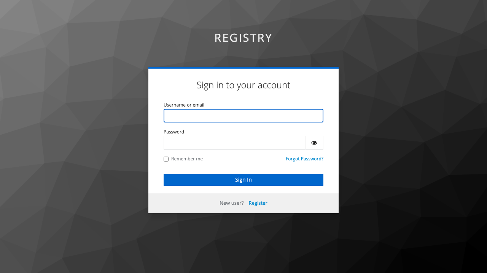
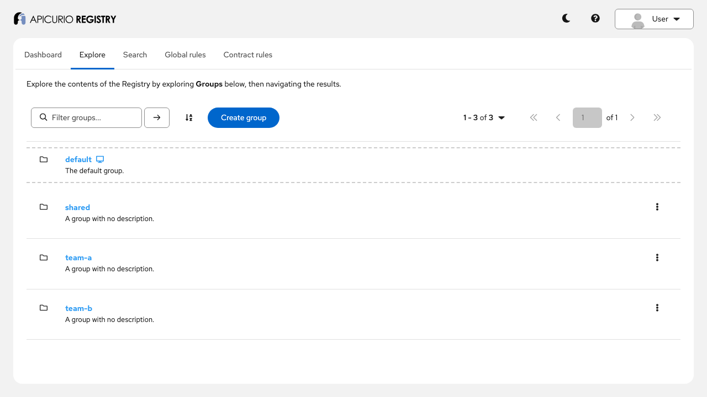
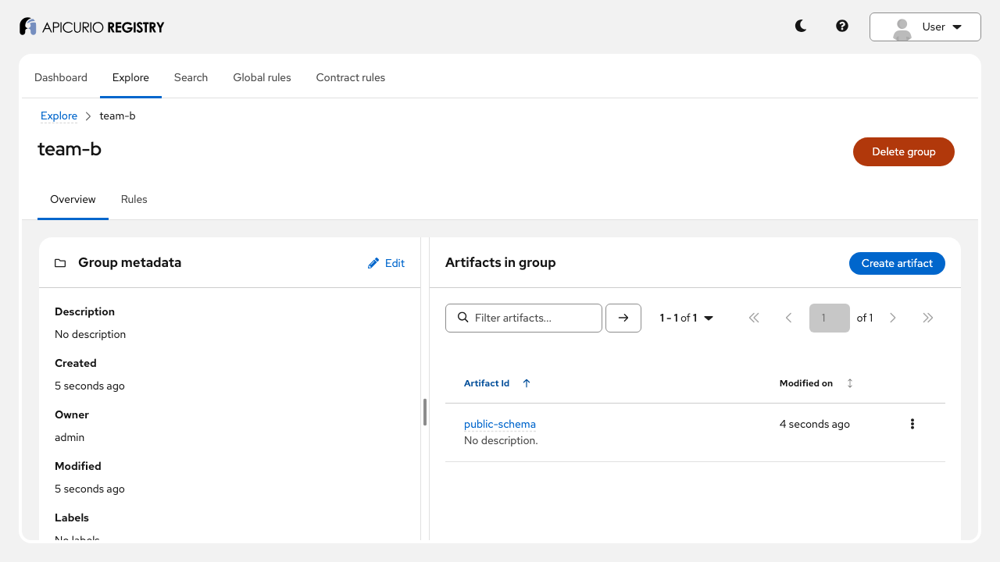
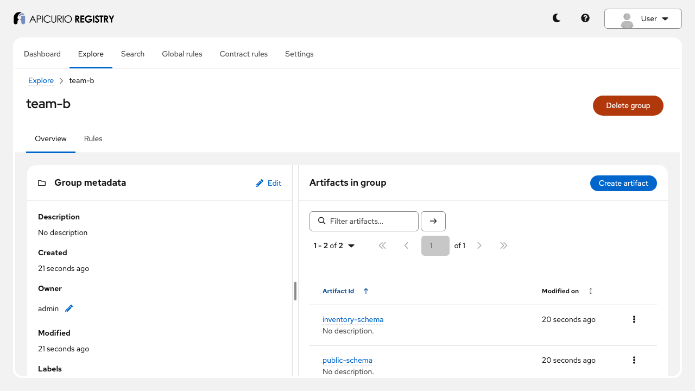
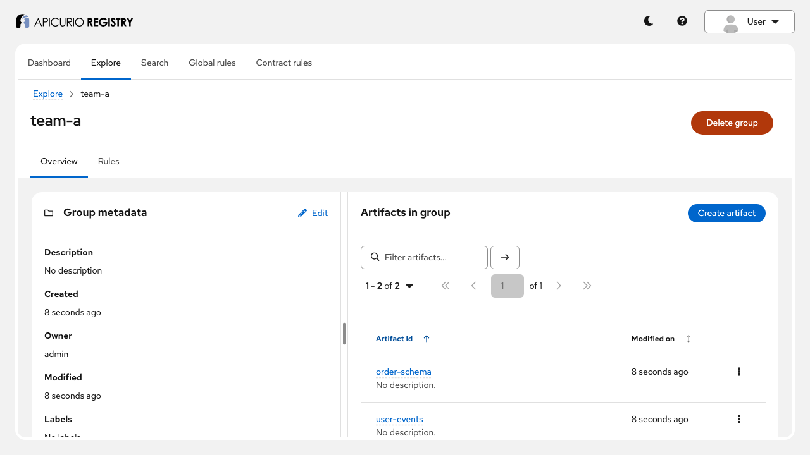
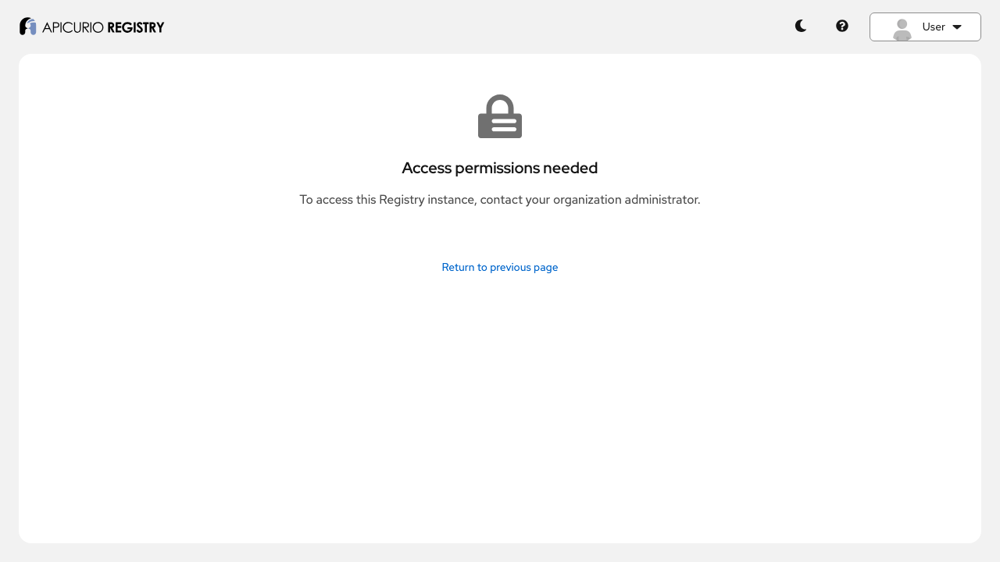
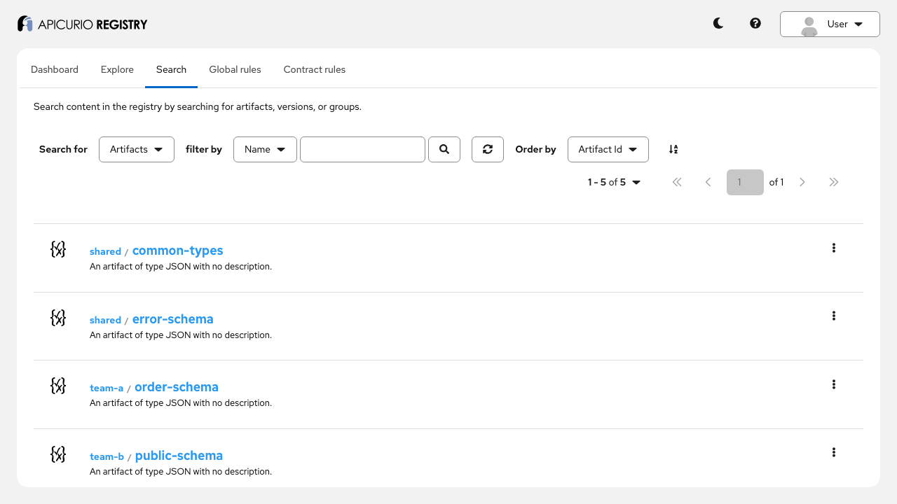
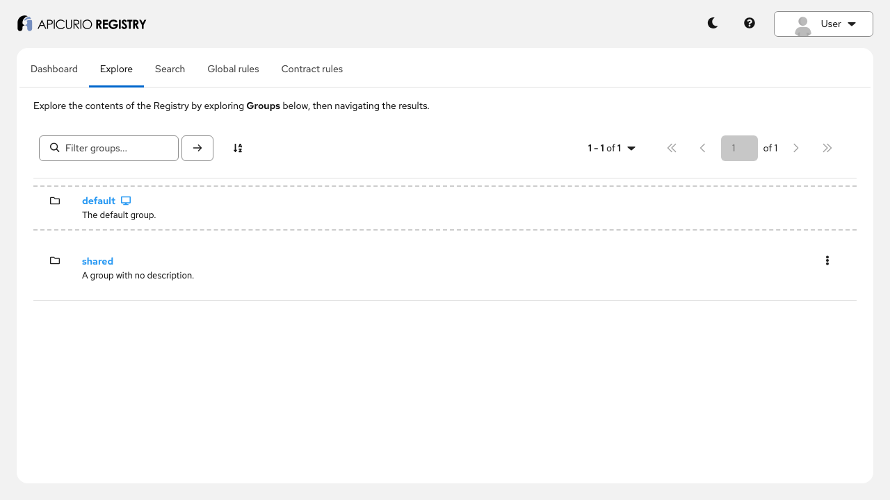
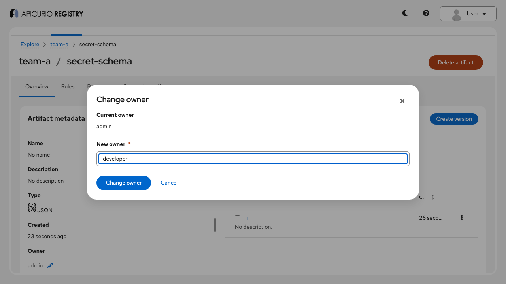
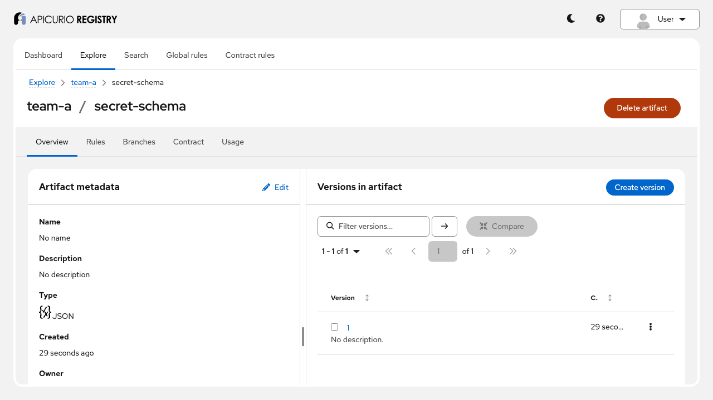

# Per-resource authorization: step-by-step guide

This guide walks through Apicurio Registry's per-resource authorization with a running example:
Keycloak for authentication and roles, and an access rules file for fine-grained access to groups
and artifacts. Follow it on your own, or use it as the script for a live demo. Each step shows the
same behaviour twice: with API commands and their expected output, then **in the UI**, with a
screenshot of what you should see. Every step builds on the previous ones, so run them in order.

**Time:** about 30 minutes. **You will see:**

- how roles (RBAC) and access rules work together, and which one decides what;
- that a deny rule wins over a broader allow;
- that search and list results contain only what a user can read, with correct counts;
- what the `permissions` flags in search results tell a client;
- why an artifact name can be denied even inside a writable group;
- how resource owners and anonymous callers are treated;
- how to change the rules without a restart, and what happens if you break the file;
- where denials are logged.

For the reference documentation, see *Configuring per-resource authorization* in the Registry
documentation ([source](../../docs/modules/ROOT/pages/getting-started/assembly-configuring-resource-authorization.adoc))
and, for how it is implemented, [ADR-0005](../../adr/0005-per-resource-authorization.md).

## Before you start

You need:

- Docker with Docker Compose v2, or Podman with a Compose provider;
- `curl` and `jq`;
- a shell: bash or zsh;
- a browser, for the UI;
- free ports 8080 (Keycloak), 8081 (Registry API) and 8888 (Registry UI). If they are in use, see
  [Using other ports](#using-other-ports).

Run every command from this directory:

```bash
cd examples/per-resource-authorization
```

> **Podman on macOS:** run from a path under your home directory, not under `/tmp`. The `/tmp`
> symlink cannot be shared into the Podman VM, and the registry then fails with
> `Access rules file not found`.

## Step 1: Start the example

```bash
docker compose up -d
```

The first run downloads three images and takes a few minutes. Compose starts Keycloak first and
starts the registry only when Keycloak is ready, so the command returns after about 15 seconds on
later runs. Check that all three containers are up:

```bash
docker compose ps --format '{{.Name}}: {{.Status}}'
```

```
apicurio-registry-api-resource-authz: Up ...
apicurio-registry-ui-resource-authz: Up ...
keycloak-resource-authz: Up ...
```

## Step 2: Create the sample data and check everything works

```bash
./demo.sh
```

`demo.sh` creates three groups and seven artifacts as `admin`, then checks the expected access. It
ends with:

```
All checks passed.
```

The script is safe to run again; it skips data that already exists.

The data, created by `admin` (so `admin` owns every artifact; this matters in step 11):

| Group    | Artifacts                                            |
|----------|------------------------------------------------------|
| `team-a` | `user-events`, `order-schema`, `secret-schema`       |
| `team-b` | `inventory-schema`, `public-schema`                  |
| `shared` | `common-types`, `error-schema`                       |

## Step 3: Load the helper commands

Keep a backup of the rules file, so you can always go back to it, and load the helpers:

```bash
cp access.rules access.rules.orig
source ./demo-env.sh
```

The helpers call the Registry API (`/apis/registry/v3`) as one of the example users, fetching a
Keycloak token for you:

| Command | What it does |
|---|---|
| `status <user> <method> <path> [json]` | prints only the HTTP status |
| `call <user> <method> <path> [json]` | prints the response |
| `visible <user>` | lists the artifacts the user's search returns |
| `denials [n]` | shows the last authorization denials from the audit log |

`<user>` is one of the users below, or `anonymous` for a request without credentials.

**In the UI:** open <http://localhost:8888>. The UI sends you to Keycloak to log in:



To switch user, open the **User** menu at the top right and choose **Logout**, then log in again.
To show two users side by side, use a private browser window for the second one: each window keeps
its own login. The menu always says *User*, whoever is logged in.

## Step 4: Meet the users and the rules

Keycloak authenticates the users and gives each one a Registry role:

| User         | Password    | Registry role  |
|--------------|-------------|----------------|
| `admin`      | `admin`     | `sr-admin`     |
| `developer`  | `developer` | `sr-developer` |
| `developer2` | `developer` | `sr-developer` |
| `user`       | `user`      | `sr-readonly`  |

The role decides **what kind** of operation a user may perform (role-based access control, RBAC):
`sr-readonly` users read, `sr-developer` users read and write, `sr-admin` users do everything. The
access rules decide **on which resources**. Look at them:

```bash
cat access.rules
```

The rules, in the Kroxylicious ACL rules format:

- `developer` may write group `team-a` and every artifact in it, **except** `team-a/secret-schema`,
  which is denied;
- `developer` may read group `team-b` and one artifact in it, `team-b/public-schema`;
- everyone with the `sr-developer` or `sr-readonly` role may read group `shared` and its artifacts;
- unauthenticated callers may read `shared/common-types`;
- `otherwise deny;`: anything not allowed is denied.

A few things to know about the format:

- **Resource names:** artifacts are named `<group>/<artifact>`, for example `team-a/user-events`.
  Groups are named by their ID.
- **Separate rules:** group and artifact rules are independent. Reading a group (its metadata, or
  listing its artifacts) needs a `Group` rule. Reading an artifact needs an `Artifact` rule.
- **Operations:** `WRITE` includes `READ`, and `ADMIN` (or `*`) includes both.
- **Rule order:** deny rules come first, and a matching deny wins over any allow.

`admin` has the `sr-admin` role, and RBAC administrators are not subject to the access rules at
all.

## Step 5: Access to a single artifact

`developer` can read an artifact in `team-a`, but not one in `team-b` that no rule allows:

```bash
status developer GET /groups/team-a/artifacts/user-events
status developer GET /groups/team-b/artifacts/inventory-schema
```

```
200
403
```

The administrator bypasses the rules:

```bash
status admin GET /groups/team-b/artifacts/inventory-schema
```

```
200
```

**In the UI:** log in as `developer`. *Explore* lists the groups `developer` may read: `shared`,
`team-a` and `team-b`. (`default` is always listed; it is the built-in default group, empty here.)



Open `team-b`: it contains only `public-schema`. `inventory-schema` is not listed at all.



Log in as `admin` (in a private window, or after logging out) and open `team-b`: both artifacts are
there.



## Step 6: A deny wins over an allow

`team-a/secret-schema` matches `developer`'s allow on `team-a/*`, and a deny for exactly that name:

```bash
status developer GET /groups/team-a/artifacts/secret-schema
```

```
403
```

Every denial by the access rules is written to the audit log, with the user, operation and the
exact resource name that was evaluated:

```bash
denials 2
```

```
... authz.denied user="developer" operation="read" resource_type="artifact" resource="team-b/inventory-schema"
... authz.denied user="developer" operation="read" resource_type="artifact" resource="team-a/secret-schema"
```

**In the UI:** as `developer`, open `team-a`: `secret-schema` is not in the list.



Go to it directly, at <http://localhost:8888/explore/team-a/secret-schema>. The registry refuses
the request, and the UI shows:



## Step 7: Search shows only what you can read

Each user's search returns exactly what they can read. Filtering happens in the storage query, so
page sizes and total counts are correct:

```bash
visible developer
call developer GET /search/artifacts | jq .count
call admin GET /search/artifacts | jq .count
```

```
shared/common-types
shared/error-schema
team-a/order-schema
team-a/user-events
team-b/public-schema
5
7
```

`team-a/secret-schema` and `team-b/inventory-schema` are missing for `developer`, and the count says
5, not 7.

**In the UI:** as `developer`, open the *Search* tab. It finds 5 artifacts, and says so: `1 - 5 of 5`.
The UI paginates over the filtered results, so no page has gaps.



## Step 8: Same role, different access

`developer2` has the same role as `developer`, but no rule names them, so only the role rule for
`shared` applies:

```bash
visible developer2
```

```
shared/common-types
shared/error-schema
```

The role says *what kind* of operation; the rules say *where*.

**In the UI:** log in as `developer2` (password `developer`). *Explore* lists only `shared` (and
`default`), although `developer2` has the same role as `developer`.

## Step 9: Roles and rules both apply

A request must pass both the role check and the rules. Try a write as `user`, whose role is
read-only, and as `developer`, whose role allows writes but whose rules only allow reading
`shared`:

```bash
status user PUT /groups/shared/artifacts/common-types '{"description":"edited"}'
status developer PUT /groups/shared/artifacts/common-types '{"description":"edited"}'
denials 1
```

```
403
403
... authz.denied user="developer" operation="write" resource_type="artifact" resource="shared/common-types"
```

Both are refused, at different layers: RBAC refuses `user` before the access rules are consulted
(so there is no `authz.denied` entry), and the access rules refuse `developer`. A rule can never
give a read-only role write access.

**In the UI:** log in as `user`. Only `shared` is listed, and there is no *Create group* button:
the UI hides actions that the user's role does not allow.



`developer`'s role does allow writes, so the UI offers *Edit* on `shared/common-types`. Try it as
`developer`: change the description and save. The registry refuses the change, and the UI shows the
*Access permissions needed* page from step 6.

## Step 10: What can I do with this? The `permissions` flags

With per-resource authorization enabled, each search and list result says what the caller may do
with it, so a client can hide actions that would fail:

```bash
call developer GET /search/artifacts | jq -c '.artifacts[] | {artifact: "\(.groupId)/\(.artifactId)", permissions}'
```

```
{"artifact":"shared/common-types","permissions":{"read":true,"write":false,"admin":false}}
{"artifact":"shared/error-schema","permissions":{"read":true,"write":false,"admin":false}}
{"artifact":"team-a/order-schema","permissions":{"read":true,"write":true,"admin":false}}
{"artifact":"team-b/public-schema","permissions":{"read":true,"write":false,"admin":false}}
{"artifact":"team-a/user-events","permissions":{"read":true,"write":true,"admin":false}}
```

Groups have them too:

```bash
call developer GET '/search/groups?limit=100' | jq -c '.groups[] | {group: .groupId, permissions}'
```

```
{"group":"shared","permissions":{"read":true,"write":false,"admin":false}}
{"group":"team-a","permissions":{"read":true,"write":true,"admin":false}}
{"group":"team-b","permissions":{"read":true,"write":false,"admin":false}}
```

`admin` is `false` everywhere: `developer`'s role does not allow administration. The flags are
hints, not permissions: every request is still checked on its own.

**In the UI:** the UI does not use the `permissions` flags yet. On `team-b`, it still offers
`developer` *Edit*, *Create artifact* and *Delete group*, which the registry then refuses. The flags
are what lets a client hide them.

## Step 11: Names are checked when you create, and owners bypass the rules

`developer` can write in `team-a`, so creating a new artifact there works, and `developer` becomes
its owner:

```bash
status developer POST /groups/team-a/artifacts '{"artifactId":"payment-events","artifactType":"JSON","firstVersion":{"content":{"content":"{\"type\":\"object\"}","contentType":"application/json"}}}'
call developer GET /groups/team-a/artifacts/payment-events | jq -c '{artifactId, owner}'
```

```
200
{"artifactId":"payment-events","owner":"developer"}
```

Creating an artifact named `secret-schema` is refused, even though the group is writable. Creation
is checked against the new artifact's name too: otherwise `developer` could create the denied
artifact, become its owner, and get around the deny.

```bash
status developer POST /groups/team-a/artifacts '{"artifactId":"secret-schema","artifactType":"JSON"}'
```

```
403
```

Why would ownership matter? By default, **the owner of a resource bypasses the access rules** for
it. Watch what happens when `admin` gives `team-a/secret-schema` to `developer`. With the API:

```bash
call admin PUT /groups/team-a/artifacts/secret-schema '{"owner":"developer"}'
status developer GET /groups/team-a/artifacts/secret-schema
```

```
200
```

The deny no longer applies to its new owner. If deny rules must apply to owners too, set
`apicurio.auth.resource-based-authorization.owner-bypass.enabled=false`. Put things back, and
delete the artifact you created:

```bash
call admin PUT /groups/team-a/artifacts/secret-schema '{"owner":"admin"}'
status developer GET /groups/team-a/artifacts/secret-schema
status developer DELETE /groups/team-a/artifacts/payment-events
```

```
403
204
```

**In the UI:** the same, by hand. As `admin`, open `team-a/secret-schema` and click the pencil next
to *Owner*. Enter `developer`, and click *Change owner*:



As `developer`, reload `team-a/secret-schema`: the page that was refused in step 6 now opens.



Change the owner back to `admin` the same way, and the page is refused again.

## Step 12: Anonymous access is opt-in, resource by resource

The example enables anonymous reads, but unauthenticated callers only get what the rules allow to
the `$anonymous` role:

```bash
status anonymous GET /groups/shared/artifacts/common-types
status anonymous GET /groups/shared/artifacts/error-schema
```

```
200
401
```

**In the UI:** the UI always asks for a login, so anonymous access is only visible through the API.

## Step 13: Change the rules without a restart

The registry checks `access.rules` for changes every 5 seconds. Give `developer` read access to all
of `team-b` by adding a rule before `otherwise deny;`:

```bash
status developer GET /groups/team-b/artifacts/inventory-schema
sed -i.bak 's|^otherwise deny;|allow User with name = "developer" to READ Artifact with name like "team-b/*";\
otherwise deny;|' access.rules
```

```
403
```

You can also edit the file in an editor instead. Wait about 10 seconds, then:

```bash
status developer GET /groups/team-b/artifacts/inventory-schema
docker logs apicurio-registry-api-resource-authz 2>&1 | grep 'Access rules' | tail -1
```

```
200
... Access rules reloaded successfully.
```

**In the UI:** as `developer`, reload `team-b`: `inventory-schema` is now listed too.


Now break the file: remove the semicolon after `otherwise deny`. Wait about 10 seconds:

```bash
sed -i.bak 's|^otherwise deny;|otherwise deny|' access.rules
sleep 10
docker logs apicurio-registry-api-resource-authz 2>&1 | grep -A1 'Failed to reload' | tail -2
status developer GET /groups/team-b/artifacts/inventory-schema
```

```
... Failed to reload access rules file /opt/apicurio/authz/access.rules; keeping the previous rules: Invalid access rules file: Found 1 syntax errors
23:0: missing ';' at '<EOF>'.
200
```

The registry refuses an invalid file and keeps the last valid rules, so a bad edit never locks
everyone out (or lets everyone in). The error gives the line and column of the problem. Restore the original
rules:

```bash
cp access.rules.orig access.rules
rm -f access.rules.bak
sleep 10
status developer GET /groups/team-b/artifacts/inventory-schema
```

```
403
```

Reload `team-b` in the UI: `inventory-schema` is gone again.

Rules must all come before `otherwise deny;`. Nothing after it ever applies.

## Step 14: Clean up

```bash
docker compose down -v
rm -f access.rules.orig
```

## Presenter notes

- **Before the session:** run steps 1 to 3 in advance, so the images are downloaded and the data
  exists. Keep a terminal with `source ./demo-env.sh` already loaded, a second one tailing the
  audit log (`docker logs -f apicurio-registry-api-resource-authz 2>&1 | grep authz.denied`), and
  two browser windows side by side: a normal one logged in as `developer`, and a private one
  logged in as `admin`. Every UI step then needs only a click or a reload.
- **API or UI first?** For an audience of users, lead with the UI and use the API commands to show
  the counts and the audit log. For developers, do the opposite.
- **The story in one sentence per step:** roles say what kind of operation; rules say where (4, 8);
  a deny wins (6); search is filtered in the query, so counts are right (7); both layers apply,
  and only rule denials reach the audit log (9); results tell the client what it can do (10);
  creation checks the name, and owners bypass the rules (11); anonymous access is explicit (12);
  rules reload live, and a broken file is refused (13).
  The UI shows each of these, except anonymous access (12) and the `permissions` flags (10).
- **Questions that usually come up:**
  - *Does a group rule give access to the artifacts in the group?* No. Group and artifact rules
    are independent (step 4).
  - *Can rules give more than the role?* No. Without RBAC enabled, the rules alone decide, but
    with RBAC both must allow (step 9).
  - *Where is the policy stored?* In a file, so it can be versioned in Git or mounted from a
    Kubernetes ConfigMap (mount the ConfigMap as a directory, not with `subPath`). Each registry
    replica reads its own copy.
  - *What about regular expressions?* `matching /regex/` works for direct access, but search
    cannot use it. Use `=`, `in` or `like` for anything that must show up in search.
- **To reset between runs:** `docker compose down -v`, `cp access.rules.orig access.rules`, then
  steps 1 to 3 again.

## Troubleshooting

| Symptom | What to do |
|---|---|
| `Access rules file not found` in the registry log | With Podman on macOS, run from a path under your home directory, not `/tmp`. |
| `docker compose up` waits, then fails on Keycloak | Check `docker logs keycloak-resource-authz`. Usually a port conflict: see [Using other ports](#using-other-ports). |
| Helper commands print nothing, or `jq: error` | Check that `curl` and `jq` are installed, and that you ran `source ./demo-env.sh` in the current shell. |
| A rule change has no effect | Wait for the next check (5 seconds). Look for `Failed to reload` in the registry log: an invalid file is not applied. |
| Different counts than in this guide | You may have run some steps twice, or skipped the clean-up in step 11. Reset with `docker compose down -v` and start again. |

## Using other ports

If ports 8080, 8081 or 8888 are in use, choose others, and tell both Compose and the helpers:

```bash
export KEYCLOAK_PORT=18080 REGISTRY_PORT=18081 UI_PORT=18888
docker compose up -d
KEYCLOAK=http://localhost:$KEYCLOAK_PORT API=http://localhost:$REGISTRY_PORT/apis ./demo.sh
export KEYCLOAK=http://localhost:$KEYCLOAK_PORT API=http://localhost:$REGISTRY_PORT/apis
source ./demo-env.sh
```

The UI is then at `http://localhost:18888`.
