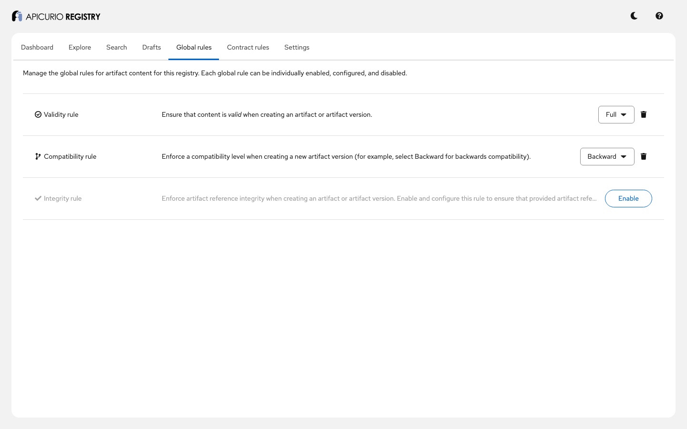
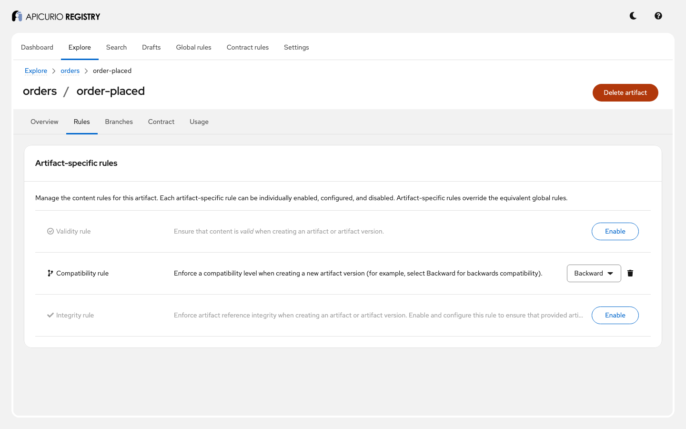
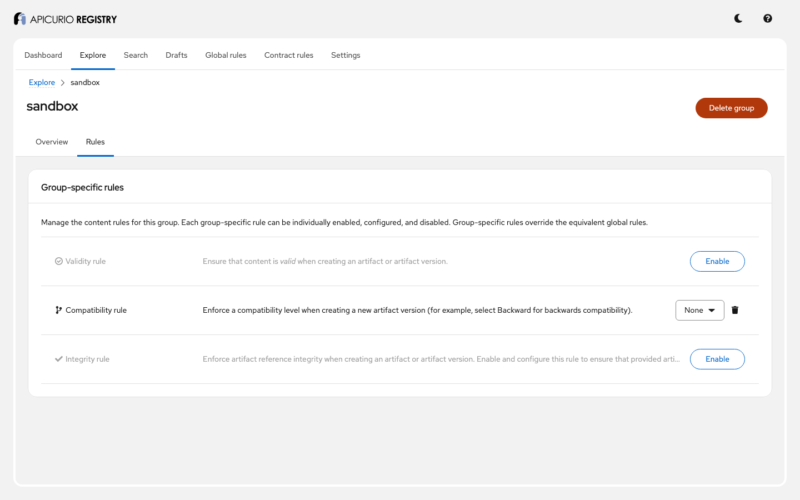
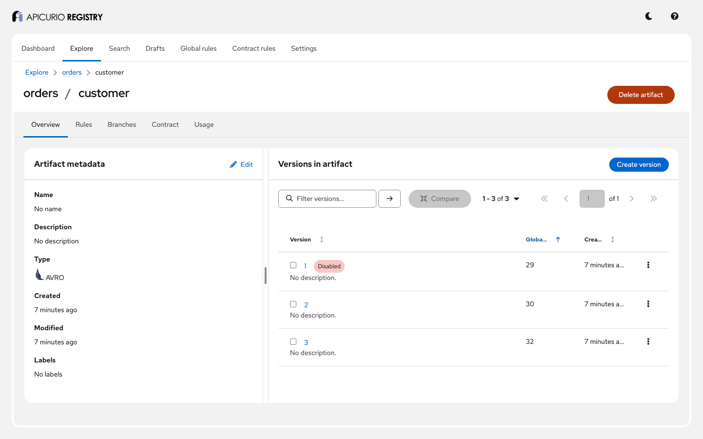
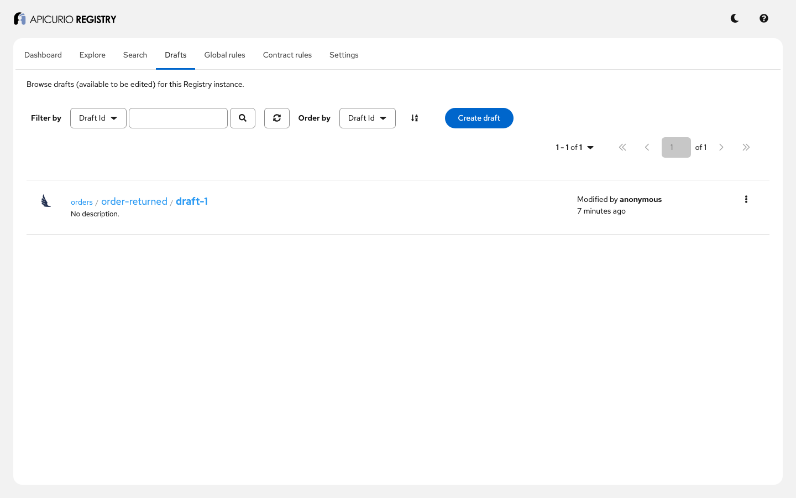
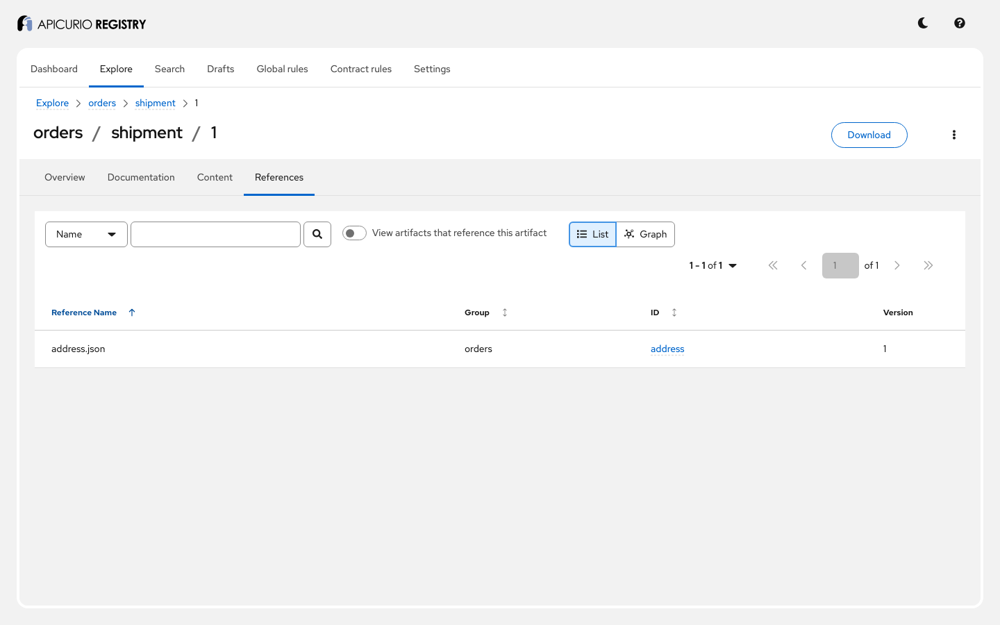

# Rules and compatibility: step-by-step guide

This guide walks through Apicurio Registry's content rules with a running example: what each rule
checks, which rule applies when several are configured, and what a client gets back when a change is
rejected. Follow it on your own, or use it as the script for a live demo. Every step builds on the
previous ones, so run them in order.

**Time:** about 30 minutes. **You will see:**

- that a validity rule rejects content that is not valid, and what the error looks like;
- the difference between BACKWARD and FORWARD compatibility;
- that the most specific rule wins, for each rule type separately;
- how a dry run checks a change without saving it;
- which earlier versions a transitive rule compares with, and how deprecating or disabling a version
  changes that;
- that drafts skip the rules until they are published;
- how an integrity rule checks references;
- how a client can validate data, not schemas, against a schema in the registry.

For the reference documentation, see *Introduction to registry rules* in the Registry documentation
([source](../../docs/modules/ROOT/pages/getting-started/assembly-intro-to-registry-rules.adoc)) and,
for how it is implemented, [ADR-0006](../../adr/0006-rules-engine.md).

## Before you start

You need:

- Docker with Docker Compose v2, or Podman with a Compose provider;
- `curl` and `jq`;
- a shell: bash or zsh;
- a browser, for the UI;
- for step 13 only: Java 17 or later, and the registry built from this checkout;
- free ports 8081 (Registry API) and 8888 (Registry UI). If they are in use, see
  [Using other ports](#using-other-ports).

Run every command from this directory:

```bash
cd examples/rules-and-compatibility
```

## Step 1: Start the example

```bash
docker compose up -d
docker compose ps --format '{{.Name}}: {{.Status}}'
```

```
apicurio-registry-api-rules: Up ... (healthy)
apicurio-registry-ui-rules: Up ...
```

## Step 2: Create the sample data and check everything works

```bash
./demo.sh
```

The script runs every step below and checks the result. It ends with:

```
All checks passed.
```

It is safe to run again: it starts by deleting the groups `orders` and `sandbox` and the global
rules, then creates them again. The schemas it uses are in [`schemas/`](schemas).

## Step 3: Load the helper commands

```bash
source ./demo-env.sh
```

`call` prints a response and `status` prints only its HTTP status. Paths are relative to
`/apis/registry/v3`. The next steps use two more shell functions, to send a schema file:

```bash
version() { jq -n --rawfile c "schemas/$1" '{content: {content: $c, contentType: "application/json"}}'; }
artifact() { jq -n --arg a "$1" --arg t "$2" --rawfile c "schemas/$3" \
  '{artifactId: $a, artifactType: $t, firstVersion: {content: {content: $c, contentType: "application/json"}}}'; }
```

## Step 4: A validity rule rejects content that is not valid

There are three rule types: **validity** (is the content well formed and a valid schema?),
**compatibility** (can it replace the earlier versions?) and **integrity** (are its references
right?). With no rule at all, the registry stores anything. [`schemas/invalid.json`](schemas/invalid.json)
is missing its closing brace; `demo.sh` showed that it is accepted without a rule, then added a global
rule:

```bash
call POST /admin/rules '{"ruleType": "VALIDITY", "config": "FULL"}'
call POST /groups/sandbox/artifacts "$(artifact broken JSON invalid.json)"
```

```json
{
  "status": 400,
  "name": "RuleViolationException",
  "ruleViolation": {
    "ruleType": "VALIDITY",
    "causes": [
      { "description": "JSON schema not valid: Unexpected end-of-input: expected close marker for Object ...", "context": "" }
    ]
  },
  ...
}
```

Every rule violation has this shape: **HTTP 400**, `ruleViolation.ruleType` says which rule, and each
entry of `ruleViolation.causes` has a `description` and a `context` (here, where in the document).
Nothing is saved. Older clients may expect 409: set `apicurio.rest.legacy-error-codes.enabled=true`
to get it.

**In the UI:** open **Global rules**. Validity is set to *Full*, and compatibility (step 7) to
*Backward*.



## Step 5: BACKWARD: new readers must read old data

`orders/order-placed` has one version with an `orderId`, and an artifact rule
`COMPATIBILITY=BACKWARD`. Version 2 adds an `amount` with no default:

```bash
call POST /groups/orders/artifacts/order-placed/versions "$(version order-placed-v2-no-default.avsc)" \
  | jq -c '.ruleViolation'
```

```json
{"causes":[{"description":"amount","context":"/fields/1"}],"ruleType":"COMPATIBILITY"}
```

A consumer using version 2 could not read an event written with version 1: it has no `amount`, and
the new schema gives no default. With a default, the same change is accepted:

```bash
status POST /groups/orders/artifacts/order-placed/versions "$(version order-placed-v2.avsc)"   # 200
```

BACKWARD is what you want when consumers upgrade first: Kafka consumers on the new schema keep
reading the topic's older events.

**In the UI:** open **Explore** > `orders` > `order-placed` > **Rules**.



## Step 6: FORWARD: old readers must read new data

`orders/order-cancelled` has `COMPATIBILITY=FORWARD`, the mirror image. Adding a required field
without a default is now **accepted** (old consumers ignore the field), but removing a field that old
consumers need is rejected:

```bash
status POST /groups/orders/artifacts/order-cancelled/versions "$(version order-cancelled-add-field.avsc)"     # 200 (already done by demo.sh)
status POST /groups/orders/artifacts/order-cancelled/versions "$(version order-cancelled-remove-field.avsc)"  # 400
```

FORWARD suits producers that upgrade first. `FULL` requires both directions. Each level has a
`_TRANSITIVE` variant (step 9), and `NONE` switches the check off.

## Step 7: The most specific rule wins, for each rule type

Rules can be set on the whole registry (global), on a group, and on an artifact. For each rule type,
the registry uses the **first** rule it finds: artifact, then group, then global, then the default
global rules from configuration (`apicurio.rules.global.compatibility=BACKWARD`, and so on). `demo.sh`
set:

| Where | Rule |
|---|---|
| global | `VALIDITY=FULL`, `COMPATIBILITY=BACKWARD` |
| group `sandbox` | `COMPATIBILITY=NONE` |
| artifact `orders/order-paid` | `COMPATIBILITY=NONE` (after the first check) |

The same incompatible change (a field without a default) then gives:

| Artifact | Compatibility rule used | Result |
|---|---|---|
| `orders/order-paid`, before its artifact rule | global `BACKWARD` | 400 |
| `sandbox/order-paid` | group `NONE` | 200 |
| `orders/order-paid`, after its artifact rule | artifact `NONE` | 200 |

The choice is made **per rule type**: the group rule of `sandbox` only covers compatibility, so the
global validity rule still applies there, which is why step 4's invalid schema was rejected in
`sandbox`.

When an artifact is **created**, it has no artifact rules yet, so its first version is checked
against the group and global rules only.

**In the UI:** open **Explore** > `sandbox` > **Rules**: compatibility is *None*, the other two are
not set, so they come from the global rules.



## Step 8: A dry run checks a change without saving it

Add `dryRun=true` to check a version before publishing it, for example in a build pipeline. The rules
run exactly as for a real request; only the save is skipped:

```bash
status POST "/groups/orders/artifacts/order-placed/versions?dryRun=true" "$(version order-placed-id-as-number.avsc)"  # 400
status POST "/groups/orders/artifacts/order-placed/versions?dryRun=true" "$(version order-placed-v2.avsc)"            # 200
call GET /groups/orders/artifacts/order-placed/versions | jq .count                                                    # 2
```

## Step 9: Which versions are compared

`orders/customer` has three schemas:

| Version | Fields |
|---|---|
| 1 | `customerId` |
| 2 | `customerId`, `tier` with default `"basic"` |
| 3 (proposed) | `customerId`, `tier` **without** a default |

Version 3 can read version 2's data (it has a `tier`), but not version 1's.

- `BACKWARD` compares with the **latest** version only, so version 3 passes.
- `BACKWARD_TRANSITIVE` compares with **every** version, so version 3 is rejected because of version 1.

Which versions count? Every version that is **not `DISABLED`**. A `DEPRECATED` version still counts:
deprecating version 1 does not let version 3 in. Disabling it does:

```bash
call PUT /groups/orders/artifacts/customer/versions/1/state '{"state": "DISABLED"}'
status POST /groups/orders/artifacts/customer/versions "$(version customer-v3.avsc)"   # 200 (already done by demo.sh)
```

**In the UI:** open **Explore** > `orders` > `customer`. Version 1 is marked *Disabled*.



## Step 10: Drafts skip the rules until they are published

A draft is a version that is still being worked on. It is saved **without** running the rules, and
the rules run when it is published (moved out of `DRAFT`):

```bash
call GET /groups/orders/artifacts/order-returned/versions/draft-1 | jq -r .state     # DRAFT: saved although incompatible
call PUT /groups/orders/artifacts/order-returned/versions/draft-1/state '{"state": "ENABLED"}' \
  | jq -r .ruleViolation.ruleType                                                      # COMPATIBILITY: not published
```

`order-returned` uses `BACKWARD_TRANSITIVE`. With a non-transitive rule, publishing currently
compares the draft with itself and lets it through:
[#11001](https://github.com/Apicurio/apicurio-registry/issues/11001).

**In the UI:** open **Drafts**: `draft-1` is still listed.



## Step 11: An integrity rule checks references

A schema can reference other artifacts. [`schemas/shipment.json`](schemas/shipment.json) uses
`"$ref": "address.json"`, and the request maps that name to the artifact `orders/address`, version 1.
With the group rule `INTEGRITY=FULL`, creating `shipment` before `address` exists is rejected:

```json
{"ruleType": "INTEGRITY", "causes": [{"description": "Referenced artifact (orders/address @ 1) does not yet exist in the registry.", "context": "address.json"}]}
```

`context` is the reference name. Once `orders/address` exists, the same request is accepted. `FULL`
combines `REFS_EXIST`, `ALL_REFS_MAPPED` (every reference in the content has a mapping),
`NO_DUPLICATES` and `NO_CIRCULAR_REFERENCES`; integrity takes one or several of them, separated by
commas.

**In the UI:** open **Explore** > `orders` > `shipment` > version 1 > **References**.



## Step 12: The rules in effect

```bash
call GET /admin/rules            # ["COMPATIBILITY", "VALIDITY"]
call GET /groups/orders/rules    # ["INTEGRITY"]
call GET /groups/orders/artifacts/customer/rules/COMPATIBILITY
```

Rules are checked when content is written, not when it is read: changing a rule never changes or
rejects versions that are already stored.

## Step 13: Validate data on the client

Rules check **schemas** when they are registered. To check **data** against a schema before sending
it, use the client-side validation library: it fetches the schema from the registry, caches it, and
validates payloads locally. [`validation-client/`](validation-client) registers a JSON Schema and an
Avro schema in the group `validation` and validates a few payloads against them.

It uses the library built from this checkout. Build it once, from the repository root:

```bash
../../mvnw install -Pexamples -pl examples/rules-and-compatibility/validation-client -am -DskipTests -f ../../pom.xml
```

Then run it:

```bash
../../mvnw -q exec:java -f validation-client -Dregistry.url=http://localhost:8081/apis/registry/v3
```

```
JSON Schema (validation/order-json):
  ok    a valid order                                 valid
  ok    a quantity of 0 (minimum is 1)                invalid: $.quantity: must have a minimum value of 1
  ok    no quantity (required)                        invalid: $: required property 'quantity' not found
Avro (validation/order-avro):
  ok    a valid order                                 valid
  ok    an amount that is not a number                invalid: Expected double. Got END_OBJECT
All validation checks passed.
```

The library has modules for JSON Schema, Avro and Protobuf (`apicurio-registry-schema-validation-*`).

## Step 14: Clean up

```bash
docker compose down -v
```

## Presenter notes

- **Before the session:** run steps 1 to 3 in advance, so the images are downloaded and the data
  exists. Keep the UI open on **Global rules**.
- **The story in one sentence per step:** validity rejects broken content, with a structured error
  (4); BACKWARD protects consumers (5) and FORWARD producers (6); the most specific rule wins, per
  rule type (7); a dry run checks without saving (8); transitive rules compare with every version
  that is not disabled (9); drafts are checked when published (10); integrity checks references
  (11); rules check writes, never stored data (12); data is checked on the client (13).
- **Questions that usually come up:**
  - *Which rules apply if I set none?* None: the registry accepts anything, unless default global
    rules are configured (`apicurio.rules.global.*`).
  - *Does deprecating a version exclude it from compatibility checks?* No, only disabling does
    (step 9).
  - *Do Kafka serializers check compatibility?* Not on their own: the registry does, when the
    serializer registers a schema (auto-register).
  - *What does the Confluent-compatible API return?* 422 (`42201`) for validity, 409 for the
    other rules.
- **To reset between runs:** `./demo.sh` resets the data itself; `docker compose down -v` starts from
  scratch.

## Troubleshooting

| Symptom | What to do |
|---|---|
| `demo.sh` times out waiting for the Registry | Check `docker logs apicurio-registry-api-rules`. Usually a port conflict: see [Using other ports](#using-other-ports). |
| Helper commands print nothing, or `jq: error` | Check that `curl` and `jq` are installed, and that you ran `source ./demo-env.sh` in the current shell. |
| Every write to an artifact returns 500 after changing a rule | The rule config is not a valid level, and is not checked when saved: [#11000](https://github.com/Apicurio/apicurio-registry/issues/11000). Set a valid value. |
| Step 13 cannot find `apicurio-registry-schema-validation-*` | Build it first, from the repository root (step 13). |

## Using other ports

If ports 8081 or 8888 are in use, choose others, and tell both Compose and the helpers:

```bash
export REGISTRY_PORT=18081 UI_PORT=18888
docker compose up -d
API=http://localhost:$REGISTRY_PORT/apis ./demo.sh
export API=http://localhost:$REGISTRY_PORT/apis
source ./demo-env.sh
```

The UI is then at `http://localhost:18888`, and step 13 uses
`-Dregistry.url=http://localhost:18081/apis/registry/v3`.
