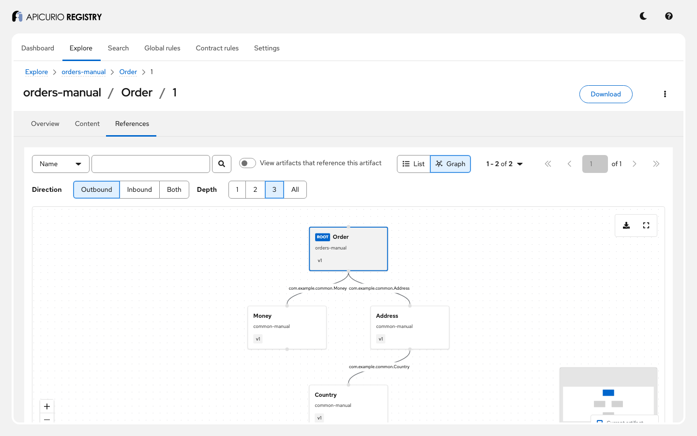
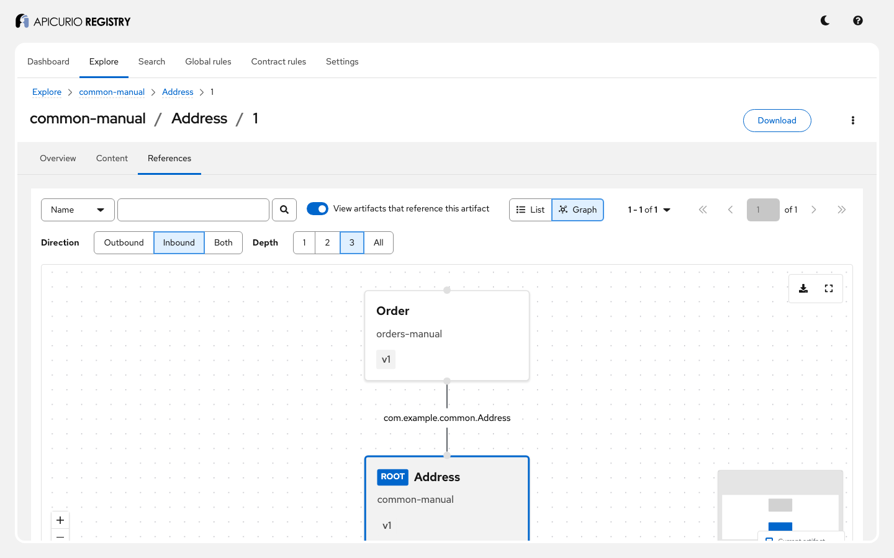
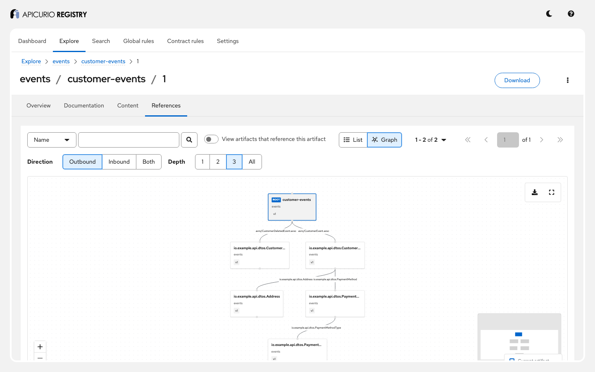

# Schema references: step-by-step guide

This guide walks through artifact references in Apicurio Registry with a running example: schemas
that use types defined in other schemas, registered by the Maven plugin (with the references spelled
out, or found automatically) and by Kafka serializers. You will see how the registry stores,
lists and resolves references, how they affect the identity of content, and what integrity rules and
deletion do to them. Follow it on your own, or use it as the script for a live demo.

**Time:** about 30 minutes. **You will see:**

- references spelled out in the Maven plugin, and found automatically for Avro, JSON Schema and
  AsyncAPI;
- outbound and inbound references, and the reference graph in the UI;
- reading content as stored, with references inlined, or with references rewritten as URLs;
- that references are part of a schema's identity, and how canonical matching works;
- integrity rules for references, and what happens when a referenced artifact is disabled or deleted;
- Kafka serializers registering nested Avro types and Protobuf imports as references.

For the reference documentation, see *Artifact references* in the Registry documentation
([source](../../docs/modules/ROOT/pages/getting-started/assembly-artifact-reference.adoc)) and, for how
references are implemented, [ADR-0008](../../adr/0008-artifact-references.md).

## Before you start

You need:

- Docker with Docker Compose v2, or Podman with a Compose provider;
- `curl`, `jq`, and JDK 21 or later (`demo.sh` builds the Maven plugin and the serdes client from
  this checkout, because snapshots are not published);
- a shell (bash or zsh) and a browser;
- free ports 9092 (Kafka), 8081 (Registry API) and 8888 (Registry UI); see
  [Using other ports](#using-other-ports).

Run every command from this directory:

```bash
cd examples/schema-references
```

## Step 1: Start the example

```bash
docker compose up -d
```

## Step 2: Register the schemas and check everything works

```bash
./demo.sh
```

The first run builds the Maven plugin and the serdes client with [`build.sh`](build.sh) (a few
minutes). `demo.sh` then deletes the example's data, runs every step below and checks it. It ends
with `All checks passed.`

## Step 3: The schemas

[`registration/schemas/avro`](registration/schemas/avro) holds four Avro schemas that use each
other's types:

| Schema | Uses |
|---|---|
| `Order` | `com.example.common.Money`, `com.example.common.Address` |
| `Address` | `com.example.common.Country` |
| `Money`, `Country` | nothing |

`Order.avsc` does not contain `Money`: it only names it. A **reference** tells the registry which
artifact version provides that name: `{name, groupId, artifactId, version}`. The `name` is how the
schema refers to the other one: for Avro the full type name, for JSON Schema and AsyncAPI the `$ref`
value, for Protobuf the imported file.

To call the API yourself:

```bash
source ./demo-env.sh
```

## Step 4: References spelled out

The `avro-manual` execution in [`registration/pom.xml`](registration/pom.xml) registers `Order` with
nested `<references>`: each one is itself an artifact to register, with its own references. The
plugin registers the leaves first (`Country`, then `Address` and `Money`), then `Order` pointing at
them:

```bash
call GET /groups/orders-manual/artifacts/Order/versions/1/references
```

```json
[
  {"groupId": "common-manual", "artifactId": "Money", "version": "1", "name": "com.example.common.Money"},
  {"groupId": "common-manual", "artifactId": "Address", "version": "1", "name": "com.example.common.Address"}
]
```

A reference always names an exact version: it does not follow `latest`. Add `refType=INBOUND` to see
who references a version: `common-manual/Address` version 1 is used by `orders-manual/Order`.

**In the UI:** open **Explore** > `orders-manual` > `Order` > version 1 > **References**, then
**Graph**: the whole tree, with each edge labelled with the reference name. (`Money` is still drawn
after `demo.sh` deletes it in step 10.)



Switch on **View artifacts that reference this artifact** on `Address` to see the inbound side:



## Step 5: References found automatically

Spelling out every reference is tedious. With `<autoRefs>true</autoRefs>`, the plugin reads the
schema, finds what it uses, and registers those files first:

| Execution | Schema | Found |
|---|---|---|
| `avro-auto` | `Order.avsc` | `Money`, `Address`, and `Country` inside `Address`, each in a group named after its namespace (`com.example.common`) |
| `json-auto` | [`customer.json`](registration/schemas/json/customer.json) | `address.json` (once, though it is used twice), and `country.json` inside it |
| `asyncapi-auto` | [`customers.yml`](registration/schemas/asyncapi/customers.yml) | the two Avro payloads of its messages, and their own Avro types |

An AsyncAPI document can reference Avro: references cross artifact types.



## Step 6: Reading content with its references

`GET .../versions/{v}/content` and `GET /ids/globalIds/{id}` take a `references` parameter:

| Value | Result |
|---|---|
| `PRESERVE` (default) | The content as registered: `Order`'s `total` field has the type `"com.example.common.Money"` |
| `DEREFERENCE` | Every referenced schema inlined, all the way down: `total` is the `Money` record, and `Address` contains the `Country` enum |
| `REWRITE` | Each reference replaced by the registry URL of its content; for JSON Schema, `"$ref": ".../groups/customers/artifacts/address.json/versions/1/content?references=REWRITE"` |

```bash
call GET "/groups/orders-manual/artifacts/Order/versions/1/content?references=DEREFERENCE"
```

Support depends on the type: Avro and Protobuf cannot be rewritten (400), XSD and WSDL cannot be
dereferenced. The default can be changed with `apicurio.rest.artifact.references.default-handling`.

## Step 7: References are part of the content's identity

`orders-manual/Order` and `com.example.orders/Order` have the same text, `Order.avsc`, but their
references point at different artifacts. They get **different content IDs**: the hashes the registry
computes include the references. That keeps a content ID meaningful: it always means the same text
with the same dependencies.

A schema without references is found by the SHA-256 of its text:

```bash
call GET /ids/contentHashes/$(shasum -a 256 registration/schemas/avro/Money.avsc | cut -d' ' -f1)
```

## Step 8: Canonical matching

`Money.avsc` reformatted onto one line is a different text, so a different content hash. With
`ifExists=FIND_OR_CREATE_VERSION&canonical=true`, the registry compares the **canonical** form
(formatting and key order normalized, per type), finds version 1, and creates nothing. Without
`canonical`, the same request creates version 2.

## Step 9: Integrity rules for references

On a group with `INTEGRITY=FULL`:

- a reference to an artifact version that does not exist is rejected (`REFS_EXIST`);
- a `$ref` with no reference mapping is rejected (`ALL_REFS_MAPPED`);
- duplicate names and cycles are rejected too (`NO_DUPLICATES`, `NO_CIRCULAR_REFERENCES`).

Without a rule, `demo.sh` creates `a`, referencing `b` before `b` exists, then `b`, referencing `a`:
the graph of `unchecked/a` reports `hasCycles: true`. Two issues there: the cycle rule does not
catch a cycle that the new artifact closes, and dereferencing a cycle fails with 500
([#11030](https://github.com/Apicurio/apicurio-registry/issues/11030)). `REFS_EXIST` prevents the
first step, so use `FULL`.

## Step 10: Disabling and deleting a referenced artifact

- A `DISABLED` version still resolves as a reference: disabling hides a version from normal reads,
  not from the schemas that already use it.
- Deleting a referenced artifact is **allowed** today. The referrer still lists the reference, but
  dereferencing it now fails (for Avro, with a 500), and so do consumers that resolve it
  ([#11029](https://github.com/Apicurio/apicurio-registry/issues/11029)). Check `refType=INBOUND`
  before deleting. The Confluent-compatible API does refuse such deletes.

## Step 11: Kafka serializers and references

The [serdes client](serdes/src/main/java/io/apicurio/registry/examples/references/SerdesClient.java)
sends, with `apicurio.registry.auto-register=true`:

- an Avro `Invoice` whose schema defines two nested records inline, `Money` and `Customer`. The
  serializer registers each nested named type as its own artifact (`default/com.example.common.Money`,
  `default/com.example.billing.Customer`), then `invoices-value` referencing them;
- a Protobuf `ShipmentCreated` from [`shipment.proto`](serdes/src/main/proto/shipment.proto), which
  imports [`money.proto`](serdes/src/main/proto/money.proto). The serializer registers `money.proto`,
  then `shipments-value` with a reference named `money.proto`.

The consumers read the ID, fetch the schema and its references, and decode both records.
`apicurio.registry.dereference-schema=true` makes the serializer (Avro) register the schema with its
types inlined instead, and the deserializer fetch it dereferenced.

## Step 12: Clean up

```bash
docker compose down -v
```

## Presenter notes

- **Before the session:** run steps 1 and 2. Keep the UI open on the graph of `orders-manual/Order`.
- **The story in one sentence per step:** a schema names types, a reference says which version
  provides them (3, 4); tools find them for you (5, 11); read schemas as stored, inlined or linked
  (6); the references are part of a schema's identity (7, 8); rules keep references valid (9), but
  deletion is not protected yet (10).
- **Questions that usually come up:**
  - *Can a reference follow the latest version?* No: references pin a version, so a schema's meaning
    never changes under it. Register a new version of the referrer to move it.
  - *Do references cross groups and types?* Yes (steps 4 and 5).
  - *Who may read a referenced schema?* With per-resource authorization, a caller needs read access
    to every artifact reached ([ADR-0005](../../adr/0005-per-resource-authorization.md)).

## Troubleshooting

| Symptom | What to do |
|---|---|
| `build.sh failed` | It needs JDK 21 or later; run `./build.sh` to see the errors. |
| A Maven plugin execution fails | Run it by hand: `../../mvnw -f registration io.apicurio:apicurio-registry-maven-plugin:3.4.0-SNAPSHOT:register@avro-manual -Dregistry.url=http://localhost:8081/apis/registry/v3`. |
| `DEREFERENCE` returns 500 | A referenced artifact was deleted (#11029) or the references form a cycle (#11030). |
| The serdes step times out | Kafka is not reachable on `localhost:9092`; see [Using other ports](#using-other-ports). |

## Using other ports

```bash
export KAFKA_PORT=19092 REGISTRY_PORT=18081 UI_PORT=18888
docker compose up -d
API=http://localhost:18081/apis KAFKA=localhost:19092 ./demo.sh
```
