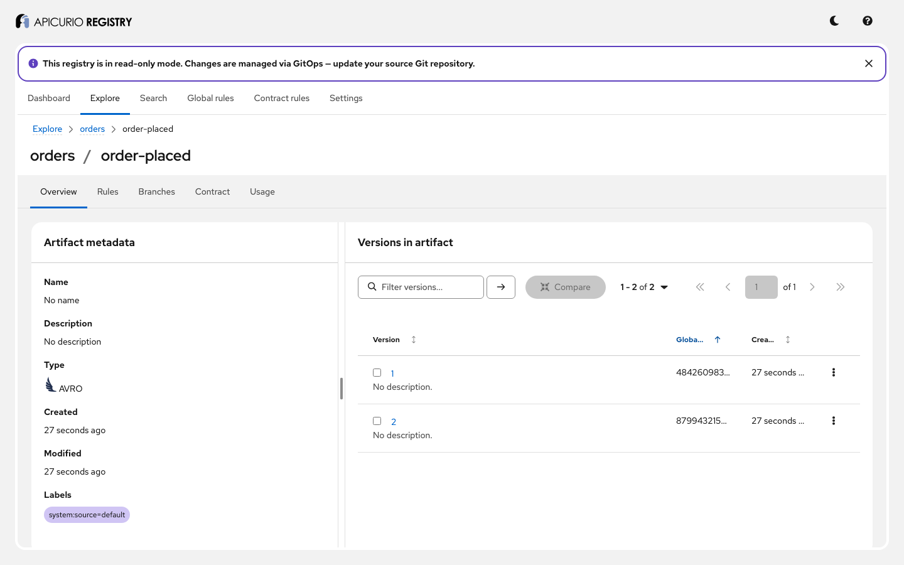

# Storage variants: step-by-step guide

One Apicurio Registry image runs on four kinds of storage. This guide runs it on each, with the same
checks, and then shows what makes each one different: two replicas sharing a database, two replicas
sharing a Kafka topic, and two read-only variants loaded from git and from Kubernetes ConfigMaps.
Follow it on your own, or use it as the script for a demo.

**Time:** about 40 minutes (each variant starts and stops in a few minutes). **You will see:**

- that the API, rules, search and read-only mode behave the same on every variant;
- SQL: PostgreSQL, MySQL and SQL Server, the schema version, and two replicas on one database;
- KafkaSQL: two replicas on one journal topic, catching up, and rebuilding from it after a restart;
- GitOps: a registry that loads a git repository, picks up commits, reports a broken commit while it
  keeps serving the last good data, and refuses writes;
- KubernetesOps: the same, from ConfigMaps;
- which variant to choose.

For the reference documentation, see *Installing Registry storage* and *Configuring GitOps storage*
in the Registry documentation ([source](../../docs/modules/ROOT/pages/getting-started/)) and, for how
storage works, [ADR-0010](../../adr/0010-storage-architecture.md).

## Before you start

You need:

- Docker with Docker Compose v2, or Podman with a Compose provider. KubernetesOps runs k3s in a
  privileged container; SQL Server's image is amd64 only, so it is skipped on other machines;
- `curl`, `jq` and `git`;
- free ports 8081, 8082 and 8888.

```bash
cd examples/storage-variants
```

## Step 1: Run every variant

```bash
./demo.sh
```

`demo.sh` starts one variant at a time (`docker compose --profile <variant> up -d --wait`), checks it,
and removes it with its data. It ends with `All checks passed.`. To run some of them:

```bash
VARIANTS="gitops kafkasql" ./demo.sh
```

Variants are `postgresql`, `mysql`, `mssql`, `kafkasql`, `gitops` and `kubernetesops`. `KEEP=1`
leaves the last one running, to look around.

## Step 2: One image, chosen by configuration

The variant is two environment variables, in [`docker-compose.yml`](docker-compose.yml):

| Variant | Settings |
|---|---|
| PostgreSQL, MySQL, SQL Server | `APICURIO_STORAGE_KIND=sql`, `APICURIO_STORAGE_SQL_KIND=postgresql`, `mysql` or `mssql`, and `APICURIO_DATASOURCE_URL`, `_USERNAME`, `_PASSWORD` |
| In-memory (the default) | `sql` with the H2 database in memory: data is lost on restart |
| KafkaSQL | `APICURIO_STORAGE_KIND=kafkasql`, `APICURIO_KAFKASQL_BOOTSTRAP_SERVERS` |
| GitOps | `APICURIO_STORAGE_KIND=gitops`, a repository in `/repos/default`, `APICURIO_FEATURES_EXPERIMENTAL_ENABLED=true` |
| KubernetesOps | `APICURIO_STORAGE_KIND=kubernetesops`, `APICURIO_KUBERNETESOPS_NAMESPACE`, `APICURIO_FEATURES_EXPERIMENTAL_ENABLED=true` |

## Step 3: What every variant does the same

On each writable variant, `demo.sh` checks the same things against the API:

- creating `orders/order-placed` and a `BACKWARD` rule; an incompatible version is rejected (400), a
  compatible one accepted;
- search finds it;
- **read-only mode**, switched on at runtime by an administrator:

  ```bash
  curl -X PUT localhost:8081/apis/registry/v3/admin/config/properties/apicurio.storage.read-only.enabled \
    -H 'Content-Type: application/json' -d '{"value": "true"}'
  ```

  Writes then return **409**, reads keep working; useful for maintenance and migrations.

The storage changes where the data lives, not what the API does.

## Step 4: SQL databases

PostgreSQL runs two registries, `registry-pg-a` on 8081 and `registry-pg-b` on 8082, on one
database. A write through one is immediately visible through the other: the database is the single
source of truth, and replicas hold nothing but caches.

The registry creates its tables on first start, and upgrades them on later releases
(`apicurio.sql.init=true`). The schema version is in the table `apicurio`:

```bash
docker compose --profile postgresql exec postgres psql -U registry -d registry \
  -c "select propvalue from apicurio where propname = 'db_version'"
```

Replicas starting together take a database lock, so only one of them creates or upgrades the schema.
After a restart, the data is still there. MySQL and SQL Server work the same way.

## Step 5: KafkaSQL

KafkaSQL keeps no database. Every write is a message on the topic `kafkasql-journal`; each replica
reads the whole topic at startup into its own in-memory database, and keeps reading it:

- a write returns once **this** replica has read its own message back, so a client reads its own
  writes on the replica it used;
- the other replica catches up a moment later (`demo.sh` waits for it): replicas are **eventually**
  consistent;
- a dynamic setting (read-only mode) changed on one replica reaches the other the same way;
- the topic must keep every message: `cleanup.policy=delete` with `retention.ms=-1`. The registry
  creates it like that, and refuses to start with a compacted topic or a finite retention;
- a restarted replica rebuilds everything from the topic. On a long journal, snapshots
  (`apicurio.kafkasql.snapshot.*`) make that faster.

The second replica waits for the first one here: replicas creating the topics at the same time can
fail ([#11079](https://github.com/Apicurio/apicurio-registry/issues/11079)).

## Step 6: GitOps

`registry-gitops` loads its data from a git repository: `demo.sh` creates one in `work/repo` from
[`gitops-seed/`](gitops-seed), commits it, and mounts it at `/repos/default`. Every file with a
`$type` describes something:

```yaml
# order-placed.registry.yaml
$type: artifact-v0
registryIds: [demo]           # loaded by registries whose APICURIO_POLLING_STORAGE_ID is "demo"
groupId: orders
artifactId: order-placed
artifactType: AVRO
rules:
  - ruleType: COMPATIBILITY
    config: BACKWARD
versions:
  - version: "1"
    state: ENABLED
    content: ./order-placed-v1.avsc
```

with `registry.registry.yaml` (`$type: registry-v0`: the registry's id and global rules) and
`orders.registry.yaml` (`$type: group-v0`).

What `demo.sh` checks:

1. The artifact and the global rules come from the repository.
2. **IDs are deterministic**, computed from the content and the coordinates, so every replica, and
   every restart, gives the same version the same global ID.
3. Writes through the API return 409: the repository is the source of truth. The console shows it:

   

4. A **commit** that adds version 2 appears within seconds. The registry polls the checkout's HEAD,
   waits for changes to settle, loads the new data into a standby copy, checks it, and switches to it
   at once.
5. A **broken commit** (version 3 breaks the `BACKWARD` rule) is not applied. The registry keeps
   serving the last good data, and reports why:

   ```bash
   curl -s localhost:8081/apis/registry/v3/admin/gitops/status | jq '{syncState, errors}'
   ```

   ```json
   {"syncState": "IDLE", "errors": [{"detail": "Rule COMPATIBILITY violation for version '3': Incompatible artifact: ...", ...}]}
   ```

6. Reverting the commit clears the error.

The registry never fetches: something must update the checkout. In this example `demo.sh` commits
to it directly. In production, a sync sidecar pulls a remote repository, or accepts `git push`; see
[`distro/gitops/compose`](../../distro/gitops/compose/) for HTTPS pull, SSH pull, multi-repository
and push setups. `POST /admin/gitops/validate` checks a branch before it is merged.

## Step 7: KubernetesOps

`registry-kubernetesops` loads the same kind of files from ConfigMaps labelled
`apicurio.io/registry-id: demo` in the namespace `registry`, in a k3s server.
[`k8s/setup.sh`](k8s/setup.sh) applies [`configmaps/v1.yaml`](configmaps/v1.yaml) and gives the
registry a service account that may only `get`, `list` and `watch` ConfigMaps there.

Each ConfigMap key is a file name; `content:` refers to another key of the same ConfigMap. Applying
[`configmaps/v2.yaml`](configmaps/v2.yaml) adds version 2:

```bash
docker compose --profile kubernetesops exec -T k3s kubectl apply -n registry -f - < configmaps/v2.yaml
```

Writes return 409, as with GitOps. Changes currently take the full debounce maximum to apply
([#11080](https://github.com/Apicurio/apicurio-registry/issues/11080)); the example sets it to 10
seconds.

## Step 8: Which variant?

| You want | Use |
|---|---|
| A database you already run, several replicas, strong consistency | SQL (PostgreSQL, MySQL, SQL Server) |
| No database; Kafka already at the center; replicas anywhere Kafka is | KafkaSQL |
| Schemas reviewed and versioned like code; the registry as a read-only projection | GitOps |
| The same, for teams that manage everything as Kubernetes objects | KubernetesOps |
| A quick try, tests | In-memory (data lost on restart) |

Events (`registry-events`) are produced by the SQL variants on PostgreSQL and SQL Server, and by
KafkaSQL.

## Step 9: Clean up

`demo.sh` removes each variant and its volumes. If you used `KEEP=1`:

```bash
docker compose --profile '*' down -v
rm -rf work
```

## Presenter notes

- **Before the session:** pull the images (`docker compose --profile '*' pull`) and run
  `VARIANTS=gitops KEEP=1 ./demo.sh`. GitOps is the most visual: keep a terminal in `work/repo` to
  commit live, and the console open.
- **The story in one sentence per step:** one image, a setting picks the storage (2); the API does
  not change (3); a database for strong consistency (4), a log for Kafka shops (5), git or Kubernetes
  for change management, with bad changes refused and good data kept (6, 7).
- **Questions that usually come up:**
  - *Can I move between variants?* Yes, with export and import (`/admin/export`, `/admin/import`).
  - *Is KafkaSQL a cache in front of Kafka?* No: Kafka is the storage; each replica rebuilds its
    view from it.
  - *Can GitOps accept writes?* No, by design: change the repository.

## Troubleshooting

| Symptom | What to do |
|---|---|
| `mssql` is skipped | The SQL Server image is amd64 only. Set `VARIANTS=mssql` on an amd64 machine. |
| `kubernetesops` does not start | `docker logs storage-k8s-setup`; k3s needs a privileged container (on Podman, a rootful machine). |
| GitOps never loads | `curl localhost:8081/apis/registry/v3/admin/gitops/status`: `errors` says which file is wrong; `registryId` must match `APICURIO_POLLING_STORAGE_ID`. |
| A KafkaSQL replica exits with `TopicExistsException` | Start replicas one after another ([#11079](https://github.com/Apicurio/apicurio-registry/issues/11079)). |
