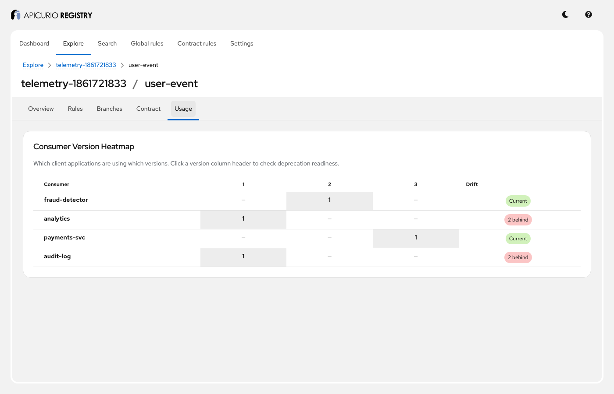

# Usage telemetry: step-by-step guide

A registry knows every schema, but not who uses them. Usage telemetry closes that gap: client
applications say who they are when they fetch a schema, and the registry turns that into answers to
governance questions. Is anyone still on version 1? Who is falling behind? Can this version be
retired? This guide plays a handful of applications and checks each answer.

**Time:** about 15 minutes. **You will see:**

- how a fetch becomes a usage event, and which fetches do not;
- per-version metrics, and why 20 fetches can be one event;
- the consumer heatmap and drift alerts;
- deprecation readiness, and the `DEPRECATED` → `SUNSET` lifecycle;
- the Active/Stale/Dead summary, and liveness inherited through references.

For the reference documentation, see *Usage telemetry* in the Registry documentation
([source](../../docs/modules/ROOT/pages/getting-started/assembly-usage-telemetry.adoc)); for the
design and its known gaps, [ADR-0003](../../adr/0003-usage-telemetry.md).

## Before you start

You need Docker with Compose v2 (or Podman), `curl` and `jq`, and free ports 8080 and 8888.

```bash
cd examples/usage-telemetry-demo
docker compose up -d
./demo.sh
```

The registry runs with the two properties the feature needs, plus faster background jobs:

```properties
apicurio.features.experimental.enabled=true
apicurio.usage.telemetry.enabled=true
apicurio.usage.flush.every=2s          # default 10s: events are written in batches
apicurio.usage.aggregation.every=5s    # default 1h: the summary counts are recomputed
```

## Step 1: Applications fetch schemas

A serializer resolves a schema by ID. With telemetry, it also says who it is:

```bash
curl localhost:8080/apis/registry/v3/ids/globalIds/3 \
  -H 'X-Registry-Client-Id: payments-svc' -H 'X-Registry-Operation: DESERIALIZE'
```

The Apicurio serdes send these headers when the application sets
`apicurio.registry.usage-telemetry.client-id`; nothing else changes in the application.
`demo.sh` creates `user-event` with three versions, and plays four applications:

| Application | Version |
|---|---|
| `payments-svc` | 3 (20 fetches) |
| `fraud-detector` | 2 |
| `analytics`, `audit-log` | 1 |

`GET /admin/usage/artifacts/{group}/user-event` then lists, per version, its clients, fetch count and
classification. `payments-svc`'s 20 fetches count as **one** event: fetches of the same schema by the
same client within 60 seconds are deduplicated, so the table grows with clients, not traffic.

## Step 2: What is recorded

Only fetches **by global ID or content ID with a valid client ID** are recorded. `demo.sh` checks that
a fetch with no client ID, with an invalid one (`[a-zA-Z0-9._-]`, at most 256 characters), or by
coordinates (`/groups/.../versions/1/content`) adds nothing. Serializers fetch by ID; coordinates are
for people and tools.

## Step 3: Version drift

`GET .../user-event/heatmap` is the grid in the console's **Usage** tab: applications by versions,
with how many versions each one is behind and a drift alert at `apicurio.usage.drift-alert-threshold`
(2):



"Behind" is measured from the newest version **anyone fetched**, not the newest version published:
`demo.sh` publishes version 4, nobody uses it, and nothing changes. A version nobody reads is not yet a
target. (The console shows "Current" for a consumer one version behind, under the threshold:
[#11212](https://github.com/Apicurio/apicurio-registry/issues/11212).)

## Step 4: Can version 1 go?

`GET .../versions/1/deprecation-readiness` answers with the applications still using it:
`analytics` and `audit-log`, so `safeToDeprecate` is `false`. Version 4 is `true`. Once the consumers
have moved, the lifecycle is `ENABLED` → `DEPRECATED` → `SUNSET` (the migration deadline has passed)
→ deleted; `demo.sh` moves version 1 to `SUNSET` to show the state.

## Step 5: The summary, and references

`GET /admin/usage/summary` counts versions by their last fetch: **Active** (within 7 days), **Stale**
(within 30), **Dead** (older). The counts come from the aggregation job (every 5 seconds here).

A schema used only through a reference still matters: `demo.sh` creates `customer`, which references
`address`, and fetches only `customer`. The summary counts both as Active; `address`'s own usage
endpoint lists nothing, because nobody fetched it directly.

Stale and Dead need time to pass, so the demo shows only Active. Versions never fetched, and not
referenced by one that was, are not counted at all.

## Step 6: Clean up

`docker compose down -v`.

## Presenter notes

- **The story in one sentence per step:** one header turns fetches into usage (1), for the fetches
  serializers make (2); the heatmap shows who lags (3); readiness tells you when to retire a version
  (4); the summary finds what nobody uses, references included (5).
- **Questions that usually come up:**
  - *Does it slow fetches down?* No: events are buffered and written in the background.
  - *Is it personal data?* No: the client ID is an application name, chosen by the application.
  - *Several registry replicas?* Each one deduplicates on its own, so counts can be higher; they
    share the storage, so the answers are the same.

## Troubleshooting

| Symptom | What to do |
|---|---|
| `/admin/usage/...` fails | Both `apicurio.features.experimental.enabled` and `apicurio.usage.telemetry.enabled` must be `true` |
| A client never appears | It must send `X-Registry-Client-Id` and fetch by global or content ID; wait for the flush (10 s by default) |
| The summary does not move | It is recomputed by the aggregation job (every hour by default) |
| Nothing is recorded on GitOps or KubernetesOps | Expected: read-only storage drops usage events |
