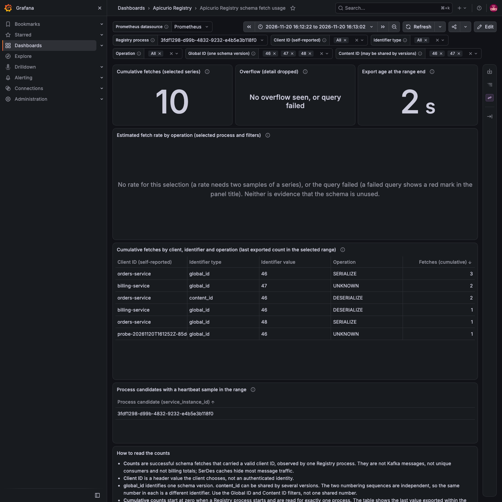
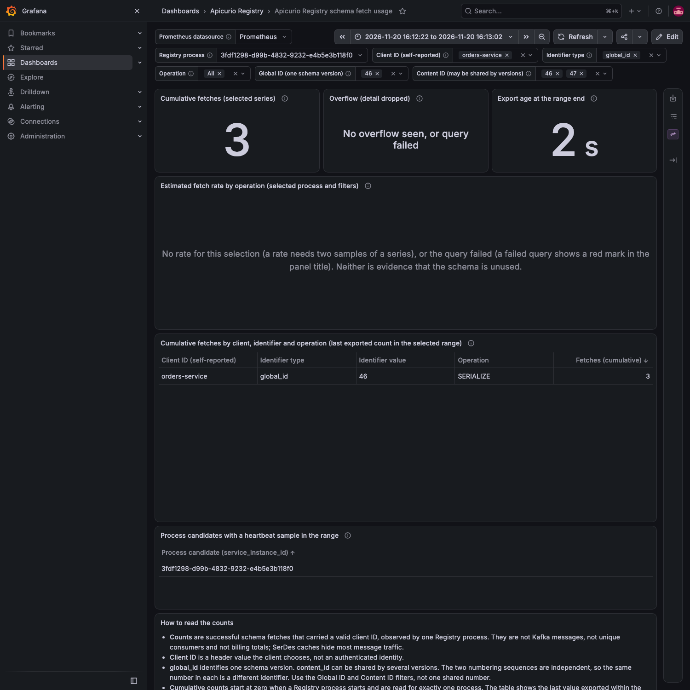

# Usage monitoring with OpenTelemetry, Prometheus and Grafana: step-by-step guide

This guide starts a Registry that exports a counter of schema fetches, a Collector, Prometheus and Grafana, sends real requests, and shows that Prometheus holds exactly the counts those requests must produce. Follow it on your own, or use it as the script for a live demo. Run the steps in order.

**Time:** about 15 minutes after the image build. **You will see:**

- how a schema fetch becomes a labeled counter, and why a content ID is not a version;
- which requests are counted and which are not;
- how the stack behaves when the Collector stops, and when the Registry restarts;
- what the counts do not tell you.

The Grafana dashboard is the optional, canonical one of `distro/metrics/usage`. This example provisions that file as it is, so Step 4 shows what you can import into your own Grafana.

For the reference documentation, see *Usage telemetry* in the Registry documentation ([source](../../docs/modules/ROOT/pages/getting-started/assembly-usage-telemetry.adoc)) and, for how it is implemented, [ADR-0003](../../adr/0003-usage-telemetry.md) and [ADR-0021](../../adr/0021-observability.md).

## Before you start

You need Podman (preferred) or Docker with Compose v2, `curl`, `jq`, a shell (bash or zsh), a browser for Grafana, and free ports 8081, 9090, 3000 and 13133. If they are in use, see [Using other ports](#using-other-ports). On macOS with Podman, start the machine first with `podman machine start`; the scripts never start it for you.

Run every command from this directory:

```bash
cd examples/usage-telemetry-otel
```

## Step 1: Build the Registry image

The example runs the ordinary Registry image. It must contain the usage metrics feature, so a published `latest-snapshot` that predates it will start but will never export the counter, and `demo.sh` will say so. Build the image from this checkout with the recipe in the README's [Build the Registry image](README.md#build-the-registry-image) section (it uses the packaging path of `distro/docker`), then, from this directory:

```bash
export REGISTRY_IMAGE=localhost/apicurio/apicurio-registry:local
```

## Step 2: Start the stack

```bash
./setup.sh
```

The script checks the prerequisites and the configuration (it runs the Collector's own `validate` command and `promtool check config` before starting anything), checks that the host ports are free, starts the four services and waits, with a deadline for each, until:

- the Registry, Collector, Prometheus and Grafana answer;
- Prometheus scrapes both Collector endpoints;
- Grafana's Prometheus datasource reports OK;
- the Registry's export has arrived in Prometheus.

It ends by printing the addresses (Grafana and the dashboard among them), the Registry image it started (name and image ID), and the next commands. If anything fails it prints the state of every service and the last log lines, saves the full logs under `.local/projects/usage-telemetry-otel/logs/`, and exits non-zero without removing anything.

## Step 3: Send real traffic and check the exact counters

```bash
./demo.sh
```

It ends with:

```
All checks passed.
```

What it does, in order:

1. **Registers schemas unique to this run** (the run ID is part of the Avro namespace, so no run shares content with another) and prints what the Registry assigned:

   ```
   ARTIFACT                                       VERSION  GLOBAL_ID  CONTENT_ID
   orders-20261119T225057Z-721aa3                 1        3          3
   orders-20261119T225057Z-721aa3                 2        4          4
   orders-copy-20261119T225057Z-721aa3            1        5          3
   ```

   `orders-copy` has the same content as `orders` version 1, so it shares its content ID 3 but has its own global ID 5. **A global ID is one version; a content ID can be shared.** That is why the metric keeps the identifier type, and why it never claims a version for a content ID. The numbers differ in every run.

2. **Sends the requests that must not be counted**, first: a fetch without a client ID, with an invalid client ID, of a schema's `/references`, and of a global and a content ID that do not exist (404). All of them are real requests with the status shown.

3. **Sends the requests that must be counted**, from two stable client names, `orders-service` and `billing-service`, with a finite number of fetches each, by global ID and by content ID and with the three operations, plus one fetch by a probe client whose name contains the run ID.

4. **Finds the Registry process.** The probe client is unique to the run, so the one series that carries its name names the Registry process (`service_instance_id`) that served this run. Nothing is inferred from "the newest data": the Collector may still hold older points.

5. **Compares the series that carry this run's identifiers with the expected set, exactly**, for that process only: six series, none missing, none extra, every raw counter value equal. It uses the raw counter, not `increase()` or `rate()`, which are estimates. Because the first three requests of step 2 use an ID and a client that also appear in step 3, a wrongly counted request would change a value or add a series, and the check would fail. The two requests for IDs that do not exist enter the run's selector through `notCounted`, so a wrongly counted one would show up as an extra series and fail the check as well. It then waits for a later export and checks again, so a scrape taken half way through an export cannot pass. Finally it **seals the run**: it takes the newest sample time of the six series from Prometheus (not from this machine's clock), checks that the same query at exactly that time returns exactly the expected series, and keeps that time as `evaluationTime`. A fetch made after the demo is exported later and has a later sample time, so it cannot change what verification of this run sees.

6. **Repeats the same comparison through Grafana's datasource**, at the sealed time, and checks that the SQL usage recording is still off (the admin usage endpoints answer 409).

7. **Saves the run state** to `.local/projects/usage-telemetry-otel/run-state.json` (the project's own directory; see the README), only if every check passed, including the sealed time from step 5.

Run it again: it creates new schemas with new global IDs, so it adds six new series and checks only those.

```bash
./demo.sh
```

## Step 4: Look at the data

Prometheus, with the instance printed at the end of the demo (it is also in `.local/projects/usage-telemetry-otel/run-state.json`):

```bash
INSTANCE=$(jq -r .source.instanceId .local/projects/usage-telemetry-otel/run-state.json)
curl -s -G http://127.0.0.1:9090/api/v1/query \
  --data-urlencode "query=apicurio_usage_schema_fetches_total{service_instance_id=\"$INSTANCE\"}" \
  | jq -r '.data.result[] | [.metric.apicurio_registry_client_id, .metric.apicurio_registry_identifier_type, .metric.apicurio_registry_identifier_value, .metric.apicurio_registry_operation, .value[1]] | @tsv'
```

In Grafana, open <http://127.0.0.1:3000/d/apicurio-schema-usage> (user `admin`, password `admin`; the port is the one you chose). It is the dashboard `Apicurio Registry schema fetch usage` in the folder `Apicurio Registry`. Set the time range to the demo (the last hour is enough), then:

1. Choose the **Registry process** in the first filter row. There is no *All* choice on purpose: counters of two processes are never combined, even when a restarted in-memory Registry reuses the same IDs. The table at the bottom of the dashboard lists the process candidates that have a heartbeat sample in the range; it does not say when each last exported (the export age panel does that for the chosen process), and it also lists any other JVM service that exports the generic heartbeat into the same Prometheus. `./verify.sh` and the end of `./demo.sh` print the process of the last run.
2. Read the **table**: one row per client, identifier type, identifier and operation with its cumulative count, the last value exported in the range. Client IDs are self-reported. A `global_id` is one version; a `content_id` can be shared by several versions, so the schema from step 3 that shares content shows up under one content ID and under two global IDs.
3. Narrow it with the filters. The **Global ID** filter applies only to `global_id` series and the **Content ID** filter only to `content_id` series, so the same number in the two sequences is never mixed. Choose *Identifier type* to look at one type.
4. Read the three panels above the chart. *Cumulative fetches* is a count since the process started, not a total over the range. *Overflow* shows fetches whose detail was collapsed once the process hit its series limit (a normal demo has none, and the panel says so instead of showing 0). *Export age at the range end* is the age of the newest heartbeat at the end of the range, so for a range in the past it is the age at that moment. A missing value is UNKNOWN, not a stopped process and not zero use.
5. The **rate chart** is an estimate from sampled counters: the finite demo traffic creates series at their final count, so it can be flat or empty. Send a few more fetches of an existing ID to see it move.

To see the same data without the dashboard, choose **Explore** in Grafana, select the `Prometheus` datasource and run `apicurio_usage_schema_fetches_total`. To import the dashboard into your own Grafana, see [its README](../../distro/metrics/usage/README.md).

How fresh the data is, per Registry process (an age, not a "green" state):

```bash
curl -s -G http://127.0.0.1:9090/api/v1/query --data-urlencode 'query=time() - timestamp(jvm_cpu_count)' | jq '.data.result[] | {instance: .metric.service_instance_id, ageSeconds: .value[1]}'
```

Prometheus keeps the time the Registry measured each sample, not the time it scraped it, so this age is the age of the last export that reached the Collector. After a Registry stops, the Collector serves its last point for five minutes, and the age keeps growing; scrape time would hide that.

## Step 5: Verify it again, later

```bash
./verify.sh
```

It reads nothing but the stack and the run state (`.local/projects/<project>/run-state.json`). It answers two separate questions. **Current export health:** the four services answer, both scrape targets are up, the newest Registry export is recent, and Grafana's datasource works and returns what Prometheus returns. The age of the newest export is not proof that a process is running, only when it last exported. **Historical verification:** the last run's series, as they stood at the exact Prometheus time the run was sealed at (`evaluationTime`), are exactly the expected counts. Later fetches, a restart or a teardown do not change that history, and a wrong sealed count still fails. A run state of an older version or of another project is rejected, and left untouched. A stopped Collector or an unreachable Prometheus is reported as UNKNOWN, never as zero use. The dashboard is checked too: `./verify.sh` confirms that Grafana provisioned it. `./tests/dashboard-test.sh` goes further and runs every query of the dashboard against Prometheus and through Grafana for the last run, without sending traffic. Use `./verify.sh --stack-only` to check the stack without a run.

## Optional: test the dashboard in a real browser

The dashboard is also tested the way a person uses it: Playwright opens the running Grafana, signs in through the login form, opens the dashboard at the exact range of the last demo run, and checks what is on the screen. The tooling is separate from Registry: it is a small npm package in `tests/ui` with locked dependencies, nothing of it is part of the Registry build or runtime, and the required CI pipeline runs it (see "In CI").





**Prerequisites.** The stack from Step 2 is running and `./demo.sh` has written a run state. Node.js 20 or later with npm. The first run downloads the locked npm packages (`npm ci`, about 45 MB) and Chromium (about 600 MB) into `tests/ui/node_modules` and `tests/ui/.browsers`, both ignored by git. It never runs `playwright install-deps` and never needs administrator rights. Before a run, every locked package must be installed at its locked version, the two Playwright commands a run uses must really start (`playwright install --dry-run chromium` and `playwright test --list`, which load the real command line and test runner), and Chromium must really start; a package that is missing, different or lacks a file its command line loads is repaired with `npm ci`, and a browser that is not there is downloaded. This is not a checksum or attestation check: a package modified in some other way is not detected. `./test-ui.sh --setup-only` does only that and stops after it has started the browser once. It needs no run state, so it works on a fresh checkout; an input you name (`--state`, `--scenario`, `--grafana-url`, `GRAFANA_URL`, `GRAFANA_DATASOURCE_UID`) is still checked and fails when it is wrong. Add `--no-install` to refuse every download, in which case anything missing, different, unable to run or unable to start is an error with a non-zero status and nothing is changed.

```bash
./test-ui.sh        # nine tests against the running stack and the last demo run
./screenshots.sh    # the same flows and assertions, writing overview.png and filtered.png
./test-ui.sh --self-test   # browser self-checks: what a trace stores, which requests the interception helpers touch, and what the query observation counts as an answer; no Grafana, no stack, no run state
```

The commands also work through npm from `tests/ui` (`npm test`, `npm run screenshots`), which call the same two scripts. These commands do not change the stack: they start, restart and purge nothing, and send no traffic to the Registry. They are not read-only on your disk: they download packages and Chromium when those are missing and write their own output directories (below). They read the run state once (`.local/projects/<project>/run-state.json`, or `--state FILE`), validate it, and work on that single snapshot; an invalid file (wrong version, an interval that does not end before the evaluation time, an identifier that no schema owns, a malformed endpoint, a number written as a fraction or an exponent, a selection the flows cannot use) fails before any download, browser or directory. The numbers the tooling reads (the versions, the start of the range, the schema IDs and the counts) are checked as they are written in the file and must be plain whole numbers up to 9007199254740991, so `3.0` or `3.0000000000000001` is refused and never silently read as 3; fields the tooling does not read, such as `evaluationTimeSeconds`, keep whatever representation `demo.sh` gives them (the fields are matched by their keys and positions in the document, so an unrelated key that only looks like the path of a field, such as `"timeRange.fromMs"`, is not affected), and the exact evaluation time is the decimal string `evaluationTime`.

**What you can set.** Only these inputs choose what is tested, and nothing else in the environment does:

| Input | Meaning |
| --- | --- |
| `--state FILE` | The run state to test (default: the last demo run) |
| `--grafana-url URL` or `GRAFANA_URL` | A Grafana other than the one the state records; an `http` or `https` URL without credentials, query or fragment. The flag wins over the variable |
| `GRAFANA_DATASOURCE_UID` | The UID of the Prometheus datasource in that Grafana (default: the one the state records, or the example's own for a scenario) |
| `GRAFANA_ADMIN_PASSWORD` | The password typed into the login form for the user `admin` (default `admin`, the demo account) |
| `PLAYWRIGHT_BROWSERS_PATH` | Where the browser is installed. It must be an absolute, normal path (no relative path, no `.` or `..` component, no trailing or repeated slash, nothing reached through a symbolic link); the default is `tests/ui/.browsers`, and the shared Playwright cache is never used unless you name it |
| `UI_INSTALL_TIMEOUT`, `UI_TEST_TIMEOUT` | Deadlines in seconds for each install (default 900) and for the browser run (default 600) |
| `PLAYWRIGHT_DOWNLOAD_HOST`, `PLAYWRIGHT_CHROMIUM_DOWNLOAD_HOST`, `PLAYWRIGHT_DOWNLOAD_CONNECTION_TIMEOUT` | Download mirror settings |

Every other `UI_*`, `PW_*` and `PLAYWRIGHT_*` variable is ignored, and the run names what it ignored. That includes the variables that would make Playwright write its HTML, JSON, JUnit or blob report somewhere else, delete another directory, open a server or change the reporter: none of them can redirect or remove anything outside the directories of the invocation, and the configuration refuses to load if one reaches it. The Grafana address and datasource of a run are the ones sealed read-only into the run's own directory at the start, so a variable set later cannot change them. The login form receives the password; no storage state, cookie jar or session file is written, and the browser context lives and dies with each test.

**One invocation at a time per checkout.** The claim is one symbolic link, `tests/ui/.invocation-claim`, made in one atomic step (`ln -s`) whose target text is the owner identity (`claim:pid=<pid>:runner=<wrapper>:token=<unique>`), so there is no empty or half written claim. It is held from before the first download until the invocation ends, so two invocations cannot install into or write over each other; the second is refused at once with a message that names the holder (only that short target is read, at most 512 printable characters, and nothing it points to is ever opened; a file, a FIFO or a directory in its place, for example a directory claim left by an older version, is reported and never opened). Whether an invocation owns the claim is decided by what is there after the step, not by the status of the command that made it, so a signal that kills that command after it created the link, even one sent to the whole process group, still ends with the claim removed. The claim is released when the invocation fails, ends or receives INT, TERM or HUP, including a signal that arrives while the claim is being made: it is then noted and acted on once the outcome is known. Only a link with this invocation's own record is ever removed; any other entry is left alone, also after an ambiguous failure. An interrupted invocation still prints the report, screenshot and trace paths it has, and keeps the status 130 (INT) or 143 (TERM, HUP). SIGKILL, a power loss or a crash cannot be handled: the claim stays, and it is never removed for you because a stale claim and a live one look alike. After you have checked that the holder is gone, remove that entry yourself. These checks are not a race-free guarantee against another process that replaces the claim at the same moment.

**What a mode needs from the run.** The runner decides this from the run state before it downloads anything or starts a browser, and refuses a run state that is valid but too small. `./test-ui.sh` and `./screenshots.sh` run the filter flow, which needs a client with a global ID `SERIALIZE` series, two different global IDs among that client's global ID series (so that narrowing to one is a visible change), and a Content ID of the run that either has no row for that client or is one of two that do. `./test-ui.sh` also runs the no-match test, which selects the probe client in Grafana and so needs that client to have at least one series (Grafana offers only clients that have series) and none of them Content ID series. No overlap between global and Content ID numbers is required: the same-number check is conditional (below). `--scenario` needs the processes scenario of a lifecycle-owned stack, in which at least one typed identifier is shown by both processes and the second process shows at least two different clients (the dependent client reload test narrows that process to one client, which is a visible change only when it has another); a scenario that lacks either is refused with a non-zero status before anything is installed or started, whether it is prepared or read back from the sealed input. A normal demo run satisfies all of this.

What the tests check, on the real exports of the run: the form login (a wrong password is refused); every panel title, the exact range (from the recorded start to the run's evaluation time) and the exact rows and total of the run; filtering by client, by identifier type, by one global ID and by one Content ID with the real controls, where *All* is unchecked explicitly before a value is chosen and the rows are compared after every change. A control is used only after Grafana has finished loading its variable: the loading indicator in the variable's label is gone and, before the control is opened, it shows a selected value, because while a variable loads its options list shows only an unchecked *All* and a state read then is not the state it will have; the same indicator is checked again before each checkbox decision, which also covers a variable that reloads because another one changed. A test against the real Grafana holds the answer that fills the client variable and releases it right after a checkbox state was read, to show that a one-shot selection waits for the loaded control instead of acting on that stale read. The Content ID control is checked on the real data: when the run has two Content IDs with rows for the chosen client it narrows to one, otherwise to a Content ID of the run that has no row there, which must empty the table. The identifiers always come from the run state. A negative control proves that this step can fail: from the moment the Content ID control is used, the browser sends every datasource query with its Content ID condition widened to match any value, and the filter flow must then fail at exactly that step. A second negative control answers HTTP 500 to only the queries of the narrowed Content ID from that step on, because an empty table is also what failed queries leave behind: an empty selection counts only when the queries of the current selection (the client, the chosen global ID and the narrowed Content ID under the selected identifier type, sent after the step began) have each been answered for the table and for the total, where an answer is a request that finished with HTTP 200 and whose body gives every query reference the request asked for a usable result (an object with a list of frames and no error; a missing or null result for a requested reference, or an unrelated result for another reference, is a failure), and a step also waits for every relevant request it has already seen to settle, looks at the outcomes once more at the moment it returns (the error-mark assertion is a real browser wait during which another matching request may start), and does all of it within one deadline. Each frame in a result must have the minimal envelope Grafana reads (a schema with a fields list and data with a values list); an empty frames list and a genuinely empty frame are fine. Only the references the request asked for are judged, so an error reported for a reference that the request did not ask for is deliberately not that request's failure. A recorded diagnostic is at most 200 characters, whatever the reference or the datasource message was, and never holds a header, a cookie or a response body. A failure that is recorded is part of the output of the step without waiting for a success that cannot come; requests that have not started yet are not known, and nothing is waited for by a fixed pause. Response headers alone are not an answer, because the body can still fail or never end, and an error reported inside an HTTP 200 is a failure. Any relevant query that failed fails the step, and a response from an earlier selection or step never counts. The flow must fail at that step when the answers are errors; `./test-ui.sh --self-test` shows the observation itself with a real browser against a local stand-in endpoint; the cases include an honest empty success, an error inside HTTP 200, a destroyed body, a body that never ends, an earlier selection, several outcomes, a request that starts during the final error-mark wait, frames without the minimal envelope (a null or empty-object frame is a failure; an empty list or a genuinely empty frame still counts), a 4096-character reference whose diagnostic stays bounded, and a matching query with no string reference (a failure) or an errored reference that was not requested (accepted on purpose); `tests/ui/specs/query-log.spec.ts` is the complete list. The same number as a global ID and as a Content ID is a different identifier; that isolation is checked only when the run has a number that is both and has a series of each type, and the result line of the invocation says whether it ran (`same-number isolation ran for number 46`) or did not (`not run: ...`). Also checked: a selection that matches nothing, which must show the no-observation text and no error mark, after the datasource has answered that selection's query successfully; and a controlled failure, where the browser itself makes every datasource request of that Grafana answer HTTP 500, which must show the native red error marks and the unknown presentation and must show the data again once the interception is removed. That last test checks how failed queries are presented; it does not claim that a real backend was down. The Grafana address may include a base path (for example `https://host/grafana`): the interception helpers match the datasource endpoint of exactly that base path, which `./test-ui.sh --self-test` shows with real browser route matching against a local stand-in endpoint at the root and below `/grafana`; that is helper-level proof, not a test of Grafana behind a reverse proxy. The rate chart's values are checked by `tests/dashboard-test.sh`, not here.

**Output.** Every invocation writes to directories of its own, `tests/ui/test-results/<run>/` and `tests/ui/playwright-report/<run>/` (ignored by git), and never reuses, overwrites or prunes those of another, so they accumulate until you delete them. The command prints the exact paths when it ends: the report, each screenshot, each failure screenshot and each trace. Open the HTML report, which has the screenshots attached, with the command it prints:

```bash
cd tests/ui && npx playwright show-report playwright-report/<run>
```

**When something fails** the command exits non-zero, so a script or a CI job fails with it, and it keeps the evidence: a failure screenshot, a trace for a failure after the sign-in, and the report. The status is the failing step's own: that of `npm ci`, of the browser download or of the browser run is passed on unchanged, and 124 means a deadline (`UI_INSTALL_TIMEOUT` or `UI_TEST_TIMEOUT`) passed. Any other invalid input, a competing invocation or a check that did not pass exits 1. The summary at the end is printed even if the run did not get far (it then says that no results or report were written), and it never replaces the status of the failure.

**Traces and what they may contain.** A trace is recorded with Playwright's native safe options, which keep the actions, screenshots and the accessibility tree of the page and record no network (no requests, headers, cookies or response bodies) and no DOM snapshot: the default mode would store the Grafana session cookie. It starts only after the sign-in has been accepted and covers everything the test does after that, including the checks that follow the explicit login test. The consequence is a privacy exception, stated plainly: a failure while the credentials are being entered or before they are accepted leaves a failure screenshot (the password field is masked, the user name is not) and no trace, and the report says so. What a trace does keep is the text of the page, the URLs and the screenshots, which show Grafana content, the client IDs, identifiers and counts of your run. Treat the reports, screenshots and traces of a real deployment as local and sensitive: do not upload or attach them unreviewed. Artifacts that were produced from synthetic demo data and vetted, such as the walkthrough images of this guide, are meant to be shared; that is a decision about specific files, not a property of the tooling. The tooling itself uploads nothing; what the CI job publishes is limited by the allowlist described in "In CI". Traces written by earlier versions of this tooling used Playwright's default mode and are not made safe by this change; delete them rather than share them. `./test-ui.sh --self-test` proves the claim about the archive format with a real browser against a throwaway local site: it looks inside a real trace archive for a password, a session cookie and a request header and expects none, expects no network records and no stored resources, and contrasts it with the default mode, which does record the cookie and the header.

**What Playwright may write.** Two commands of the pinned Playwright write into the browser directory, and both follow links that already exist there. The runner asks the installer where it would write (`playwright install --dry-run chromium`, which writes nothing) and checks, before anything is installed or launched and with or without `--no-install`: every install location it reports must be an ordinary directory, not a link and not something else, and must lie inside the browser directory; and each marker file that already exists in an install location (`DEPENDENCIES_VALIDATED`, which the browser launcher writes when it validates the host and truncates through a link, and `INSTALLATION_COMPLETE`) must be an ordinary file. The locations are taken from that report, so a cache that keeps older revisions is checked at the revision that is really used and not at an arbitrary entry. Before an installation only (without `--no-install`), the runner also checks what the installer writes first: its `.links` directory and `__dirlock` lock directory must be ordinary directories if they exist, and every entry inside `.links` (the package reference file) must be an ordinary file, not a link, a FIFO or a directory, because the installer would write through a link or block opening a FIFO. A refusal has status 1 and happens before anything runs. Links inside an existing install location (a browser application bundle legitimately has some) are not examined. The runner also sets `PLAYWRIGHT_SKIP_BROWSER_GC=1` for the install, because the installer otherwise deletes browser revisions of that directory that no project references (measured: two sentinel revisions were removed before any download). These checks look at the state before Playwright starts; a link another process creates in the meantime is not prevented. The shared Playwright cache is used only if you name it with `PLAYWRIGHT_BROWSERS_PATH`.

**Tests of the tooling itself.** From `tests/ui`: `npm run unit` (the input boundary, Node only), `npm run runner-test` (the runner with stand-ins for npm, the Playwright command line and the browser package, under a pinned Bash; `bash test/runner-test.sh --bash /path/to/bash` selects the interpreter and asserts the `BASH_VERSION` both `env bash` hops report, so a run under one shell says nothing about the runner's shell unless it is pinned), `npm run tooling-test` (the real pinned installer and command line in owned copies, with unreachable values for both `PLAYWRIGHT_DOWNLOAD_HOST` and the higher priority `PLAYWRIGHT_CHROMIUM_DOWNLOAD_HOST` (a value inherited from the caller would otherwise win), so nothing is downloaded; add `-- --with-npm` for the real `npm ci` repair), `npm run typecheck` and `npm run static`. The stand-in tests prove how the runner admits input, reports statuses and releases its claim; they do not prove that npm or a browser behaves in any particular way.

**Regenerate the pictures above.** Run `./screenshots.sh`, then copy the two files it lists (`overview.png` and `filtered.png` in `tests/ui/test-results/<run>/screenshots/`) to `images/schema-usage-overview.png` and `images/schema-usage-filtered.png`. They are 1500 by 1500 pixels, in UTC, dark, and show the run of the state they were taken from. `screenshots.sh` is a standalone command and does not run the other tests.

**Switching between real Registry processes.** One more test checks that two real processes that reuse the same typed identifiers each show their own rows, using the `processes` scenario of `tests/dashboard-scenarios.sh --keep` (it prints the path of its `scenarios.json` and the project it keeps). It runs only when asked for, against the Grafana of that scenario stack, and a normal run says that it was not selected. The scenario file has its own `schemaVersion` (1) and is validated like the run state; the Grafana address is required, because the scenario stack's Grafana is not recorded in the file:

```bash
./test-ui.sh --scenario <scenarios.json> --grafana-url http://127.0.0.1:<grafana port of that stack>
```

The same run adds one test for a variable that reloads because another one changed: the client filter depends on the Registry process. After the dashboard has loaded for the first process, the test holds only the real client-values request of the second process (the request of the initial load names the first process and is not touched), waits until that request is held and the client control is visibly loading, and only then starts the one-shot client selection with the real controls. The answer is released unchanged after a fixed delay that this test injects as its fault; nothing is mocked. The selection must not read any checkbox while the answer is held, and afterwards the URL, the rows and the total must be those of the chosen client in the second process. With both readiness waits of the selection helper removed this test fails at the first checkbox read; with either wait alone it still passes, because each one is enough on its own for this sequence. A reload that begins after the control is open, in the middle of a selection, is not covered by any test.

## In CI

The required Verify pipeline runs this example in its Examples job, against the Registry image built for the commit (`REGISTRY_IMAGE` is that image; the job fails when the stack would use any other Apicurio Registry image). The job starts the stack, runs `./demo.sh` and `./demo.sh` again, and then runs `tests/ci-suite.sh` as one explicit step of its own (`CI_SUITE` in `ci.env`). The two demo runs are not the suite: a run of the demo does not run any of the test scripts below.

`tests/ci-suite.sh` runs these phases one after the other, each with its own deadline and its own log, and fails unless every phase passed (a phase that depends on one that failed is recorded as skipped, which also fails):

| Phase | What it runs |
|---|---|
| `unit`, `dashboard-unit`, `dashboard-promql`, `suite-selftest` | `tests/unit-test.sh`, `tests/dashboard-unit-test.sh`, `tests/dashboard-promql-test.sh`, `tests/ci-suite-test.sh` (the suite's own tests: failure propagation, the scenario stack's removal, the artifact policy) |
| `browser-setup` | `./test-ui.sh --setup-only`: the locked npm packages and Chromium, downloaded without privileges (the workflow installed the operating system packages before, with `npm ci` and `playwright install-deps chromium`; no script of the example does that) |
| `ui-tooling`, `ui-selftest`, `ui-runner`, `ui-clone`, `ui-real-tooling` | the browser tooling's own checks on this operating system: type check, static rules and Node tests; the browser self-tests; the runner tests; the portable copy; and the real-tooling tests against the pinned Playwright, including the repair with a real `npm ci` |
| `dashboard-test`, `ui-seeded`, `ui-screenshots` | the example's own stack and the last demo run, read-only: the dashboard checks, the Playwright tests and the screenshots |
| `lifecycle` | `tests/lifecycle-test.sh`, a Compose project of its own |
| `scenarios`, `ui-scenario`, `scenarios-teardown` | `tests/dashboard-scenarios.sh --keep` (a project of its own), the process tests of `./test-ui.sh --scenario` on its Grafana, and the removal of that stack whatever happened before, a signal included |
| `artifacts` | the collection described below |

The phases never overlap: `lifecycle` and `scenarios` compare the containers they did not start, so no other phase starts or stops containers while they run. The example's own stack is only read. After the browser setup every browser phase passes `--no-install`, so a missing package or browser is an error, never a hidden download. `ui-real-tooling` copies `node_modules` and the browser directory: it uses an APFS clone on macOS, a reflink copy where the file system has them and an ordinary copy otherwise, made beside the destination and renamed into place, so a fast copy that fails part way cannot leave a half-filled destination for the fallback to copy into.

**Artifacts.** The suite starts in a new, empty directory (`CI_ARTIFACT_DIR`; it refuses a used one) and keeps the full logs in `work/`, which never leaves the runner. Only `publish/` is uploaded, as the artifact `example-ci-usage-telemetry-otel`, also when a phase failed or the job was cancelled (14 days). `tests/ci-artifacts.py` fills it from an explicit allowlist and checks every file first; anything else is left out. `MANIFEST.json` lists what was published and only counts what was left out or rejected, because a name or a reason could carry text from the files being judged; the names and reasons are in `work/artifact-report.json`, which stays on the runner. The job console shows the status of each phase and never the output of a phase or of a container, for the same reason: that output is only available through the checked, published tails. A job whose example has a suite therefore does not replay or upload the raw Compose logs of the workflow's generic stack log steps:

- the phase logs (`logs/<phase>.log`), cut to their last 2 MiB and rejected when they hold a credential pattern (an Authorization or cookie header, also as a quoted key, a Grafana session cookie, a bearer or web token, a private key, a GitHub or AWS credential); the container logs (`components/<project>/<container>.log`), taken by the suite from the container runtime for the example's own project and for the scenario project its runner reported as kept, never from a path that a runner or a test printed, with the same cut and checks; `summary.tsv`, the status and duration of every phase;
- the run directories the browser phases printed, and only those: the screenshots `overview.png` and `filtered.png`, the failure screenshots (`test-failed-N.png`), the `error-context.md` of a failed test, and `results-summary.json`, made by the collector from Playwright's `results.json` and holding numbers only (`expected`, `unexpected`, `flaky`, `skipped` and `duration` in milliseconds);
- never: the raw `results.json` (it carries the title, location and error text of every test), the trace archives (a zip that cannot be vetted; they are not even opened), the Playwright HTML report and its `data/` tree, the raw run state (`input.sealed.json`) and any other file the list does not name; and a file that is stale, a symbolic link or another kind of entry (a named pipe is refused without being opened), outside the run's own directory, or that fails its check (a wrong file type, a credential pattern, a credential in its published name) is not published AND makes the `artifacts` phase fail, so a leak cannot pass quietly.

The data in these artifacts is synthetic: the example's own stack, a demo account that exists only for the job, schemas created by the demo. The screenshots still show the pages of that stack, so they are kept for 14 days like everything else. The traces and the report that earlier descriptions of this job listed are not part of the upload; they stay on the runner (and in your checkout when you run the tests locally).

**Cancellation.** A cancelled job gets SIGINT, about 7.5 seconds later SIGTERM, and 2.5 seconds after that it is killed (the GitHub documentation on cancelling a workflow). The suite's cleanup after a signal is therefore best effort and an upload after a cancellation is not guaranteed. On a signal it collects the evidence first, without container logs, then removes the kept scenario stack, each step limited to `CI_CLEANUP_SECONDS` (default 5), and a second signal ends it at once. The collector builds `publish/` beside it and renames it into place, so what is uploaded is a complete collection or nothing; a `publish/` without its `MANIFEST.json` is set aside in `work/`. The normal collection has its own limit, `CI_COLLECT_SECONDS` (default 300).

**What is never published, and why.** The Playwright HTML report, the raw `results.json` and the trace archives stay on the runner: the report embeds its data in encoded form (base64 and zip), a trace is a zip, and `results.json` holds the free text of every test, so none of them can be vetted by the checks below. **The configured-credential scan is a local opt-in.** It looks for the value of `GRAFANA_ADMIN_PASSWORD`, `GF_SECURITY_ADMIN_PASSWORD` and any variable named in `CI_REDACT_ENV` (space separated) when it is in the environment of the suite process; a variable that is absent or empty is not scanned. CI runs an isolated demo with the public default password and sets none of them (the workflow passes neither them nor `CI_REDACT_ENV`, and the `CI_` lines of `ci.env` are not exported), so there the scan has nothing to look for and what protects the upload is the allowlist, the pattern checks and the console that shows only statuses. When a variable is set, the scan covers the text of the published files (the logs, the container logs, `error-context.md`, the summary) and the published names (the run directories, the test directories and the container log names), for these forms of the value: raw, percent-encoded (a space is `%20`), base64 of the value and base64 of `admin:` followed by the value, each as the padded base64 string of that text: it is found when it is the whole encoded text, and inside a longer encoded text only when its length is a multiple of three. It does not cover PNG screenshots (pixels), JSON-escaped text, `+` for a space, other base64 alignments or a user other than `admin`. A file or a name that holds a form is withheld and the `artifacts` phase fails, which fails the suite. There is no exemption by value: a short secret, or one that equals a word such as `admin`, is searched for like any other and withholds every file that holds it. `setup.sh` never prints a configured password; it prints the password only when it is the default `admin`. The job console shows only the status of each phase and the collector's counts. `ci.env` is committed: never put a credential in it (the Apply ci.env step echoes its lines to the job log).

**The status table.** The suite passes only when every required phase has exactly one row and it passed: a missing row, a repeated row, an unexpected row, a row that could not be written and a table that could not be read each fail it. The scenario stack is removed only through what its own runner reported as kept (the project and directory it printed); a project the runner did not claim, for example one it refused because the name was already in use, is never selected and deleted by label or name. The handoff counts as verified when the runner printed the project's own name with an absolute state directory (its keep line); that makes the stack the suite's own, whether or not the runner got as far as writing the scenario file. The file only decides whether the scenario browser phase can run: without it that phase is skipped, which fails the suite, and the stack is still torn down. Without a verified handoff (a refused project, a runner ended before it printed its keep line, a signal at that moment) the console says once, in one fixed sentence, that cleanup is unavailable and names only the suite's own generated project; nothing is removed, and nothing the runner printed is repeated on the console.

**Run it yourself.** `REGISTRY_IMAGE=<image built from this checkout> ./tests/ci-suite.sh` runs the same phases (CI sets `CONTAINER_RUNTIME=docker` because Podman is also installed on the runner, but the image of the commit is in Docker; locally the scripts prefer Podman). It needs the stack of Step 2 to be running and `./demo.sh` to have run, Node.js 20 or later. The unit phase alone took about 13 minutes on a developer laptop and the stack-free browser phases about five more; the container phases have not been timed yet, so the job deadline in `ci.env` is an estimate. It prints the directory it used. A failure shows its phase and status in the output, and the log of the phase in `work/logs/`; the console does not echo logs.

## Step 6: Stop the Collector

Fetches do not depend on the telemetry path. Stop only the Collector:

```bash
podman compose -p usage-telemetry-otel stop otel-collector
./verify.sh --stack-only                   # fails: the Collector and the export are not there, usage is UNKNOWN
GID=$(jq -r '.schemas[0].globalId' .local/projects/usage-telemetry-otel/run-state.json)
curl -s -o /dev/null -w '%{http_code} %{time_total}s\n' http://127.0.0.1:8081/apis/registry/v3/ids/globalIds/$GID \
  -H 'X-Registry-Client-Id: outage-test' -H 'X-Registry-Operation: SERIALIZE'
podman compose -p usage-telemetry-otel start otel-collector
```

The fetch answers 200 at once. It uses an ID of the last demo run with a new client name, which `verify.sh` tolerates because it reads that run's counters at the time they were sealed, before this fetch. In the finite run that `tests/lifecycle-test.sh` performs (five fetches during a short outage, with the Registry process kept running), Prometheus showed all five under their client after the Collector returned, because the Registry sent its cumulative total with its next successful export. That observation is not a guarantee: it does not show zero overhead or lossless delivery, a Registry that stops before a successful export loses what it had not exported, and an export that cannot reach the Collector for long is not shown to be safe. Until Prometheus holds the data again, the answer is unknown, not zero.

## Step 7: Restart the Registry

```bash
podman compose -p usage-telemetry-otel restart registry
./demo.sh
```

The in-memory storage started again, so the first schema of this run gets the same global ID as the first schema of an earlier run, and the same stable clients fetch it. Without the process identity the counters of the old and the new process would be the same series. The demo found the new process through its probe client, compared only that process's series, and passed. Prometheus still holds the old process's series, as separate series with the other `service_instance_id`:

```bash
./verify.sh --state .local/projects/usage-telemetry-otel/runs/<an earlier run id>.json   # passes (history is read at its sealed time) and reports when that process last exported
```

## Step 8: Clean up

```bash
./teardown.sh           # stops this project's containers and keeps the volumes (history)
./setup.sh              # starts again; Prometheus still has the earlier history
./teardown.sh --purge   # deletes the volumes and the run states too
```

Teardown only touches this Compose project. It never prunes anything globally and never touches other containers.

## Presenter notes

- **The story in one sentence per step:** a fetch becomes a counter with a client and an identifier (3); the check is exact, for one named process (3); the same history is readable in Prometheus and Grafana (4, 5); an outage and a restart are visible, not silent (6, 7).
- **Questions that usually come up:**
  - *Does it replace the usage endpoints and the console's usage pages?* No. This is an optional export; the SQL usage recording is separate, off here, and unchanged.
  - *Why not count messages?* The Registry sees only schema fetches, and the serdes cache schemas, so a busy client can fetch once an hour. The counts are fetches observed, not messages and not billing.
  - *Can I trust the client name?* No: it is a header value the client chooses.
  - *What if the metric has too many combinations?* A per-process threshold (`apicurio.usage.metrics.max-series`, default 2000) collapses the detail into one overflow series and keeps totals exact; unique schemas per run create new series, so the demo adds six per run.
  - *Does it cost nothing?* No. Instrumentation uses bounded CPU and memory in the Registry. Exporting removes telemetry storage and queries from the Registry, not all overhead.

## Troubleshooting

| Symptom | What to do |
|---|---|
| `setup.sh` says a port is in use | Use another with the matching option, for example `./setup.sh --registry-port 18081`, and export the variables it prints |
| `setup.sh` says podman is not usable | On macOS or Windows run `podman machine start`; on Linux check `podman info` |
| The Registry image cannot be pulled | Build it (Step 1) and set `REGISTRY_IMAGE`; with Podman keep the `localhost/` prefix |
| `demo.sh` says the usage metric did not appear but the exports reach Prometheus | The Registry image predates the feature, or `APICURIO_USAGE_METRICS_ENABLED` is not `true` on it |
| `demo.sh` says nothing from the Registry reached Prometheus | Run `./verify.sh` to see which hop is broken; `podman compose -p usage-telemetry-otel logs otel-collector registry` shows the rest |
| `demo.sh` or `verify.sh` says a service is unknown or does not answer | The result is unknown, not zero use; fix the service, then rerun |
| A bind mount error mentions a directory | A configuration file was missing when the containers were created; the scripts check for it, and plain `docker compose up` does not |
| SELinux denies the configuration mounts (Linux) | Add `:z` to the bind mounts in `docker-compose.yml` for your host; this example does not |
| The dashboard is missing in Grafana | `./verify.sh` says whether Grafana has it. It is mounted from `distro/metrics/usage/grafana` two directories up, so start the stack from a checkout that has that directory (`./setup.sh` checks); `./setup.sh` waits for Grafana to load it and fails if it does not appear within its deadline, and `./verify.sh` fails without it (use `./verify.sh --external` only for services this example did not start) |
| The dashboard shows "No observations" | Check the Registry process filter (an older process has older data) and the time range. The text is not a zero: see the panel descriptions. A red mark in a panel title is a failed query, for example a datasource that cannot reach Prometheus |
| Grafana rejects `admin` / `admin` | The password is stored in the `grafana-data` volume from the first start; use the password that was set then, or `./teardown.sh --purge` |

## Using other ports

Pass them to `setup.sh` as options, or in the environment, and export the same values for the other scripts:

```bash
./setup.sh --project usage-otel-2 --registry-port 18081 --prometheus-port 19090 --grafana-port 13000 --collector-health-port 23133
export COMPOSE_PROJECT_NAME=usage-otel-2 REGISTRY_PORT=18081 PROMETHEUS_PORT=19090 GRAFANA_PORT=13000 COLLECTOR_HEALTH_PORT=23133
./demo.sh && ./verify.sh && ./teardown.sh
```

A different `COMPOSE_PROJECT_NAME` gives separate containers, network and volumes. `setup.sh` prints the exact `export` line for the values you chose.
